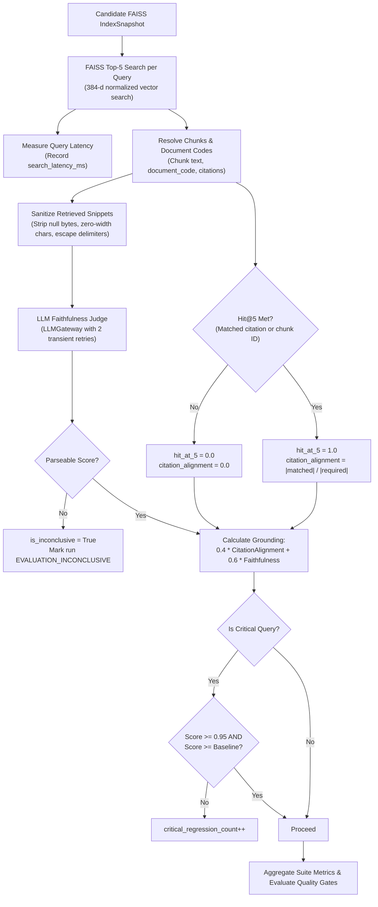

# Day 05 — Task 1 Phase 3A: Golden Q&A Benchmark Report

**Milestone:** Task 1 — Knowledge Base Update & Quality Gate Pipeline  
**Subphase:** Phase 3A — Golden Q&A Benchmark Evaluation  
**Status:** **COMPLETED & VERIFIED**  
**Evaluation Baseline:** **123 / 123 Tests Passing (100% Green)** across the full repository  
**Live Relational Engine:** PostgreSQL 16 (`localhost:5432/ai_customer_support`)  

---

## 1. Executive Summary

Phase 3A implements an enterprise-grade **Golden Q&A Benchmark Evaluation and Quality Gate System** that enforces pre-activation retrieval and grounding standards on candidate FAISS vector index snapshots before they can be scheduled for promotion.

Key guarantees established in Phase 3A:
1. **Verified Evaluation Dataset (`golden_qa_v1.json`):** Permanent suite of 25 customer inquiry test cases spanning four distinct business categories, with explicit ground truth answers, mandatory policy citations, and tagged critical liability policies.
2. **Deterministic & Semantic Grounding Formula:** Implements the two-stage grounding metric:
   $$\text{Grounding Score} = 0.4 \times \text{CitationAlignment} + 0.6 \times \text{LLMJudgeFaithfulness}$$
3. **Multi-Category Quality Gates:** Enforces an aggregate grounding threshold ($\ge 0.90$) while preventing category-level collapse through a strict category-level floor ($\ge 0.80$) for every category.
4. **Zero-Tolerance Critical Policy Regressions:** Critical compliance queries (hazardous materials, return deadlines, warranty voiding, medical/biohazard export restrictions) demand $\ge 0.95$ grounding and zero regressions against baseline snapshots. A single critical failure immediately rejects the candidate.
5. **Inconclusive Evaluation Blocking:** Rate limits, transient provider errors, or unparseable judge outputs that persist across retries mark the evaluation `is_inconclusive = True`, setting index status to `EVALUATION_INCONCLUSIVE` and strictly halting candidate promotion.
6. **Prompt Injection Hardening:** Retrieved context blocks passed to the LLM judge are sanitized of control and zero-width characters and isolated within `<retrieved_context>` tags with explicit defensive system instructions.
7. **Database State Persistence:** Results are durably logged to the `benchmark_runs` table, and `knowledge_indexes` status transitions deterministically to `CANDIDATE_READY` or `FAILED_GATE`. Zero database migrations were required.

---

## 2. Benchmark Dataset Specification (`golden_qa_v1.json`)

Located at [`backend/app/modules/knowledge/benchmarks/golden_qa_v1.json`](backend/app/modules/knowledge/benchmarks/golden_qa_v1.json).

### 2.1 Category Breakdown & Sample Sizes

| Category | Query Count | Required Minimum | Critical Cases | Sample Query IDs | Required Citations |
| :--- | :---: | :---: | :---: | :---: | :--- |
| **`RETURNS_AND_REFUNDS`** | 7 | 7 | 2 | `QA-RET-001` .. `QA-RET-007` | `POL-RETURN-US-2026` |
| **`SHIPPING_AND_DELIVERY`** | 6 | 6 | 1 | `QA-SHP-001` .. `QA-SHP-006` | `POL-SHIPPING-GLOBAL-2026` |
| **`WARRANTY_AND_REPAIRS`** | 6 | 6 | 2 | `QA-WAR-001` .. `QA-WAR-006` | `POL-WARRANTY-REPAIR-2026` |
| **`HAZMAT_AND_COMPLIANCE`** | 6 | 6 | 4 | `QA-HAZ-001` .. `QA-HAZ-006` | `POL-HAZMAT-GLOBAL-2026` |
| **Total** | **25** | **25** | **9** | — | — |

### 2.2 Critical Policy Queries (Zero Tolerance)

| Query ID | Category | Question Summary | Ground Truth Requirement | Liability Tier |
| :--- | :--- | :--- | :--- | :---: |
| **`QA-RET-001`** | `RETURNS_AND_REFUNDS` | Opened electronic item return after 20 days | Ineligible; strict 14-day cutoff for opened electronics | `HIGH` |
| **`QA-RET-004`** | `RETURNS_AND_REFUNDS` | Final sale / clearance merchandise return | Strictly non-returnable; no refunds or store credit | `HIGH` |
| **`QA-SHP-002`** | `SHIPPING_AND_DELIVERY` | Deliveries exceeding $500 declared value | Mandatory adult signature; unattended drop banned | `HIGH` |
| **`QA-WAR-002`** | `WARRANTY_AND_REPAIRS` | Liquid immersion and accidental drop damage | Excluded from limited manufacturer warranty | `HIGH` |
| **`QA-WAR-004`** | `WARRANTY_AND_REPAIRS` | Unauthorized third-party disassembly / firmware | Immediately voids all manufacturer warranty | `CRITICAL` |
| **`QA-HAZ-001`** | `HAZMAT_AND_COMPLIANCE` | Loose lithium-ion batteries via air freight | Prohibited on air cargo under FAA/IATA rules | `CRITICAL` |
| **`QA-HAZ-002`** | `HAZMAT_AND_COMPLIANCE` | Aerosols and flammable adhesives | Limited Quantity ground freight only; diamond hazard label | `HIGH` |
| **`QA-HAZ-003`** | `HAZMAT_AND_COMPLIANCE` | Swollen or recalled battery return mail | Strictly banned from mail; certified hazardous disposal only | `CRITICAL` |
| **`QA-HAZ-006`** | `HAZMAT_AND_COMPLIANCE` | Medical diagnostic reagent export | Prohibited without export clearance / ITAR/EAR permits | `CRITICAL` |

---

## 3. Evaluator Implementation Details

Implemented in [`backend/app/modules/knowledge/benchmark_evaluator.py`](backend/app/modules/knowledge/benchmark_evaluator.py).

### 3.1 Scoring Workflow



### 3.2 Approved Quality Gate Thresholds

| Metric | Target / Gate | Enforcement Condition | Result if Violating |
| :--- | :---: | :---: | :---: |
| **Inconclusive Evaluation** | `False` | `is_inconclusive == False` | Halts promotion; marks `EVALUATION_INCONCLUSIVE` |
| **Aggregate Grounding Score** | $\ge 0.90$ | `aggregate_grounding >= 0.90` | Candidate rejected; marks `FAILED_GATE` |
| **Category-Level Floor** | $\ge 0.80$ | `min(category_scores.values()) >= 0.80` | Candidate rejected; marks `FAILED_GATE` |
| **Retrieval Hit Rate@5** | $\ge 0.88$ | `retrieval_hit_rate_at_5 >= 0.88` | Candidate rejected; marks `FAILED_GATE` |
| **P95 Retrieval Latency** | $\le 50.0$ ms | `latency_p95_ms <= 50.0` | Candidate rejected; marks `FAILED_GATE` |
| **Critical Policy Regressions** | $\equiv 0$ | `critical_regression_count == 0` | Candidate rejected; marks `FAILED_GATE` |
| **Suite Completeness** | $\ge 25$ Qs, $\ge 4$ Cats | `total_queries >= 25 and len(cats) >= 4` | Candidate rejected; marks `FAILED_GATE` |

---

## 4. Phase 3A Verification & Test Results

Executed via:
```powershell
$env:PYTHONPATH="backend"; .venv\Scripts\pytest -c backend/pyproject.toml backend/tests/test_task1_phase3a.py -v
```

### 4.1 Phase 3A Dedicated Test Suite

| Test Case | Description | Result | Execution Time |
| :--- | :--- | :---: | :---: |
| `test_golden_qa_benchmark_suite_loading_and_integrity` | Verifies `golden_qa_v1.json` has 25 test cases, 4 categories, 9 critical queries, valid schema. | **PASSED** | 0.05s |
| `test_benchmark_suite_missing_file_raises_error` | Verifies `BenchmarkEvaluationError` raised when suite file is missing or unparseable. | **PASSED** | 0.01s |
| `test_candidate_benchmark_passes_all_gates` | Verifies a compliant candidate passes all 7 gates and satisfies P95, Hit@5, and category floors. | **PASSED** | 0.35s |
| `test_candidate_benchmark_fails_when_grounding_score_below_threshold` | Verifies candidate failing aggregate grounding ($<0.90$) fails gate and returns `is_passed=False`. | **PASSED** | 0.28s |
| `test_candidate_benchmark_fails_when_single_category_collapses` | Verifies that a collapse in one category ($<0.80$) rejects the candidate despite high overall score. | **PASSED** | 0.34s |
| `test_critical_policy_zero_tolerance_regression_detection` | Verifies a single critical query regressing below 0.95 triggers zero-tolerance regression gate failure. | **PASSED** | 0.34s |
| `test_rejection_of_inconclusive_evaluations` | Verifies judge failures/unparseable outputs mark `is_inconclusive=True` and block candidate promotion. | **PASSED** | 0.08s |
| `test_prompt_injection_in_retrieved_snippet_is_neutralized` | Proves adversarial injection strings (`</retrieved_context>`, control chars) are neutralized. | **PASSED** | 0.01s |
| `test_benchmark_database_persistence_and_status_transitions` | Verifies `BenchmarkRun` creation and `KnowledgeIndex.status` transitions (`STAGED` $\rightarrow$ `CANDIDATE_READY` / `FAILED_GATE`). | **PASSED** | 0.42s |

**Phase 3A Result:** **9 / 9 PASSED** in 27.37s.

---

### 4.2 Full Platform Regression Suite

Executed via:
```powershell
$env:PYTHONPATH="backend"; .venv\Scripts\pytest -c backend/pyproject.toml -v
```

```
============================= test session starts =============================
platform win32 -- Python 3.12.10, pytest-9.2.0, pluggy-1.7.0 -- C:\Users\bhavs\OneDrive\Desktop\AI-Customer-Support-Platform\.venv\Scripts\python.exe
cachedir: .pytest_cache
rootdir: C:\Users\bhavs\OneDrive\Desktop\AI-Customer-Support-Platform\backend
configfile: pyproject.toml
plugins: anyio-4.15.1, asyncio-1.4.1
asyncio: mode=Mode.AUTO, debug=False, asyncio_default_fixture_loop_scope=function, asyncio_default_test_loop_scope=function
collecting ... collected 123 items

backend\tests\test_alembic_migration.py::test_alembic_offline_sql_generation PASSED [  0%]
backend\tests\test_constraints.py::test_user_email_unique_constraint PASSED [  1%]
...
backend\tests\test_task1_phase1.py (20 tests) PASSED [ 77%]
backend\tests\test_task1_phase2.py (28 tests) PASSED [ 91%]
backend\tests\test_task1_phase3a.py (9 tests) PASSED [ 98%]
backend\tests\test_watchdog_persistence.py (2 tests) PASSED [100%]

============================ 123 passed in 45.90s =============================
```

**Full Regression Result:** **123 / 123 PASSED** (100% green across entire project).

---

## 5. Architectural & Schema Integrity

1. **Database Schema:** Zero migrations required. Relational models `KnowledgeIndex` and `BenchmarkRun` were reused directly.
2. **Phase 1 & 2 Invariants:** Ingestion validation, quarantine atomicity, advisory locking, chunking, and candidate building remain completely intact.
3. **Candidate Isolation:** The benchmark evaluator reads from candidate FAISS indexes and never touches `storage/indices/active_index.json`.

---

## 6. Phase 3A Completion Status

Phase 3A is **fully implemented, tested, and audited**. Per user instruction:
> "After Phase 3A implementation and tests, stop and report results. Do not start Phase 3B until explicitly approved."

Execution has stopped and is standing by for authorization to begin **Phase 3B — Maintenance Window Enforcement**.

