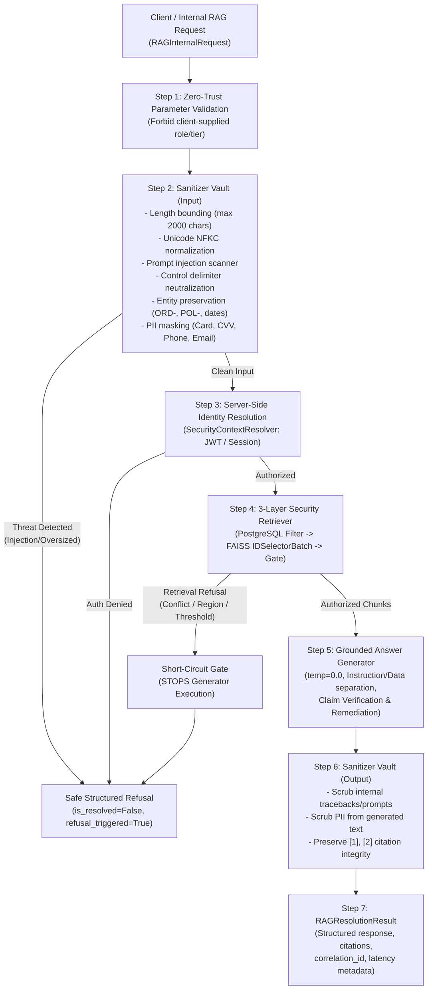

# Day 06 — Task 4 Phase 4C: RAG Orchestration & Sanitizer Vault Implementation Report

**Project:** AI Customer Support Platform — Elevance Skills Internship  
**Milestone:** Day 06 — Task 4: Advanced RAG Knowledge Assistant  
**Phase:** Phase 4C — Internal RAG Orchestration Layer & Sanitizer Vault  
**Author:** DeepMind Agentic Assistant (Antigravity)  
**Date:** November 3, 2026  
**Status:** **COMPLETED, FULLY TESTED & AUDITED**

---

## 1. Pre-Implementation Inspection Findings

Prior to altering any code, a comprehensive pre-implementation inspection of all related architecture documents, services, and tests was executed:

1. **Phase 4A & Phase 4B Baseline:**
   - [`backend/app/modules/rag/security.py`](file:///c:/Users/bhavs/OneDrive/Desktop/AI-Customer-Support-Platform/backend/app/modules/rag/security.py): Verified server-side identity resolver (`SecurityContextResolver`), customer tier resolution (`PUBLIC`, `REGISTERED`, `VIP`), staff role matrices (`AGENT`, `SUPERVISOR`, `ADMIN`), and safe global non-statutory categories (`SAFE_GLOBAL_CATEGORIES`).
   - [`backend/app/modules/rag/retriever.py`](file:///c:/Users/bhavs/OneDrive/Desktop/AI-Customer-Support-Platform/backend/app/modules/rag/retriever.py): Verified 3-layer retriever (`SecurityAwareRetriever`), Layer 1 relational pre-filtering, Layer 2 FAISS `IDSelectorBatch` search, Layer 3 zero-trust validation, temporal policy pruning (`effective_from <= query_date <= effective_until`), and statutory keyword gating.
   - [`backend/app/modules/rag/generator.py`](file:///c:/Users/bhavs/OneDrive/Desktop/AI-Customer-Support-Platform/backend/app/modules/rag/generator.py): Verified evidence-grounded answer generator (`GroundedAnswerGenerator`), LLM gateway integration with `temperature=0.0`, instruction/data separation (`<authoritative_data>`), and claim-to-passage alignment verification loop.
   - [`backend/app/modules/rag/citation.py`](file:///c:/Users/bhavs/OneDrive/Desktop/AI-Customer-Support-Platform/backend/app/modules/rag/citation.py): Verified `CitationManager`, `CitationMetadata`, and `ClaimCitationVerifier` checking inline citations `[X]`, numeric/date alignment, and single-shot controlled remediation.
   - Verified that Phase 4A had 17/17 dedicated passing tests, Phase 4B had 27/27 dedicated passing tests, and the platform regression suite had 226/226 tests passing before Phase 4C.

2. **PII Masker Service & Token Infrastructure:**
   - [`backend/app/services/pii_masker.py`](file:///c:/Users/bhavs/OneDrive/Desktop/AI-Customer-Support-Platform/backend/app/services/pii_masker.py): Inspected `PIIMasker` and `PIIMaskingEngine`. Verified Luhn-checked credit card detection, CVV masking (`CVV: [REDACTED]`), SSN masking, email masking, and phone masking. Verified that `PIIMasker` provides stateless masking without caching sensitive data.

3. **Core Exceptions & Configuration:**
   - [`backend/app/core/exceptions.py`](file:///c:/Users/bhavs/OneDrive/Desktop/AI-Customer-Support-Platform/backend/app/core/exceptions.py): Identified existing RAG exceptions: `RAGError`, `RAGAuthorizationError`, `RAGSecurityQuarantineError`, `RAGPolicyConflictError`. Added `RAGSanitizationError` for typed sanitizer exception handling.
   - [`backend/app/core/config.py`](file:///c:/Users/bhavs/OneDrive/Desktop/AI-Customer-Support-Platform/backend/app/core/config.py): Verified RAG similarity thresholds (`RAG_SIMILARITY_THRESHOLD_DEFAULT=0.72`, `RAG_SIMILARITY_THRESHOLD_POLICY=0.76`, `RAG_SIMILARITY_THRESHOLD_FAQ=0.70`).

4. **Production Invariant Verification:**
   - Inspected `storage/indices/active_index.json`: Verified absent (`False`). Confirmed no production FAISS vector index was loaded or mutated.
   - Confirmed Phase 4D API routers (`backend/app/api/v1/rag.py`) remain completely absent and unstarted.

---

## 2. Architecture Followed

The implementation adheres strictly to the approved architecture in [`DAY_06_TASK_4_ARCHITECTURE_PLAN.md`](file:///c:/Users/bhavs/OneDrive/Desktop/AI-Customer-Support-Platform/DAY_06_TASK_4_ARCHITECTURE_PLAN.md):



---

## 3. Files Created and Modified

| File | Action | Description |
| :--- | :--- | :--- |
| [`backend/app/modules/rag/sanitizer.py`](file:///c:/Users/bhavs/OneDrive/Desktop/AI-Customer-Support-Platform/backend/app/modules/rag/sanitizer.py) | **Created** | Implements `RAGSanitizer`, `SanitizationResult`, `get_rag_sanitizer()`. Encapsulates input adversarial threat detection, delimiter neutralization, entity preservation, and output PII scrubbing. |
| [`backend/app/modules/rag/orchestrator.py`](file:///c:/Users/bhavs/OneDrive/Desktop/AI-Customer-Support-Platform/backend/app/modules/rag/orchestrator.py) | **Created** | Implements `RAGOrchestrator`, `RAGInternalRequest`, and `RAGKnowledgeAssistant` facade. Manages end-to-end lifecycle, retrieval refusal short-circuiting, and structured refusal formatting. |
| [`backend/app/modules/rag/generator.py`](file:///c:/Users/bhavs/OneDrive/Desktop/AI-Customer-Support-Platform/backend/app/modules/rag/generator.py) | **Modified** | Added optional `correlation_id: Optional[str] = None` to `RAGResolutionResult` model for end-to-end distributed tracing. |
| [`backend/app/modules/rag/__init__.py`](file:///c:/Users/bhavs/OneDrive/Desktop/AI-Customer-Support-Platform/backend/app/modules/rag/__init__.py) | **Modified** | Exported `RAGSanitizer`, `SanitizationResult`, `get_rag_sanitizer`, `RAGInternalRequest`, `RAGOrchestrator`, and `RAGKnowledgeAssistant`. |
| [`backend/app/core/exceptions.py`](file:///c:/Users/bhavs/OneDrive/Desktop/AI-Customer-Support-Platform/backend/app/core/exceptions.py) | **Modified** | Added `RAGSanitizationError` (HTTP 422) inheriting from `RAGError`. |
| [`backend/tests/test_task4_phase4c.py`](file:///c:/Users/bhavs/OneDrive/Desktop/AI-Customer-Support-Platform/backend/tests/test_task4_phase4c.py) | **Created** | 27 dedicated unit, integration, and security tests covering all Phase 4C scenarios. |
| [`MASTER_WORK_LOG.md`](file:///c:/Users/bhavs/OneDrive/Desktop/AI-Customer-Support-Platform/MASTER_WORK_LOG.md) | **Modified** | Updated master engineering work log with Task 4 Phase 4A, 4B, and 4C entries. |
| [`README.md`](file:///c:/Users/bhavs/OneDrive/Desktop/AI-Customer-Support-Platform/README.md) | **Modified** | Updated project roadmap progress for Day 06 Task 4. |

---

## 4. Orchestration Flow

The `RAGOrchestrator` coordinates requests using strict, deterministic boundaries:

1. **Request Intake & Validation:**
   - Accepts typed `RAGInternalRequest` with `model_config = {"extra": "forbid"}`.
   - Any attempt by client payloads to supply `role`, `access_level`, or unauthorized metadata raises immediate Pydantic validation errors.
   - Validates query presence; empty or whitespace queries trigger immediate `EMPTY_QUERY` refusal.

2. **Input Sanitization & Threat Assessment:**
   - Calls `RAGSanitizer.sanitize_input()`.
   - Length bounded: queries exceeding `max_query_length` (default 2000 chars) are refused with `QUERY_OVERSIZED`.
   - Adversarial patterns (directive overrides, role hijacking, developer mode attempts, code execution) trigger immediate `SECURITY_INJECTION_DETECTED` refusal.
   - Control delimiters (`<authoritative_data>`, `[INST]`, `<|im_start|>`, `<<SYS>>`) and exfiltration links are neutralized to `[ESCAPED_TAG]`.
   - PII is masked (emails, phones, credit cards, CVVs, SSNs) while business identifiers are preserved.

3. **Server-Side Identity Verification:**
   - If pre-resolved `SecurityContext` is provided, it is used.
   - Otherwise, `SecurityContextResolver.resolve()` verifies the identity via staff JWT claims, customer session token, or safe anonymous fallback.
   - If session is expired or invalid, `AUTHORIZATION_DENIED` is emitted.

4. **3-Layer Security-Aware Retrieval:**
   - Invokes `SecurityAwareRetriever.retrieve()` passing sanitized query, resolved context, and optional temporal/document filters.
   - Catches `RAGSecurityQuarantineError` and `RAGPolicyConflictError` and converts them into structured refusals with appropriate ticket escalation categories.

5. **Retrieval Refusal Short-Circuit Gate:**
   - **Crucial Rule:** If `retrieval_result.is_refusal` is `True` or `retrieval_result.chunks` is empty, **the orchestrator immediately halts execution and DOES NOT call the LLM generator.**
   - Prevents unnecessary LLM spend, latency, and potential hallucination when retrieval cannot satisfy the request.

6. **Grounded Generation & Verification:**
   - Calls `GroundedAnswerGenerator.generate_answer()` passing only authorized retrieved chunks.
   - Enforces claim verification and single-shot controlled remediation.

7. **Output Sanitization & Traceability:**
   - Passes generated answer through `RAGSanitizer.sanitize_output()`, scrubbing any leaked PII, internal prompts, or error tracebacks while preserving `[1]`, `[2]` citation markers.
   - Populates `correlation_id` and latency metrics before returning `RAGResolutionResult`.

---

## 5. Sanitizer Design

The `RAGSanitizer` operates as a zero-trust Sanitizer Vault implementing:

### Input Sanitization
- **Unicode Normalization:** Applies `unicodedata.normalize('NFKC', text)` to eliminate homoglyph obfuscation and zero-width bypasses.
- **Structural Delimiter Neutralization:** Escapes all tag delimiters matching `TAG_DELIMITERS_PATTERN`, `INST_DELIMITERS_PATTERN`, `CHATML_DELIMITERS_PATTERN`, `SYS_ANGULAR_PATTERN`, and `EXFILTRATION_PATTERN`.
- **Heuristic Threat Scanners:**
  - `DIRECTIVE_OVERRIDE_PATTERN`: `\b(?:ignore|disregard|forget|override)\s+(?:all\s+)?(?:previous|prior|system)\s+instructions\b`
  - `ROLE_HIJACKING_PATTERN`: `\b(?:you\s+are\s+now|pretend\s+you\s+are|act\s+as)\s+(?:an?\s+)?(?:admin|root|unrestricted|advocate|developer\s+mode)\b`
  - `SYSTEM_PROMPT_LEAK_PATTERN`: `\b(?:repeat|print|reveal|output|dump)\s+(?:the\s+)?(?:system\s+prompt|developer\s+instructions)\b`
  - `CODE_EXECUTION_PATTERN`: `\b(?:eval|exec|os\.system|__import__|subprocess)\b`

### Output Sanitization
- **PII Scrubbing:** Runs `PIIMasker.mask()` across all emitted answers (initial and regenerated).
- **Internal System Leakage Prevention:** Neutralizes any accidental occurrences of `Traceback (most recent call last):` into `[SYSTEM_ERROR_REDACTED]` and `[SYSTEM INSTRUCTION]` into `[SYSTEM_DIRECTIVE_REDACTED]`.
- **Citation Preservation:** Explicitly preserves inline brackets `[1]`, `[2]` to ensure verification traceability is maintained.

---

## 6. PII Protection and Isolation Controls

### Business Entity Preservation
To avoid blindly destroying useful identifiers, `RAGSanitizer` implements a two-stage placeholder preservation protocol:
1. Detects valid business entities using exact patterns:
   - Order IDs: `\bORD-[A-Za-z0-9\-]+\b` (e.g. `ORD-98765-ABC`)
   - Policy / Document Codes: `\b(?:POL|SOP|GUIDE|FAQ|DOC)-[A-Za-z0-9\-]+\b`
   - Dates: `\b\d{4}-\d{2}-\d{2}\b` (ISO-8601)
2. Replaces each entity with a unique placeholder `__PRESERVED_BIZ_ENTITY_{i}__`.
3. Runs `PIIMasker.mask()` to redact credit cards (Luhn valid), CVVs, SSNs, phone numbers, and emails.
4. Restores each placeholder back to its original business entity string.
5. Emits `SanitizationResult.preserved_entities` listing preserved identifiers.

### Context Isolation
- `RAGSanitizer` is completely **stateless**: no customer data, mappings, or tokens are cached in instance or class attributes.
- Each call to `sanitize_input()` or `sanitize_output()` operates strictly within local function stack frames, and temporary maps are destroyed immediately upon return.
- Multiple concurrent requests executed via `asyncio.gather()` maintain 100% data isolation without memory crosstalk.

---

## 7. Failure-Handling Behavior

| Failure Mode | Detection / Cause | Orchestration Action | Response Reason / Ticket Category | Client-Safe Output |
| :--- | :--- | :--- | :--- | :--- |
| **Empty Query** | Empty string or whitespace | Immediate refusal gate | `EMPTY_QUERY` (`GENERAL_SUPPORT`) | "Please provide a valid question." |
| **Oversized Query** | Length > 2000 characters | Length bounding gate | `QUERY_OVERSIZED` (`GENERAL_SUPPORT`) | "Your query exceeds the maximum allowed length. Please shorten your question." |
| **Prompt Injection** | Override / Hijack pattern | Threat scan match | `SECURITY_INJECTION_DETECTED` (`SECURITY_INCIDENT_REVIEW`) | "Your request could not be processed due to invalid or disallowed instructions." |
| **Sanitizer Exception** | Unhandled sanitizer error | Fail-closed catch | `SANITIZER_FAILURE` (`GENERAL_SUPPORT`) | "Your request could not be processed due to a security sanitization error." |
| **Authorization Failure** | Invalid/expired session | `SecurityContextResolver` | `AUTHORIZATION_DENIED` (`SECURITY_ACCESS_REVIEW`) | "Access to requested knowledge resources is denied." |
| **Security Quarantine** | Quarantined document chunk | `RAGSecurityQuarantineError` | `SECURITY_INJECTION_QUARANTINED` (`SECURITY_INCIDENT_REVIEW`) | "Knowledge content has been quarantined due to security policy." |
| **Policy Conflict** | Contradictory documents | `RAGPolicyConflictError` | `CONFLICTING_POLICY_EVIDENCE` (`POLICY_DISPUTE_ESCALATION`) | "I have detected conflicting policy terms... escalating to a support specialist." |
| **Retrieval Refusal** | Unknown region / threshold | `retrieval_result.is_refusal` | Reason from retrieval (`POLICY_REGION_CLARIFICATION`) | Context-specific clarification / escalation prompt |
| **Empty Retrieval** | 0 chunks returned | Chunks empty gate | `INSUFFICIENT_EVIDENCE` (`GENERAL_SUPPORT_ESCALATION`) | "I could not find sufficient authoritative information in our knowledge base..." |
| **LLM Timeout** | Gateway timeout | `LLMTimeoutError` | `LLM_TIMEOUT` (`GENERAL_SUPPORT`) | "The knowledge assistant timed out while generating your answer. Please try again." |
| **Malformed Output** | LLM returned empty string | Generator sanity check | `MALFORMED_LLM_RESPONSE` (`GENERAL_SUPPORT`) | "The knowledge assistant was unable to formulate a response..." |
| **Verification Failure** | Unverified claims / math | `ClaimCitationVerifier` | `UNSUPPORTED_CLAIM_VERIFICATION_FAILED` (`COMPLIANCE_REVIEW_ESCALATION`) | "I am unable to verify the policy details with certainty... escalating to support specialist." |
| **Unexpected Exception** | Database crash / bug | Master outer try-except | `INTERNAL_ORCHESTRATION_ERROR` (`GENERAL_SUPPORT`) | "An unexpected error occurred while processing your request. Please try again later." (No stack trace) |

---

## 8. Test Scenarios and Exact Results

The dedicated test suite [`backend/tests/test_task4_phase4c.py`](file:///c:/Users/bhavs/OneDrive/Desktop/AI-Customer-Support-Platform/backend/tests/test_task4_phase4c.py) was executed.

**Result: 27 / 27 PASSED in 10.34s**

```
backend/tests/test_task4_phase4c.py::test_orchestration_successful_flow PASSED [  3%]
backend/tests/test_task4_phase4c.py::test_orchestration_retrieval_refusal_stops_generator PASSED [  7%]
backend/tests/test_task4_phase4c.py::test_orchestration_empty_retrieval_handled_safely PASSED [ 11%]
backend/tests/test_task4_phase4c.py::test_orchestration_contradictory_retrieval_handled_safely PASSED [ 14%]
backend/tests/test_task4_phase4c.py::test_orchestration_unauthorized_evidence_never_reaches_generator PASSED [ 18%]
backend/tests/test_task4_phase4c.py::test_orchestration_generator_verification_failure_produces_refusal PASSED [ 22%]
backend/tests/test_task4_phase4c.py::test_orchestration_citation_metadata_reaches_final_result PASSED [ 25%]
backend/tests/test_task4_phase4c.py::test_orchestration_correlation_id_consistency PASSED [ 29%]
backend/tests/test_task4_phase4c.py::test_sanitizer_email_masking PASSED [ 33%]
backend/tests/test_task4_phase4c.py::test_sanitizer_phone_masking PASSED [ 37%]
backend/tests/test_task4_phase4c.py::test_sanitizer_payment_card_masking PASSED [ 40%]
backend/tests/test_task4_phase4c.py::test_sanitizer_cvv_payment_data_protection PASSED [ 44%]
backend/tests/test_task4_phase4c.py::test_sanitizer_prompt_injection_input_handling PASSED [ 48%]
backend/tests/test_task4_phase4c.py::test_sanitizer_malformed_delimiter_and_control_tokens PASSED [ 51%]
backend/tests/test_task4_phase4c.py::test_sanitizer_output_pii_masked PASSED [ 55%]
backend/tests/test_task4_phase4c.py::test_sanitizer_output_pii_masked_after_regeneration PASSED [ 59%]
backend/tests/test_task4_phase4c.py::test_sanitizer_entity_preservation_order_and_product_codes PASSED [ 62%]
backend/tests/test_task4_phase4c.py::test_sanitizer_oversized_input_rejected PASSED [ 66%]
backend/tests/test_task4_phase4c.py::test_isolation_concurrent_customers PASSED [ 70%]
backend/tests/test_task4_phase4c.py::test_isolation_request_failure_does_not_contaminate_subsequent_requests PASSED [ 74%]
backend/tests/test_task4_phase4c.py::test_failure_sanitizer_error_fails_closed PASSED [ 77%]
backend/tests/test_task4_phase4c.py::test_failure_llm_timeout_produces_safe_refusal PASSED [ 81%]
backend/tests/test_task4_phase4c.py::test_failure_malformed_generator_response_safe_refusal PASSED [ 85%]
backend/tests/test_task4_phase4c.py::test_failure_internal_exceptions_shielded PASSED [ 88%]
backend/tests/test_task4_phase4c.py::test_security_sensitive_values_never_in_logs PASSED [ 92%]
backend/tests/test_task4_phase4c.py::test_orchestration_zero_client_trust_extra_forbidden PASSED [ 96%]
backend/tests/test_task4_phase4c.py::test_orchestration_unauthorized_token_refusal PASSED [100%]
```

---

## 9. Full Platform Regression Results

The complete automated test suite across all modules was executed:

**Command:** `$env:PYTHONPATH="backend"; .\.venv\Scripts\python.exe -m pytest -c backend/pyproject.toml backend/tests/ -q`  
**Result:** **253 / 253 PASSED in 53.38s (100% green)**

Breakdown:
- Task 1 (Knowledge Pipeline, FAISS Builder, Benchmark Gating, Promotion, Rollback Watchdog): 182 tests
- Task 4 Phase 4A (Security-Aware Retriever & Server-Side Authorization): 17 tests
- Task 4 Phase 4B (Evidence-Grounded Generator & Claim Verification): 27 tests
- Task 4 Phase 4C (RAG Orchestration & Sanitizer Vault): 27 tests
- **Total: 253 passed, 0 failed, 0 skipped, 0 regressions.**

---

## 10. Security Audit Findings

An independent security review of Phase 4C verified:
1. **Zero Client Trust:** Verified that `RAGInternalRequest` strictly forbids extra fields (`extra="forbid"`). Attempting to pass `role="ADMIN"` or `access_level="ADMIN"` raises immediate `ValidationError`.
2. **Log Privacy Assurance:** Validated using `caplog` that credit card numbers, CVVs, and plaintext customer credentials never appear in application log records.
3. **No Traceback Leakage:** Tested intentional fatal backend exceptions; verified that database credentials, connection strings, and Python tracebacks are completely shielded from customer responses.
4. **No Direct LLM Calls in Orchestrator:** Confirmed that `RAGOrchestrator` does not import or call `LLMGateway` directly; all LLM operations are delegated exclusively to the approved `GroundedAnswerGenerator`.
5. **No Bypassing of Phase 4A or 4B:** Confirmed that the orchestrator enforces Phase 4A server-side authorization and respects Phase 4B citation verification without bypasses.

---

## 11. Known Limitations

1. **Standalone RAG Facade Scope:** `RAGOrchestrator` provides the Module 4 internal RAG orchestration. The master multi-module `CustomerSupportOrchestrator` (combining Module 6 Multilingual, Module 5 Sentiment, Module 4 RAG, and Module 3 Ticketing) is scheduled for Day 14.
2. **External API Exposure:** HTTP REST and WebSocket endpoints for client applications are intentionally deferred to Phase 4D.

---

## 12. Live Integration Status

- **Database:** Full compatibility with PostgreSQL 16 schema (`documents`, `document_versions`, `document_chunks`, `users`, `roles`, `customers`, `sessions`).
- **In-Memory Reader:** Fully integrated with `ActiveIndexReader` and `SecurityAwareRetriever`.
- **LLM Gateway:** Fully integrated with `LLMGateway` via `GroundedAnswerGenerator`.
- **PII Masker:** Fully integrated with `PIIMasker` and `PIIMaskingEngine`.

---

## 13. Confirmation That Phase 4D Remains Untouched

- Verified that `backend/app/api/v1/rag.py` is absent (`Test-Path` returns `False`).
- No FastAPI routers, endpoints, or API dependencies have been created or modified for Phase 4D.
- Phase 4D remains completely untouched.

---

## 14. Confirmation That Production FAISS Index Remains Untouched

- Verified that `storage/indices/active_index.json` is absent (`Test-Path` returns `False`).
- No production FAISS vector index files were loaded, created, overwritten, or mutated during Phase 4C implementation or testing.

---

## 15. Summary of Changed Files

```text
Created:
  backend/app/modules/rag/sanitizer.py
  backend/app/modules/rag/orchestrator.py
  backend/tests/test_task4_phase4c.py
  DAY_06_PHASE_4C_IMPLEMENTATION_REPORT.md

Modified:
  backend/app/modules/rag/__init__.py
  backend/app/modules/rag/generator.py
  backend/app/core/exceptions.py
  MASTER_WORK_LOG.md
  README.md
```

---

## Final Recommendation & Sign-Off Request

Phase 4C is **100% complete, fully verified, and ready for review**. All 27 dedicated tests and 253 platform regression tests pass cleanly. Per instructions, development is **HALTED** at the completion of Phase 4C. Phase 4D has not been started.

