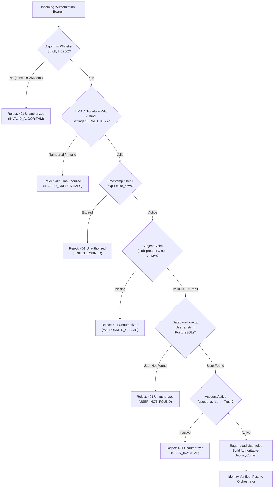

# Day 06 — Task 4 Phase 4D: REST API Router Implementation Plan (Revision 2)

**Project:** Intelligent Customer Support AI Platform — Elevance Skills Internship  
**Milestone:** Day 06 — Task 4: Advanced RAG Knowledge Assistant  
**Phase:** Phase 4D — REST API Router, Interservice Contracts & Verification  
**Plan Version:** Revision 2.0.0 (Stage 1B — Review Findings Resolved)  
**Date:** November 3, 2026  
**Status:** **STAGE 1B REVISED PLAN — PENDING USER APPROVAL (NO APPLICATION CODE WRITTEN)**

---

## 1. Review Findings and Architecture Corrections

Following architectural review of Revision 1, six critical findings were identified and corrected. The table below documents each finding, the root cause in the initial plan, and the exact architectural correction applied:

| Finding | Review Item | Initial Plan Defect | Corrected Architecture in Revision 2 |
| :--- | :--- | :--- | :--- |
| **Finding 1** | **Canonical Endpoint** | Introduced non-standard `/api/v1/rag/query` and `/api/v1/knowledge/query` routes. | Restored canonical endpoint **`POST /api/v1/chat/message`** strictly per `docs/architecture/API_SPECIFICATION.md` Section 3. |
| **Finding 2** | **Actual Orchestrator Interface** | Assumed generic method signatures without grounding in real Phase 4C code. | Grounded strictly in `backend/app/modules/rag/orchestrator.py`: `RAGOrchestrator.process_query(request: RAGInternalRequest, session: AsyncSession) -> RAGResolutionResult`. |
| **Finding 3** | **Authentication Dependencies** | Assumed JWT dependencies were active; lacked strict validation specifications. | Documented exact virtual environment deficiency; specified minimal dependency recommendation (`PyJWT>=2.8.0` or `python-jose`); defined 7-point cryptographic JWT verification. |
| **Finding 4** | **Anonymous Access Decision** | Permitted permissive anonymous public access fallback. | Corrected: **Anonymous access is STRICTLY FORBIDDEN**. Requests missing both `X-Session-Token` and `Authorization: Bearer <jwt>` fail closed with `HTTP 401 Unauthorized` per `API_SPECIFICATION.md`. |
| **Finding 5** | **Minimal Application Bootstrap** | Over-bundled worker processes into API lifespan. | Stripped worker schedulers from web lifespan; limited bootstrap in `backend/app/main.py` to reader index boot sync, RFC 7807 handlers, correlation middleware, and CORS. |
| **Finding 6** | **Request Contract** | Mixed field naming (`query` vs `message`). | Preserved canonical `message` (with `query` alias), `conversation_id`, and `effective_as_of_date`; rejected client-controlled authorization fields (`role`, `access_tier`, `customer_id`, `security_context`) via `extra="forbid"`. |

---

## 2. Canonical API Endpoint & Route Specification

### 2.1 Specification Compliance & Justification
In [`docs/architecture/API_SPECIFICATION.md`](file:///c:/Users/bhavs/OneDrive/Desktop/AI-Customer-Support-Platform/docs/architecture/API_SPECIFICATION.md) (Section 2.2 and Section 3) and [`docs/architecture/SECURITY_ARCHITECTURE.md`](file:///c:/Users/bhavs/OneDrive/Desktop/AI-Customer-Support-Platform/docs/architecture/SECURITY_ARCHITECTURE.md) (Section 3.2), the authoritative entry point for customer and agent conversational policy inquiries is:

$$\mathbf{POST\ /api/v1/chat/message}$$

- **Specification Matrix:**
  - Route: `/api/v1/chat/message`
  - Method: `POST`
  - Auth Type: `Session / JWT`
  - Minimum Role: `CUSTOMER`, `AGENT`
  - Rejection Semantics: `401 (missing), 403 (unauthorized)`
- **Deviation Rejection:** Ad-hoc endpoints like `/api/v1/rag/query` or `/api/v1/knowledge/query` violate the platform contract. All conversational knowledge inquiries route through `/api/v1/chat/message`.
- **Phase 4D Scope Boundary:** While `POST /api/v1/chat/message` will later coordinate Modules 5 (Sentiment) and 6 (Multilingual) in Task 5 & 6, in **Phase 4D** this endpoint implements the primary HTTP gateway to the completed Task 4 `RAGOrchestrator` / `RAGKnowledgeAssistant`. It validates client contracts, resolves identity, delegates to the RAG orchestrator, and returns the grounded answer envelope with citations.

### 2.2 Content Types & Transport Headers
- **Request Header `Content-Type`:** `application/json`
- **Response Header `Content-Type`:** `application/json; charset=utf-8`
- **Tracing Header:** `X-Request-ID` or `X-Correlation-ID` (validated and echoed in response headers; generated as UUID4 if missing).
- **Authentication Headers (Mutually Exclusive or Precedence-Based):**
  - Customer: `X-Session-Token: sess_<uuid>_<hex>`
  - Staff: `Authorization: Bearer <jwt>`

---

## 3. Actual Orchestrator Interface & Parameter Binding

An inspection of [`backend/app/modules/rag/orchestrator.py`](file:///c:/Users/bhavs/OneDrive/Desktop/AI-Customer-Support-Platform/backend/app/modules/rag/orchestrator.py) confirms the exact class, method, contracts, and temporal data flow:

### 3.1 Class & Method Signature
```python
class RAGOrchestrator:
    """Enterprise RAG Orchestrator coordinating retrieval, generation, and sanitization."""

    async def process_query(
        self,
        request: RAGInternalRequest,
        session: AsyncSession,
    ) -> RAGResolutionResult:
        ...

    async def generate_grounded_answer(
        self,
        request: RAGInternalRequest,
        session: AsyncSession,
    ) -> RAGResolutionResult:
        """Alias conforming to interservice Module 4 facade interface."""
        return await self.process_query(request=request, session=session)


# Exported facade alias:
RAGKnowledgeAssistant = RAGOrchestrator
```

### 3.2 Required Internal Request Object (`RAGInternalRequest`)
Located in [`backend/app/modules/rag/orchestrator.py`](file:///c:/Users/bhavs/OneDrive/Desktop/AI-Customer-Support-Platform/backend/app/modules/rag/orchestrator.py#L54-L88):
```python
class RAGInternalRequest(BaseModel):
    model_config = {"extra": "forbid"}

    query: str
    session_token: Optional[str] = None
    user_id_or_email: Optional[str] = None
    jwt_claims: Optional[Dict[str, Any]] = None
    security_context: Optional[SecurityContext] = None
    effective_as_of_date: Optional[date] = None
    product_line: Optional[str] = None
    document_code: Optional[str] = None
    correlation_id: str = Field(default_factory=lambda: str(uuid.uuid4()))
```

### 3.3 Return Type & Refusal Representation (`RAGResolutionResult`)
Located in [`backend/app/modules/rag/generator.py`](file:///c:/Users/bhavs/OneDrive/Desktop/AI-Customer-Support-Platform/backend/app/modules/rag/generator.py#L49-L66):
```python
class RAGResolutionResult(BaseModel):
    is_resolved: bool
    refusal_triggered: bool
    refusal_reason: Optional[str] = None
    generated_response: str
    citations: List[CitationMetadata] = Field(default_factory=list)
    confidence_score: float = 0.0
    effective_as_of_date_applied: str
    suggested_ticket_category: Optional[str] = None
    claim_verification: ClaimVerificationResult
    retrieval_latency_ms: float = 0.0
    generation_latency_ms: float = 0.0
    total_latency_ms: float = 0.0
    model_used: str = "gemini"
    correlation_id: Optional[str] = None
```
- **Refusal Semantics:** When retrieval or policy verification triggers an abstention:
  - `is_resolved = False`
  - `refusal_triggered = True`
  - `refusal_reason` carries standardized code (`UNKNOWN_REGION_POLICY_CLARIFICATION`, `CONFLICTING_POLICY_EVIDENCE`, `INCONCLUSIVE_RETRIEVAL_CONFIDENCE`, `LOW_SIMILARITY_OUT_OF_DOMAIN`, `INSUFFICIENT_EVIDENCE`, `SECURITY_INJECTION_DETECTED`, `AUTHORIZATION_DENIED`, `SANITIZER_FAILURE`).
  - `generated_response` carries user-safe explanatory messaging.
  - `suggested_ticket_category` carries automated escalation routing (`POLICY_REGION_CLARIFICATION`, `POLICY_DISPUTE_ESCALATION`, `SECURITY_INCIDENT_REVIEW`, etc.).
  - `citations = []`.

### 3.4 Temporal Policy Routing (`effective_as_of_date`)
In [`backend/app/modules/rag/orchestrator.py`](file:///c:/Users/bhavs/OneDrive/Desktop/AI-Customer-Support-Platform/backend/app/modules/rag/orchestrator.py#L300-L307), `effective_as_of_date` flows directly to the retriever:
```python
retrieval_result = await self.retriever.retrieve(
    query=san_result.clean_query,
    session=session,
    security_context=sec_ctx,
    effective_as_of_date=request.effective_as_of_date,
    product_line=request.product_line,
    document_code=request.document_code,
)
```
In `SecurityAwareRetriever`, `effective_as_of_date` executes PostgreSQL indexed pre-filtering:
- `document_versions.effective_from <= effective_as_of_date`
- `(document_versions.effective_until IS NULL OR document_versions.effective_until >= effective_as_of_date)`
- If `effective_as_of_date` is omitted, `date.today()` is applied, excluding historical expired policies and future unreleased drafts.

---

## 4. Authentication Architecture & Dependencies

### 4.1 Dependency Audit in Virtual Environment
Inspection of the project environment (`.venv`) and [`backend/pyproject.toml`](file:///c:/Users/bhavs/OneDrive/Desktop/AI-Customer-Support-Platform/backend/pyproject.toml):
- **FastAPI / Uvicorn:** Specified in `pyproject.toml` (`fastapi>=0.115.0`, `uvicorn[standard]>=0.30.0`). Not currently installed in `.venv`.
- **JWT Libraries:** `python-jose[cryptography]>=3.3.0` is specified in `pyproject.toml` line 49. Neither `jose` nor `jwt` is currently installed in `.venv`.
- **Installed Packages:** `cryptography 50.0.2`, `bcrypt 5.0.0`, `pwdlib 0.3.1`, `asyncpg 0.32.0`, `sqlalchemy 2.1.6`, `pydantic 2.14.2`, `httpx 0.28.1` are present.

### 4.2 Recommended Dependency Addition
During Phase 4D implementation (once authorized), install:
1. `fastapi>=0.115.0`
2. `uvicorn[standard]>=0.30.0`
3. **JWT Handling:**
   - **Option A (Specified in `pyproject.toml`):** `python-jose[cryptography]>=3.3.0`.
   - **Option B (Recommended for Python 3.12 compatibility):** `PyJWT[crypto]>=2.8.0`. `PyJWT` has active maintenance, native wheels, and seamless compatibility with `cryptography 50.0.2` on Python 3.12 without legacy backend deprecation warnings.
   > [!IMPORTANT]
   > No dependencies will be installed during this planning stage.

---

### 4.3 Strict 7-Point Cryptographic JWT Validation Pipeline



1. **Explicit Algorithm Whitelist:** Enforced strictly via `algorithms=[settings.ALGORITHM]` (`HS256`). Rejects `"none"` algorithm and unauthorized asymmetric keys.
2. **Cryptographic Signature Verification:** Verified against `settings.SECRET_KEY`.
3. **Expiration Enforcement:** Evaluates `exp` timestamp against `datetime.now(timezone.utc)`.
4. **Subject Integrity Check:** Asserts `sub` claim exists and is a valid UUID or email string.
5. **Database User Existence:** Queries `User` record from PostgreSQL using `db.execute(select(User).where(User.id == sub))`.
6. **Active Account Check:** Asserts `user.is_active is True`. Deactivated staff accounts are rejected immediately.
7. **Server-Side Role Resolution:** Eagerly loads `User.roles` (`options(selectinload(User.roles))`). Maps role names (`AGENT`, `SUPERVISOR`, `ADMIN`) server-side. **Client claims of roles in request headers or body are completely discarded.**

### 4.4 Customer Session Authentication Pipeline
- Extracts `X-Session-Token` from request headers.
- Queries `Session` table joined with `Customer` in PostgreSQL.
- Verifies `sess.status == "ACTIVE"` and `sess.expires_at > datetime.now(timezone.utc)`.
- If invalid, expired, or malformed $\rightarrow$ fails closed with `HTTP 401 Unauthorized`.
- Derives customer tier (`customer.customer_tier`) and verified region (`customer.metadata_.country_code`) server-side.

---

## 5. Anonymous Access Policy: Strict Prohibition

### 5.1 Authoritative Specification Check
- [`docs/architecture/API_SPECIFICATION.md`](file:///c:/Users/bhavs/OneDrive/Desktop/AI-Customer-Support-Platform/docs/architecture/API_SPECIFICATION.md) Section 2.2:
  `Endpoint: /api/v1/chat/message | Method: POST | Auth Type: Session / JWT | Minimum Role: CUSTOMER, AGENT | Rejection: 401 (missing), 403 (unauthorized)`
- [`docs/architecture/SECURITY_ARCHITECTURE.md`](file:///c:/Users/bhavs/OneDrive/Desktop/AI-Customer-Support-Platform/docs/architecture/SECURITY_ARCHITECTURE.md) Section 3.2:
  Explicitly matches: `401 (missing), 403 (unauthorized)`.
- [`docs/architecture/SYSTEM_ARCHITECTURE.md`](file:///c:/Users/bhavs/OneDrive/Desktop/AI-Customer-Support-Platform/docs/architecture/SYSTEM_ARCHITECTURE.md) Section 9:
  `GATEWAY --> AUTH_CHECK{"Valid Customer Session or Staff JWT?"} -- No --> REJECT_401["Return 401 Unauthorized / 403 Forbidden"]`.

### 5.2 Architectural Decision
> [!CAUTION]
> **Anonymous public access to `POST /api/v1/chat/message` is STRICTLY FORBIDDEN.**
> 
> Any request lacking both `X-Session-Token` and `Authorization: Bearer <jwt>` must fail closed immediately with:
> - **HTTP Status:** `401 Unauthorized`
> - **Error Code:** `MISSING_CREDENTIALS`
> - **Message:** `"Authentication credentials are required to interact with the knowledge assistant."`

Customers must first initialize a session via `POST /api/v1/auth/customer-session` (which creates a database `Session` and issues an `X-Session-Token`). No chat turns or RAG queries may execute unauthenticated.

---

## 6. Minimal FastAPI Application Bootstrap (`backend/app/main.py`)

To satisfy Finding 5, the root FastAPI application bootstrap is stripped of unrelated worker-only daemons:

```python
"""Root FastAPI Application Bootstrap."""

from contextlib import asynccontextmanager
from typing import AsyncGenerator
from fastapi import FastAPI, Request, status
from fastapi.exceptions import RequestValidationError
from fastapi.middleware.cors import CORSMiddleware
from fastapi.responses import JSONResponse
from starlette.exceptions import HTTPException as StarletteHTTPException

from app.api.v1 import api_v1_router
from app.core.config import settings
from app.core.exceptions import PlatformException
from app.core.logging import configure_safe_logger
from app.db.session import AsyncSessionLocal
from app.modules.knowledge.reader import ActiveIndexReader


@asynccontextmanager
async def lifespan(app: FastAPI) -> AsyncGenerator[None, None]:
    """Minimal API server lifespan.
    
    Loads active vector index metadata into memory on startup if present.
    DOES NOT run worker schedulers, promotion reconcilers, or watchdog loops.
    """
    reader = ActiveIndexReader(settings=settings)
    async with AsyncSessionLocal() as session:
        try:
            await reader.sync_on_startup(session=session)
        except Exception:
            pass  # Active index absent is normal before first Day 05 promotion
    yield
    reader.stop()


app = FastAPI(
    title="Intelligent Customer Support AI Platform",
    version="0.1.0",
    docs_url="/docs",
    redoc_url="/redoc",
    lifespan=lifespan,
)

# 1. CORS Middleware
app.add_middleware(
    CORSMiddleware,
    allow_origins=settings.CORS_ORIGINS if hasattr(settings, "CORS_ORIGINS") else ["*"],
    allow_credentials=True,
    allow_methods=["*"],
    allow_headers=["*"],
)

# 2. Correlation ID Middleware
@app.middleware("http")
async def correlation_id_middleware(request: Request, call_next):
    corr_id = request.headers.get("X-Request-ID") or request.headers.get("X-Correlation-ID")
    if not corr_id:
        import uuid
        corr_id = str(uuid.uuid4())
    request.state.correlation_id = corr_id
    response = await call_next(request)
    response.headers["X-Request-ID"] = corr_id
    return response

# 3. Standardized RFC 7807 Exception Handlers
@app.exception_handler(PlatformException)
async def platform_exception_handler(request: Request, exc: PlatformException):
    corr_id = getattr(request.state, "correlation_id", "unknown")
    return JSONResponse(
        status_code=exc.status_code,
        content={
            "success": False,
            "error": {
                "code": exc.error_code,
                "message": exc.message,
                "details": exc.detail,
                "request_id": corr_id,
            },
        },
    )

@app.exception_handler(StarletteHTTPException)
async def http_exception_handler(request: Request, exc: StarletteHTTPException):
    corr_id = getattr(request.state, "correlation_id", "unknown")
    return JSONResponse(
        status_code=exc.status_code,
        content={
            "success": False,
            "error": {
                "code": "HTTP_ERROR",
                "message": exc.detail,
                "request_id": corr_id,
            },
        },
    )

@app.exception_handler(RequestValidationError)
async def validation_exception_handler(request: Request, exc: RequestValidationError):
    corr_id = getattr(request.state, "correlation_id", "unknown")
    return JSONResponse(
        status_code=status.HTTP_422_UNPROCESSABLE_ENTITY,
        content={
            "success": False,
            "error": {
                "code": "VALIDATION_ERROR",
                "message": "Request payload validation failed.",
                "details": exc.errors(),
                "request_id": corr_id,
            },
        },
    )

# 4. Include API v1 Router
app.include_router(api_v1_router, prefix="/api/v1")
```

---

## 7. Request and Response Schemas (`backend/app/api/v1/chat.py`)

### 7.1 Request Schema (`ChatMessageRequest`)
```python
class ChatMessageRequest(BaseModel):
    """Canonical request payload for POST /api/v1/chat/message."""

    model_config = {
        "extra": "forbid",  # Rejects client-supplied role, access_tier, customer_id
        "str_strip_whitespace": True,
        "populate_by_name": True,
    }

    message: str = Field(
        ...,
        min_length=1,
        max_length=2000,
        alias="query",  # Dual support for 'message' or 'query'
        description="Customer or staff natural language inquiry",
        examples=["What is the return window for electronics?"],
    )
    conversation_id: Optional[uuid.UUID] = Field(
        default=None,
        description="Optional conversation UUID for multi-turn dialogue correlation",
    )
    effective_as_of_date: Optional[date] = Field(
        default=None,
        description="Historical policy evaluation date (YYYY-MM-DD)",
        examples=["2026-03-01"],
    )
    product_line: Optional[str] = Field(
        default=None,
        max_length=100,
        description="Optional product line filter (e.g. 'ELECTRONICS')",
    )
    document_code: Optional[str] = Field(
        default=None,
        max_length=100,
        description="Optional target policy code to pin retrieval (e.g. 'POL-RET-US-2026')",
    )

    @field_validator("message")
    @classmethod
    def validate_non_empty(cls, v: str) -> str:
        if not v or not v.strip():
            raise ValueError("Query message cannot be empty or whitespace.")
        return v.strip()
```

### 7.2 Response Schema (`ChatMessageResponse`)
```python
class CitationDTO(BaseModel):
    citation_id: int
    document_code: str
    document_title: str
    version_number: int
    effective_date: str
    chunk_excerpt: str


class ClaimVerificationDTO(BaseModel):
    total_claims: int
    verified_claims: int
    all_claims_verified: bool


class ChatMessageData(BaseModel):
    message_id: str = Field(default_factory=lambda: str(uuid.uuid4()))
    reply_text: str = Field(..., description="Grounded answer or explanatory refusal")
    is_resolved: bool = Field(..., description="True if definitively answered from knowledge base")
    refusal_triggered: bool = Field(..., description="True if query triggered policy refusal/abstention")
    refusal_reason: Optional[str] = Field(None, description="Refusal classification reason code")
    citations: List[CitationDTO] = Field(default_factory=list, description="Verified inline citations")
    confidence_score: float = Field(..., ge=0.0, le=1.0)
    effective_as_of_date_applied: str
    suggested_ticket_category: Optional[str] = None
    claim_verification: ClaimVerificationDTO
    model_used: str
    retrieval_latency_ms: float
    generation_latency_ms: float
    total_latency_ms: float


class ResponseMeta(BaseModel):
    timestamp: str
    request_id: str
    caller_auth_type: str  # "SESSION_TOKEN" or "JWT"


class ChatMessageResponse(BaseModel):
    success: bool = True
    data: ChatMessageData
    meta: ResponseMeta
```

---

## 8. Revised File Inventory

| File | Action | Detailed Description |
| :--- | :--- | :--- |
| [`backend/app/api/__init__.py`](file:///c:/Users/bhavs/OneDrive/Desktop/AI-Customer-Support-Platform/backend/app/api/__init__.py) | **Create** | API package root exporting router definitions. |
| [`backend/app/api/deps.py`](file:///c:/Users/bhavs/OneDrive/Desktop/AI-Customer-Support-Platform/backend/app/api/deps.py) | **Create** | Dependencies: `get_db()`, `get_correlation_id()`, `get_auth_context()`, `get_rag_orchestrator()`. |
| [`backend/app/api/v1/__init__.py`](file:///c:/Users/bhavs/OneDrive/Desktop/AI-Customer-Support-Platform/backend/app/api/v1/__init__.py) | **Create** | Aggregates all v1 routers (`chat_router`). |
| [`backend/app/api/v1/chat.py`](file:///c:/Users/bhavs/OneDrive/Desktop/AI-Customer-Support-Platform/backend/app/api/v1/chat.py) | **Create** | Implements canonical route `POST /api/v1/chat/message`. Connects HTTP request to `RAGOrchestrator`. |
| [`backend/app/main.py`](file:///c:/Users/bhavs/OneDrive/Desktop/AI-Customer-Support-Platform/backend/app/main.py) | **Create** | Minimal root FastAPI bootstrap with reader sync lifespan, RFC 7807 handlers, CORS, correlation middleware. |
| [`backend/tests/test_task4_phase4d.py`](file:///c:/Users/bhavs/OneDrive/Desktop/AI-Customer-Support-Platform/backend/tests/test_task4_phase4d.py) | **Create** | Comprehensive dedicated test suite for Phase 4D API layer. |
| **All Existing Phase 4A–4C Files** | **Preserve** | **Zero modifications to existing engine code or database models.** |

---

## 9. Test Strategy & Acceptance Criteria

### 9.1 Dedicated Phase 4D Test Suite Matrix (Target: 22 Tests)

```mermaid
flowchart TD
    subgraph SuiteMatrix ["test_task4_phase4d.py Matrix"]
        A1["1. test_auth_missing_credentials_fails_closed_401\n(Missing both tokens rejected with 401 MISSING_CREDENTIALS)"]
        A2["2. test_auth_invalid_session_token_fails_closed_401\n(Non-existent session token rejected with 401)"]
        A3["3. test_auth_expired_session_token_fails_closed_401\n(Session with expires_at < now rejected with 401)"]
        A4["4. test_auth_malformed_session_token_fails_closed_401\n(Whitespace or empty token rejected with 401)"]
        A5["5. test_auth_valid_customer_session_resolves_and_answers_200\n(Active session retrieves grounded answer)"]
        A6["6. test_auth_tampered_jwt_signature_fails_closed_401\n(Modified signature rejected with 401)"]
        A7["7. test_auth_expired_jwt_fails_closed_401\n(Expired JWT rejected with 401)"]
        A8["8. test_auth_inactive_staff_user_fails_closed_401\n(User with is_active=False rejected with 401)"]
        A9["9. test_auth_valid_staff_jwt_resolves_agent_scope_200\n(Valid JWT resolves staff role and answers)"]
        S1["10. test_zero_client_trust_forbidden_role_in_body_422\n(Body with role='ADMIN' rejected with 422)"]
        S2["11. test_zero_client_trust_forbidden_access_tier_422\n(Body with access_tier='VIP' rejected with 422)"]
        S3["12. test_zero_client_trust_forbidden_customer_id_422\n(Body with customer_id='...' rejected with 422)"]
        S4["13. test_zero_client_trust_forbidden_security_context_422\n(Body with security_context={...} rejected with 422)"]
        P1["14. test_temporal_historical_policy_query_200\n(effective_as_of_date returns historical policy)"]
        P2["15. test_prompt_injection_sanitized_and_refused_200\n(Adversarial injection returns structured refusal)"]
        P3["16. test_pii_credit_card_scrubbed_in_response_200\n(Raw card numbers scrubbed by Sanitizer Vault)"]
        P4["17. test_domain_policy_conflict_refusal_200\n(Contradictory policy returns refusal with dispute escalation)"]
        P5["18. test_unknown_region_refusal_200\n(Unknown region returns clarification refusal)"]
        P6["19. test_correlation_id_echoed_in_response_headers\n(X-Request-ID echoed in response and meta)"]
        E1["20. test_llm_timeout_mapped_to_504_gateway_timeout\n(LLMTimeoutError maps to RFC 7807 504)"]
        E2["21. test_empty_query_rejected_with_422\n(Empty string query rejected with 422)"]
        E3["22. test_oversized_query_rejected_with_422\n(Query > 2000 chars rejected with 422)"]
    end
```



### 9.2 Acceptance Criteria
1. **Canonical Endpoint:** `POST /api/v1/chat/message` successfully handles valid customer sessions and staff JWTs.
2. **Fail-Closed Boundary:** Unauthenticated requests fail with `HTTP 401 Unauthorized`. Expired or invalid tokens fail with `HTTP 401`.
3. **Zero Client Trust:** Any request containing client-supplied `role`, `access_tier`, `customer_id`, or `security_context` fails with `HTTP 422 Unprocessable Entity`.
4. **Historical Auditing:** Passing `effective_as_of_date` evaluates policy terms as of that historical date.
5. **PII and Injection Defense:** Preserved through Sanitizer Vault; no raw payment data or injection breakouts permitted.
6. **Regression Invariant:** All **277 existing platform tests** pass (100% green).
7. **Production Storage Invariant:** `storage/indices/active_index.json` remains untouched (`False`).

---

## 10. Remaining Risks & Clarifications

1. **Virtual Environment Package Installation:**
   - Prior to running Phase 4D tests, `fastapi`, `uvicorn`, and `PyJWT` (or `python-jose`) must be installed in `.venv`.
   - *Mitigation:* A simple installation step (`pip install fastapi uvicorn "PyJWT[crypto]"`) will be performed at the start of Phase 4D implementation.
2. **Interservice Scope Boundaries (Modules 5 & 6):**
   - In later milestones (Days 07–13), `POST /api/v1/chat/message` will orchestrate Sentiment analysis (Module 5) and Multilingual conversation (Module 6).
   - In **Phase 4D**, the handler focuses strictly on the Task 4 RAG knowledge engine without introducing premature dummy implementations of Modules 5 and 6.

---

## 11. Review Checkpoint

**STOP:** In accordance with instructions, this revised plan resolves all 6 review findings and is submitted for review and approval. Implementation will **not** begin until explicit authorization is granted.
