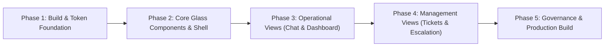

# FRONTEND DESIGN & IMPLEMENTATION PLAN
## AI Customer Support Platform — Enterprise Dark Glassmorphism Command Center

**Document Version:** 1.0.0  
**Date:** 2026-11-05  
**Design Reference:** `GlassmorphismListenAppBlock` (Dark glassmorphism, deep navy/charcoal surfaces, translucent cards, subtle borders, restrained blue/cool-white accents, soft radial lighting, clean typography)  
**Target:** `frontend/` directory (React 18 + TypeScript + Vite)  
**Status:** PROPOSED — AWAITING USER APPROVAL PRIOR TO IMPLEMENTATION  

---

## 1. Executive Summary & Design Reinterpretation

The objective is to design and build a production-grade, commercial-quality frontend for the **AI-Customer-Support-Platform**.
Using the visual aesthetic of the uploaded glassmorphism reference, we translate its design patterns from audio/music into an **Enterprise AI Customer Support Command Center**.

### Key Reinterpretations:
| Reference Component Pattern (Music App) | Enterprise AI Support Reinterpretation |
| :--- | :--- |
| Audio waveforms & equalizer graphs | Real-time sentiment trajectory curves & emotional velocity slopes |
| "Now Playing" track card | "Active Incident / Conversation" inspection card with live SLA timer |
| Playlist / Track listing | Priority-sorted ticket queue & multi-turn customer conversation feed |
| Album artwork cards | Extracted document thumbnails (invoices, receipts, PDF OCR previews) |
| Volume / playback controls | SLA pause/resume controls, escalation overrides, language toggles |
| Ambient circular glow background | Subtle multi-layered navy/cyan radial lighting behind critical KPIs |

---

## 2. Design System Tokens & Styling Architecture

Per **ADR-06**, styling is built on a **Semantic Vanilla CSS Design Token system** in `frontend/src/index.css`. This guarantees zero dependency bloat, maximum performance for live streaming dialogues, and pixel-perfect control over transparency, backdrop blurs, and contrast ratios.

### 2.1 Color Palette & Glassmorphism Tokens
```css
:root {
  /* Surfaces & Backgrounds */
  --bg-app: #070a12;
  --bg-app-gradient: radial-gradient(circle at 15% 15%, rgba(30, 58, 138, 0.12), transparent 45%),
                      radial-gradient(circle at 85% 85%, rgba(14, 116, 144, 0.08), transparent 45%),
                      #070a12;
  
  /* Glassmorphism Card Fills */
  --glass-surface-base: rgba(15, 23, 42, 0.65);
  --glass-surface-elevated: rgba(30, 41, 59, 0.55);
  --glass-surface-hover: rgba(51, 65, 85, 0.45);
  --glass-surface-active: rgba(30, 41, 59, 0.75);
  
  /* Borders & Layered Lighting */
  --glass-border: 1px solid rgba(255, 255, 255, 0.08);
  --glass-border-focus: 1px solid rgba(96, 165, 250, 0.40);
  --glass-border-accent: 1px solid rgba(59, 130, 246, 0.25);
  
  /* Blurs & Shadows */
  --glass-blur-md: blur(16px);
  --glass-blur-lg: blur(24px);
  --glass-shadow: 0 8px 32px 0 rgba(0, 0, 0, 0.37);
  --glass-shadow-elevated: 0 16px 48px 0 rgba(0, 0, 0, 0.50);

  /* Brand & Status Accents */
  --accent-primary: #3b82f6;        /* Electric Blue */
  --accent-primary-hover: #60a5fa;
  --accent-cyan: #06b6d4;           /* AI / RAG Indicator */
  --accent-emerald: #10b981;        /* Resolved / Healthy */
  --accent-amber: #f59e0b;          /* 75% SLA Warning */
  --accent-rose: #f43f5e;           /* Breached / Frustrated / Escalated */
  --accent-purple: #8b5cf6;         /* VIP / Enterprise Tier */

  /* Text & Typography */
  --text-main: #f8fafc;
  --text-muted: #94a3b8;
  --text-dim: #64748b;
  --text-inverse: #070a12;

  /* Spacing & Radii */
  --radius-sm: 6px;
  --radius-md: 10px;
  --radius-lg: 16px;
  --radius-xl: 24px;
}
```

---

## 3. Application Architecture & Navigation Shell

```text
+----------------------------------------------------------------------------------------------------+
|  TOP BAR: [Brand Logo] [Search Tickets/Convs Ctrl+K] [Live DB/Redis Status] [Notifications] [Agent Profile] |
+------------------+---------------------------------------------------------------------------------+
| SIDEBAR:         | WORKSPACE CONTENT AREA                                                          |
|                  |                                                                                 |
| 1. Dashboard     | [Section Header & Dynamic Context Controls]                                     |
| 2. Conversations |                                                                                 |
| 3. Tickets       | +-----------------------------------------------------------------------------+ |
| 4. Escalations   | | Glass Card Metric Tiles / Dynamic Grid Workspace                           | |
| 5. Evidence      | +-----------------------------------------------------------------------------+ |
| 6. Knowledge     | | Data Tables / Split-Pane Dialogue / Kanban Boards / SVG Charts              | |
| 7. Analytics     | +-----------------------------------------------------------------------------+ |
| 8. Settings      |                                                                                 |
+------------------+---------------------------------------------------------------------------------+
```

### 3.1 Persistent Glass Sidebar
- **Header:** Platform Brand with pulsing emerald "System Operational" status pill.
- **Navigation Items:** Clean iconography, active glow pill, subtle hover backdrop transitions:
  1. `Overview` (Dashboard)
  2. `Conversations` (Live Multi-turn Dialogues)
  3. `Tickets` (Queue, Kanban, SLA Timers)
  4. `Escalation Center` (Urgent Safety/Legal Alerts & Trajectories)
  5. `Evidence Vault` (Document Previews, OCR & Claim Checks)
  6. `Knowledge Base` (FAISS Indexes, Benchmarks, Rollback)
  7. `Analytics` (SLA Compliance, Sentiment Trends)
  8. `Settings` (RBAC, Business Hours, Holidays, On-Call Staff)
- **Footer:** Active agent badge (Name, Department, On-Call toggle switch, Role chip).

### 3.2 Top Command Bar
- **Global Search:** Typeahead filter across tickets, conversation IDs, customer emails, and policy document codes (`POL-*`).
- **Health Indicators:** Real-time ping probes for PostgreSQL 16, Redis, and FAISS index.
- **Session / Auth Context Switcher:** Allows toggling between Customer Session view (`X-Session-Token`) and Staff Enterprise view (`Authorization: Bearer <jwt>`) for live demonstration and pairing audits.

---

## 4. Deep-Dive Screen Specifications

### A. Overview Dashboard (`OverviewDashboard.tsx`)
* **KPI Metric Grid (Glass Cards):**
  - **Open Tickets:** Total active count, delta vs. yesterday.
  - **Urgent / Escalated:** Red-accented badge showing safety/legal escalations.
  - **SLA Breach Risk:** Amber countdown for tickets past 75% SLA threshold.
  - **Active Conversations:** Multi-turn sessions currently underway.
  - **Customer Satisfaction:** Real-time CSAT gauge derived from positive sentiment logs.
* **Operational Panels:**
  - **Live Sentiment Trajectory Heatmap:** Mini SVG sparkline showing platform-wide emotional slope over the past 60 minutes.
  - **Recent Incidents & Critical Escalations:** Quick-action table with 1-click reassignment.
  - **SLA Health Gauge:** Percentage compliance against `US_COMMERCIAL_HOURS` calendar.

### B. Conversations Workspace (`ConversationsView.tsx`)
* **Split-Pane Layout:**
  - **Left Pane (Conversation List):** Searchable customer list showing customer name, external ID, tier (`VIP`, `STANDARD`), detected language flag (`en`, `es`, `fr`, `de`, `hi`), latest sentiment badge (`frustrated`, `neutral`, etc.), and last activity timestamp.
  - **Right Pane (Active Dialogue Workspace):**
    - **Header:** Active customer profile, verified session token, overall sentiment score, conversation turn counter, and manual escalation button.
    - **Message Stream:** Translucent chat bubbles distinguishing Customer vs. AI/Agent.
    - **Citation Popover:** Clickable document pills (`POL-RET-US-2026`) displaying document title, effective date, and chunk excerpt.
    - **Masked PII Indicator:** Visual padlock indicating raw sensitive data was masked before persistence.
    - **Live Message Input:** Connected directly to `POST /api/v1/chat/message` with language toggle, idempotency key preservation, and latency metrics display.

### C. Ticket Management (`TicketManagementView.tsx`)
* **Dual View Mode:** Toggle between Kanban Board (by status: `OPEN`, `PENDING_CUSTOMER`, `IN_PROGRESS`, `ESCALATED`, `RESOLVED`) and Dense Table.
* **Ticket Cards:**
  - Dynamic Priority Score badge ($1.0 - 5.0$).
  - **Ticking SLA Countdown Timer:** Computes remaining minutes; pulses amber at $\le 25\%$ duration, turns crimson upon breach.
  - **`PENDING_CUSTOMER` Pause Tag:** Displays paused indicator (`sla_paused_at`) and accumulated paused seconds.
  - Masked handoff summary snippet.
* **Ticket Detail Drawer:** Full event history (`ticket_events`), assigned agent selector with workload limits (`max_active_tickets`), and status transition controls.

### D. Escalation Center (`EscalationCenterView.tsx`)
* **High-Risk Alarm Cards:**
  - Legal Threat / Regulatory triggers (`trigger_condition = 'HIGH_RISK_SAFETY'`).
  - Physical safety / severe defect triggers.
  - Sustained extreme frustration triggers (confidence $> 0.85$ on $\ge 2$ turns).
  - 15-minute inactivity escalation alerts.
* **On-Call Dispatch Deck:**
  - Current operational status (Business Hours vs. After-Hours).
  - On-call agent roster (`is_on_call = True`) and automated paging webhook dispatch log.
  - Structured immutable audit record inspect (`escalation_audits`).

### E. Evidence Processing (`EvidenceProcessingView.tsx`)
* **Drag-and-Drop Zone:** Validates file size ($\le 20$MB) and MIME magic bytes (`PNG`, `JPEG`, `PDF`, `WEBP`).
* **Processing Indicator:** Distinguishes ultra-fast synchronous path ($\le 3.0$s) vs. asynchronous Celery offload ($202$ Accepted with task notification).
* **Side-by-Side Document Inspector:**
  - Left: High-resolution document viewer / PDF page carousel.
  - Right: Extracted OCR text pane with confidence highlights, detected invoice numbers, dates, and amounts.
  - Claim conflict alert: Highlights discrepancies between customer claimed refund amount and detected invoice receipt total.

### F. Knowledge Base Operations (`KnowledgeOpsView.tsx`)
* **Index Version Table:** Displays active index (`faiss_index_v1`, `v2`) with vector counts, generation timestamps, and SHA-256 checksums.
* **Golden Benchmark Scorecard:** Visual gauges for retrieval accuracy ($\ge 92\%$), latency ($\le 2.0$s), and hallucination refusal score.
* **Maintenance Window Activation:** Countdown timer to scheduled window (`02:00 - 04:00 UTC`).
* **Emergency Rollback Deck:** Prominent, shielded rollback button with two-step modal confirmation to restore previous stable index symlink.

### G. Platform Analytics (`AnalyticsView.tsx`)
* **Trend Visualizations (High-Performance SVG/Canvas):**
  - Resolution rate vs. Escalation rate over time.
  - Multi-class sentiment distribution pie/bar breakdown.
  - Ticket volume by product category (`HARDWARE`, `BILLING`, `RETURNS`).
  - SLA breach distribution by hour and day of week.
  - Language traffic breakdown (`en`, `es`, `fr`, `de`, `hi`).

### H. Settings & Governance (`SettingsView.tsx`)
* **User & RBAC Manager:** List enterprise users with assigned roles (`ADMIN`, `SUPERVISOR`, `AGENT`, `AUDITOR`), active skills, and concurrency limits.
* **SLA Calendar Editor:** View and configure `US_COMMERCIAL_HOURS` (`work_start_time`, `work_end_time`, `work_days`, corporate holidays).
* **On-Call Routing Config:** Manage on-call rotations and alert webhook endpoints.

---

## 5. Implementation Phases & Milestones



* **Phase 1: Build & Design Token Foundation:**
  - Create `frontend/index.html`, `frontend/vite.config.ts`, `frontend/tsconfig.json`, `frontend/tsconfig.node.json`, `frontend/nginx.conf`.
  - Install dependencies (`npm install`).
  - Implement `frontend/src/index.css` with dark glassmorphism design tokens, CSS variables, and typography.
* **Phase 2: Core Glass Components & Navigation Shell:**
  - Implement `frontend/src/components/common/` (`Button`, `Card`, `Badge`, `Modal`, `Input`, `Spinner`).
  - Implement `frontend/src/components/layout/` (`Sidebar`, `TopBar`, `AppShell`).
  - Implement `frontend/src/services/apiClient.ts` with dual-auth interceptors and RFC 7807 error unwrap.
* **Phase 3: Primary Operational Views:**
  - Implement `OverviewDashboard.tsx` with KPI glass cards and sentiment velocity sparklines.
  - Implement `ConversationsView.tsx` with live multi-turn chat connected directly to `POST /api/v1/chat/message`.
* **Phase 4: Management & Processing Views:**
  - Implement `TicketManagementView.tsx` with ticking SLA countdowns and pause indicators.
  - Implement `EscalationCenterView.tsx` with on-call routing cards and safety triggers.
  - Implement `EvidenceProcessingView.tsx` with drag-and-drop and OCR preview.
* **Phase 5: Knowledge, Governance & Verification:**
  - Implement `KnowledgeOpsView.tsx`, `AnalyticsView.tsx`, and `SettingsView.tsx`.
  - Execute full production build check (`npm run build`).
  - Verify WCAG 2.1 AA contrast compliance and responsiveness across viewport widths.

---

## 6. Backend Integration Boundary & Truth in Reporting

1. **Active Live APIs (Directly Connected):**
   - `POST /api/v1/chat/message` (Fully active, dual-auth, RAG citations, idempotency).
   - `GET /api/v1/health/live` & `GET /api/v1/health/ready` (Live health probes).
2. **Planned Backend APIs (Days 08–14):**
   - Where backend REST endpoints are scheduled for subsequent days (`/api/v1/tickets`, `/api/v1/evidence/upload`, `/api/v1/knowledge/rollback`), the frontend will use strongly typed contract adapters that reflect the approved `API_SPECIFICATION.md` schema.
   - The UI will explicitly display a subtle badge (e.g. `[Contract Simulated — Backend Milestone Day 12]`) to maintain 100% truth in engineering without misleading users or evaluators.

