# Master Engineering Work Log

**Project:** Intelligent Customer Support AI Platform  
**Architecture:** Modular Monolith (FastAPI + SQLAlchemy 2.0 AsyncIO + PostgreSQL 16 + React 18 TypeScript)  
**Repository Working Directory:** `c:\Users\bhavs\OneDrive\Desktop\AI-Customer-Support-Platform`  
**Current Milestone:** Day 08 — Intelligent Escalation & After-Hours Handling (Implemented, Hardened & Audited — 587/587 Passing Tests, 0 Regressions)

---

## Milestone Chronology

```mermaid
flowchart LR
    D01["Day 01<br/>System Architecture & Audit<br/>(COMPLETED)"] --> D02["Day 02<br/>Database & Persistence Foundation<br/>(COMPLETED)"]
    D02 --> D03["Day 03<br/>Foundational Services<br/>(COMPLETED)"]
    D03 --> D04["Day 04 Phase 1<br/>Ingestion & Change Detection<br/>(COMPLETED)"]
    D04 --> D04P2["Day 04 Phase 2<br/>Vector Builder & Staging<br/>(COMPLETED)"]
    D04P2 --> D05["Day 05<br/>Benchmark, Maintenance, Promotion & Watchdog<br/>(COMPLETED)"]
    D05 --> D06["Day 06<br/>Task 4: RAG Engine & API<br/>(COMPLETED)"]
    D06 --> D07["Day 07<br/>Task 6: Multilingual & Outbox<br/>(COMPLETED)"]
    D07 --> D08["Day 08<br/>Intelligent Escalation & After-Hours<br/>(COMPLETED)"]
```

---

## Day 01 — Architecture, Requirements & Audit Resolution
- **Milestone Goal:** Establish system architecture, engineering standards, RTM matrix, ADRs, and resolve feasibility audit findings.
- **Key Deliverables:**
  - Standardized all 6 business capabilities under a unified modular monolith architecture.
  - Compiled [`PRODUCT_REQUIREMENTS.md`](docs/architecture/PRODUCT_REQUIREMENTS.md) with 41 detailed requirements in the Requirements Traceability Matrix (RTM-01 through RTM-41).
  - Drafted comprehensive specifications: [`SYSTEM_ARCHITECTURE.md`](docs/architecture/SYSTEM_ARCHITECTURE.md), [`DATABASE_DESIGN.md`](docs/architecture/DATABASE_DESIGN.md), [`API_SPECIFICATION.md`](docs/architecture/API_SPECIFICATION.md), [`SECURITY_ARCHITECTURE.md`](docs/architecture/SECURITY_ARCHITECTURE.md), [`TESTING_STRATEGY.md`](docs/architecture/TESTING_STRATEGY.md), [`TECHNOLOGY_DECISIONS.md`](docs/architecture/TECHNOLOGY_DECISIONS.md), [`PROJECT_STRUCTURE.md`](docs/architecture/PROJECT_STRUCTURE.md), [`MODULE_DEPENDENCIES.md`](docs/architecture/MODULE_DEPENDENCIES.md).
  - Resolved 10 critical audit findings in [`ARCHITECTURE_AUDIT_RESOLUTION.md`](docs/development-history/ARCHITECTURE_AUDIT_RESOLUTION.md): FAISS BIGINT vector ID mapping, index watchdog state persistence in PostgreSQL, metadata pre-retrieval filtering, customer vs admin auth tokens, and 3-second fast path with 30-second background evidence execution.

---

## Day 02 — Database & Persistence Foundation

### 1. Scope & Execution Overview
Implemented the complete persistence foundation without placeholder code, verified against an active PostgreSQL 16.15 instance.

### 2. SQLAlchemy 2.0 Domain Entities (20 Models)
Implemented all 20 domain models across 6 modular namespaces in `backend/app/models/`:
- **Identity & RBAC:** `User`, `Role`, `UserRole` association ([`auth.py`](backend/app/models/auth.py)).
- **Customer Dialogs & Sessions:** `Customer`, `Session`, `Conversation`, `Message`, `SentimentLog` ([`customer.py`](backend/app/models/customer.py)).
- **Document Management & FAISS Mapping:** `Document`, `DocumentVersion`, `DocumentChunk` with signed 64-bit integer `faiss_vector_id` backed by a sequence ([`document.py`](backend/app/models/document.py)).
- **Knowledge Indexes & Watchdog:** `KnowledgeIndex` with canary failure counters and persistent watchdog expiry timestamps, `BenchmarkRun` with diagnostics ([`knowledge_index.py`](backend/app/models/knowledge_index.py)).
- **Ticketing & SLA Calendars:** `Ticket`, `TicketEvent`, `SLACalendar` with business hours and holiday lists, `EscalationAudit` ([`ticket.py`](backend/app/models/ticket.py)).
- **Evidence Verification & Extraction:** `EvidenceFile`, `ExtractedEvidenceEntity`, `EvidenceVerification` ([`evidence.py`](backend/app/models/evidence.py)).

### 3. PII-Safe & Cryptographic Architecture
- Implemented [`PIIMaskingEngine`](backend/app/core/pii.py) with deterministic regex scrubbers for Visa, Mastercard, Amex, CVVs, SSNs, phone numbers, and email addresses.
- Implemented [`ApplicationLayerEncryption`](backend/app/core/encryption.py) with AES-256-GCM authenticated encryption.
  - Guaranteed 12-byte cryptographically secure random nonces per payload (`os.urandom(12)`).
  - Enforced conversation ID binding via GCM `associated_data` parameter, detecting ciphertext tampering or cross-conversation injection.
  - Stored raw encrypted content in PostgreSQL `bytea` columns, completely decoupled from masked `text` columns.

### 4. Database Migrations & Catalogs
- Configured Alembic in [`backend/alembic/`](backend/alembic/).
- Generated migration [`001_initial_schema.py`](backend/alembic/versions/001_initial_schema.py), creating:
  - Sequence `document_chunks_faiss_vector_id_seq`
  - 20 authoritative domain tables
  - 22 foreign key constraints
  - 11 unique constraints
  - 77 indexes (including B-tree and composite temporal/active indexes)

### 5. Debugging & Issue Resolutions
During live integration testing against PostgreSQL 16, four technical issues were isolated, diagnosed, and resolved:

| Issue | Root Cause | Engineering Resolution |
| :--- | :--- | :--- |
| **1. `skills` type mismatch (`character varying[]` vs `json`)** | `001_initial_schema.py` created `users.skills` as `json`, while `auth.py` mapped it to `StringArrayType` (`VARCHAR[]`). | Mapped `User.skills` to `JSONBType` in [`auth.py`](backend/app/models/auth.py#L65). PostgreSQL now serializes list strings directly into native `json` without table schema alterations. |
| **2. Missing standard library import** | `setup_and_verify_postgres.py` handled `io.UnsupportedOperation` without `import io`. | Added `import io` to [`setup_and_verify_postgres.py`](backend/scripts/setup_and_verify_postgres.py#L10). |
| **3. `GUID` join operator error (`varchar = uuid`)** | `GUID.load_dialect_impl` returned `PG_UUID(as_uuid=True)` on PostgreSQL while table primary keys were generated as `VARCHAR(36)`. | Standardized `GUID` to bind and load `String(36)` across all dialects while preserving Python `uuid.UUID` objects in memory. |
| **4. Alembic URL overwrite during disposable downgrade** | `alembic/env.py` unconditionally set `sqlalchemy.url = settings.async_database_url`, overriding the disposable database URL passed by the caller. | Guarded [`env.py`](backend/alembic/env.py#L33-L37) so caller-provided connection URLs are preserved. |

### 6. Verification & Test Suite Summary
- **Live Script Execution:** [`setup_and_verify_postgres.py`](backend/scripts/setup_and_verify_postgres.py) completed all 6 phases with exit code 0.
- **Seed Idempotency:** Executed `seed_database()` twice consecutively; verified exact count diff was 0 across all roles, users, user_roles, customers, and SLA calendars.
- **Deep Schema Check:** Verified all 20 tables in PostgreSQL `public` schema matched the 20 SQLAlchemy ORM models with 0 column or nullability discrepancies.
- **Test Suite:** **35 / 35 tests passing** in 3.73 seconds:
  - 28 unit tests (in-memory SQLite + PII + encryption + constraints + SLA pause + FAISS ID mapping).
  - 7 live integration tests directly querying PostgreSQL 16 (`ai_customer_support`).

---

## Day 03 — Foundational Services (Configuration, PII, Redis, Embeddings, LLM Gateway)

### 1. Scope & Execution Overview
Implemented the complete suite of foundational services supporting Tasks 1 through 6. All work was divided into three structured phases, tested iteratively, and regression-verified against Day 01 and Day 02 baselines.

### 2. Implementation Deliverables

#### Phase 1: Centralized Configuration & Standardized Exceptions
- Added validated configuration settings in [`backend/app/core/config.py`](backend/app/core/config.py):
  - Primary provider: `LLM_PRIMARY_PROVIDER = "gemini"`
  - Default Gemini model: `GEMINI_MODEL = "gemini-3.8-flash"` (updated from decommissioned `gemini-1.5-flash`)
  - Ollama fallback: `OLLAMA_BASE_URL`, `OLLAMA_MODEL = "llama3"`
  - Dense vector embeddings: `EMBEDDING_MODEL_NAME = "sentence-transformers/all-MiniLM-L6-v2"`, dimension `384`
  - Redis connection pool: socket/connect timeouts (2.0s), max connections (20), computed URL with password encoding
- Added standardized exception hierarchy in [`backend/app/core/exceptions.py`](backend/app/core/exceptions.py):
  - Base `PlatformError` with HTTP status code and machine-readable `error_code`
  - `LLMProviderError`, `LLMAuthenticationError`, `LLMTimeoutError`, `LLMRateLimitError`
  - `EmbeddingDimensionMismatchError`, `EmbeddingModelLoadError`
  - `RedisConnectionError`, `RedisTimeoutError`

#### Phase 2: Standalone PII Masking Service & Safe Logging
- Created [`backend/app/services/pii_masker.py`](backend/app/services/pii_masker.py) encapsulating `PIIMaskingResult` with:
  - Exact match character offsets (`start`, `end`) in original unmasked text
  - Luhn checksum validation for 13–19 digit credit cards (Visa, Mastercard, Amex, Discover)
  - Scrubbers for CVV (3-4 digits), SSN (9 digits), email addresses, and phone numbers
  - Recursive dictionary/collection sanitization for JSON payloads
- Implemented `PIISafeFormatter` and `PIISafeFilter` in [`backend/app/core/logging_config.py`](backend/app/core/logging_config.py) ensuring zero raw credentials or card numbers reach stdout or log files.

#### Phase 3: Redis, Embeddings & LLM Gateway
- **Async Redis Service ([`redis_service.py`](backend/app/services/redis_service.py)):**
  - Managed async connection pool (`redis.asyncio`) with socket/connect timeouts.
  - Health checks (`ping()`, `is_healthy()`) returning `False` on drop rather than unhandled crashes.
  - Three-state query resolution: `get_with_status()` returning `(value, cache_hit: bool, redis_available: bool)`.
  - Non-falsified writes: `set()` and `delete()` return explicit booleans (`False` on failure), never claiming false success.
  - Pub/Sub channels for cache invalidation and vector index reload events.
- **Dense Vector Embedding Engine ([`embedding_service.py`](backend/app/services/embedding_service.py)):**
  - HuggingFace `sentence-transformers/all-MiniLM-L6-v2` producing 384-dimensional dense vectors.
  - CPU-only execution (`torch-2.15.0+cpu`, no CUDA/GPU dependencies).
  - Lazy singleton model initialization with thread safety via `asyncio.Lock`.
  - Offloaded forward passes to thread pool via `asyncio.to_thread` to prevent event-loop stalls.
  - Unit normalization (`normalize_embeddings=True`), ensuring Inner Product in FAISS `IndexFlatIP` matches Cosine Similarity.
- **Multi-Provider LLM Gateway ([`llm_gateway.py`](backend/app/services/llm_gateway.py)):**
  - Unified `BaseLLMProvider` interface with `GeminiProvider` (`google-genai` modern SDK) and `OllamaProvider` (async HTTP).
  - Strict boundary rules: Authentication failures (401/403) and invalid request errors (400) immediately raise `LLMAuthenticationError` / `LLMProviderError` and **never** retry or fall back to Ollama.
  - Transient error handling: Timeouts and transient HTTP errors (429, 503) retry with exponential backoff up to limit, and fall back to Ollama only on exhaustion.
  - Automated PII scrubbing on all logged prompts and responses.

### 3. Debugging & Issue Resolutions

| Issue | Root Cause | Engineering Resolution |
| :--- | :--- | :--- |
| **1. Model Decommissioning** | `gemini-1.5-flash` model shutdown | Configured `GEMINI_MODEL = "gemini-3.8-flash"` as default, overridable through environment settings. |
| **2. Redis Async Exception Namespace** | `redis.asyncio` does not export `exceptions` directly in `redis-py 8.1.0`. | Imported `redis.exceptions` directly in test mocks. |
| **3. Alembic Logger Silencing Collision** | `alembic.config.fileConfig()` disables existing loggers by default (`disable_existing_loggers=True`), muting application loggers during test runs. | Added `disable_existing_loggers=False` to [`backend/alembic/env.py`](backend/alembic/env.py) and reset logger states in tests. |

### 4. Verification & Test Suite Summary
- **Test Suite Status:** **76 / 76 tests passing** in 20.32 seconds:
  - 35 Day 01 & Day 02 tests (database, constraints, Alembic, encryption, SLA, FAISS ID, PostgreSQL 16 live integration)
  - 20 Day 03 Phase 1 & 2 tests (config validation, aliases, exception hierarchy, PII masking, safe logging)
  - 21 Day 03 Phase 3 tests (Redis pool & pubsub, embedding singleton & dimensions, LLM Gateway retries & fallback)
- **Live Redis Note:** Redis service tested with async in-memory mocks per instructions; live Redis service integration will occur during subsequent container orchestration phase.

---

## Day 04 — Task 1: Knowledge Base Pipeline (Phase 1: Ingestion, Sanitization & Change Detection)

### 1. Scope & Execution Overview
Implemented Phase 1 of Task 1 (Knowledge Base Update & Monitoring Pipeline) adhering to [TASK_1_ARCHITECTURE_PLAN.md](docs/development-history/TASK_1_ARCHITECTURE_PLAN.md) Version 3.0.0. All changes reused the existing Day 02 database schema with **zero schema migrations**.

### 2. Implementation Deliverables

#### Phase 1A: File Ingestion Sanitizer & Prompt Injection Defense
- Created [`backend/app/modules/knowledge/sanitizer.py`](backend/app/modules/knowledge/sanitizer.py):
  - File size validation enforcing `MAX_FILE_SIZE_BYTES` (10 MB).
  - Extension whitelist checking (`.md`, `.txt`, `.pdf`).
  - Magic byte sniffing: enforces `%PDF-` header and `%%EOF` trailer for PDFs; blocks binary NUL control characters in Markdown/Text (`BINARY_IN_TEXT_FILE`).
  - Deterministic heuristic prompt injection detection blocking system prompt overrides, delimiter escapes, and zero-width unicode obfuscations.
  - Fail-safe semantic LLM classifier with default-deny quarantine: quarantines under `INJECTION_SCAN_UNAVAILABLE` on LLM timeout rather than failing open.
  - Automated PII scrubbing of vector derivatives via `PIIMasker`, preserving raw original content for storage.
  - Atomically moves quarantined files to `storage/quarantine/` and generates `<filename>.meta.json` audit logs.

#### Phase 1B: Cryptographic Change Detection & Deduplication
- Created [`backend/app/modules/knowledge/change_detector.py`](backend/app/modules/knowledge/change_detector.py):
  - SHA-256 streaming content hashing with $O(1)$ memory usage.
  - Four-state classification: `NEW` (creates v1), `MODIFIED` (creates vN+1), `UNTOUCHED` (hash match against active/staged version), and `DELETED` (storage deletion).
  - Zero-migration existing-field tombstone protocol:
    1. `documents.is_active = False`
    2. `document_versions.is_current = False`
    3. `document_versions.status = 'SUPERSEDED'`
    4. `document_versions.effective_until = date.today()`
  - Content deduplication: flags same-batch duplicates as `DUPLICATE_HASH` and cross-document duplicates as `CROSS_DOCUMENT_DUPLICATE`.
  - In-memory `asyncio.Lock()` concurrency serialization preventing duplicate version allocations during overlapping scans.

### 3. Debugging & Issue Resolutions

| Issue | Root Cause | Engineering Resolution |
| :--- | :--- | :--- |
| **1. Missing Regex Library Import** | `re` was omitted from import list in `change_detector.py`. | Added `import re` for filename normalization and sanitization. |
| **2. Detailed Error Code Extraction** | `IngestionSanitizer` returned base exception `error_code` instead of specific `detail["error_code"]`. | Updated exception handling to unpack `exc.detail.get("error_code")` when present. |
| **3. Cross-Document Duplicate Precedence** | Same-scan hash tracking triggered `DUPLICATE_HASH` before evaluating database-backed cross-document duplicates. | Prioritized `doc_code_by_sha256` lookup so identical content under a different document code is flagged as `CROSS_DOCUMENT_DUPLICATE`. |
| **4. PII Test Card Luhn Checksum** | Arbitrary card digits in test suite failed Luhn checksum validation in `PIIMasker`. | Updated test suite to use standard Visa test number `4111-1111-1111-1111` which satisfies Luhn algorithm. |

### 4. Verification & Initial Test Suite Summary
- **Initial Phase 1 Test Suite:** **89 / 89 tests passing** in 17.11 seconds.

### 5. Phase 1 Final Engineering Audit & Hardening
Conducted deep engineering audit across concurrency, scope deduplication, original document security, and edge-case file validation:
- **Database Advisory Locking (`DatabaseAdvisoryLock`):** Replaced process-local `asyncio.Lock` with PostgreSQL `SELECT pg_try_advisory_lock(5432001)` polling with timeout and safe release in `__aexit__`.
- **Decoupled Critical Section:** File iteration, SHA-256 computation, and sanitization run *outside* the DB lock. Only state reconciliation and version persistence run *inside* the lock.
- **Cross-Document Authorization Scope Preservation:** Proved that identical content under distinct authorization scopes (`access_level`, `region`, `product_line`, `document_code`) creates independent `Document` and `DocumentVersion` rows in PostgreSQL without merging.
- **Security Hardening:** Implemented symlink rejection (`SYMLINK_NOT_ALLOWED`), path traversal defense (`PATH_TRAVERSAL_ATTEMPT`), collision-safe quarantine filenames (`<ts>_<uuid[:8]>_<safe_name>`), atomic moves (`shutil.move`), PII-safe `.meta.json` audit logs, and TOCTOU defense (`FILE_MODIFIED_DURING_SCAN`).
- **File Validation Edge Cases:** Validated trailing bytes after PDF `%%EOF`, magic headers in first 1024 bytes, MIME/binary extension mismatch (`MIME_EXTENSION_MISMATCH`, `DISGUISED_EXECUTABLE`), and malformed UTF-8 (`CORRUPT_ENCODING`).

### 6. Final Audit Test Suite Summary
- **Total Tests:** **95 / 95 tests passing** in 18.09 seconds:
  - 35 Day 01 & Day 02 tests (database, constraints, Alembic, encryption, SLA, FAISS ID, PostgreSQL 16 live integration)
  - 20 Day 03 Phase 1 & 2 tests (config validation, aliases, exception hierarchy, PII masking, safe logging)
  - 21 Day 03 Phase 3 tests (Redis pool & pubsub, embedding singleton & dimensions, LLM Gateway retries & fallback)
  - 19 Day 04 Phase 1 tests (including concurrency timeout, scope preservation, TOCTOU detection, symlink rejection, path traversal, PDF variations, and collision-safe quarantine)

---

## Day 04 (Phase 2): Task 1 — Knowledge Base FAISS Vector Builder & Persistent Staging

**Status:** Completed & Formally Verified  
**Date:** 2026-11-01  
**Test Baseline:** **107 / 107 Passing** (100% green across entire platform)  
**Execution Time:** 18.51 seconds  
**Reference Report:** [`PHASE_2_REPORT.md`](docs/development-history/PHASE_2_REPORT.md)  

### 1. Scope & Execution Overview
Implemented Phase 2 of Task 1 (Structure-Aware Chunking, Dense Vector Embeddings, Deterministic Candidate Selection, and Isolated FAISS Vector Index Construction) adhering to [`TASK_1_ARCHITECTURE_PLAN.md`](docs/development-history/TASK_1_ARCHITECTURE_PLAN.md) Version 3.0.0. All changes reused the existing Day 02 database schema with **zero schema migrations**.

### 2. Implementation Deliverables

#### Phase 2A: Structure-Aware Document Chunker
- Created [`backend/app/modules/knowledge/chunker.py`](backend/app/modules/knowledge/chunker.py):
  - Preserves Markdown heading hierarchy stack (`#`, `##`, `###`) and attaches contextual breadcrumbs (e.g. `[Enterprise Support > Return Guidelines]`).
  - Tracks PDF page boundaries (`--- Page X ---`, `[Page X]`) and guarantees each chunk carries its correct `page_number`.
  - Splits text on punctuation sentence boundaries (`.`, `!`, `?`) without word clipping, respecting `chunk_size_chars` (default 600) and `chunk_overlap_chars` (default 100).
  - Preserves rich metadata: `document_id`, `version_id`, `document_code`, `category`, `product_line`, `region`, `access_level`, `section_hierarchy`, `heading_path`, `chunk_index`, and `page_number`.
  - Rejects empty/whitespace content (`EMPTY_DOCUMENT_TEXT`) and documents producing 0 valid chunks (`NO_VALID_CHUNKS`) via `DocumentCorruptError`.
  - Filters duplicate chunks within the same document to prevent vector index pollution.

#### Phase 2B: Dense Vector Embedding & Normalization
- Integrated singleton `EmbeddingService` ([`backend/app/services/embedding_service.py`](backend/app/services/embedding_service.py)):
  - Generates 384-dimensional dense vectors using `sentence-transformers/all-MiniLM-L6-v2`.
  - Enforces $L_2$ unit normalization on all vectors (`np.linalg.norm(v) == 1.0`).
  - Employs non-blocking batch execution via `asyncio.to_thread`.
  - Validates vector dimensions and raises `EmbeddingDimensionMismatchError` on dimension drift.

#### Phase 2C: Deterministic Candidate Version Selection
- Implemented `select_candidate_versions` in [`backend/app/modules/knowledge/vector_builder.py`](backend/app/modules/knowledge/vector_builder.py):
  - Enforces Single-Version Guarantee: each document contributes at most one authoritative version to the candidate index.
  - Staged replacements take strict precedence over active predecessors (`STAGED` priority 0 > `ACTIVE` priority 1).
  - Selects only active documents (`is_active = TRUE`) and authoritative versions (`status IN ('STAGED', 'ACTIVE')`).
  - Excludes superseded, quarantined, deactivated, or expired documents.

#### Phase 2D: FAISS Candidate Index Construction & Isolation
- Created [`backend/app/modules/knowledge/vector_builder.py`](backend/app/modules/knowledge/vector_builder.py):
  - Uses `faiss.IndexIDMap2(faiss.IndexFlatIP(384))` for inner-product vector indexing with custom 64-bit ID mapping.
  - Allocates signed 64-bit integer IDs from the PostgreSQL sequence `document_chunks_faiss_vector_id_seq`, ensuring exact 1:1 ID parity with `DocumentChunk.faiss_vector_id` without ID reuse.
  - Strictly isolates candidate builds inside `storage/indices/candidate_<tag>/`: `active_index.json` is never accessed, mutated, or swapped.
  - Writes candidate manifest (`manifest.json`) and SHA-256 integrity checksum (`index.faiss.sha256`).
  - Records candidate index in PostgreSQL `knowledge_indices` table with `status='STAGED'`.
  - Safely handles empty document collections (`ntotal == 0`).
  - Failure recovery: on error, rolls back DB transaction, quarantines candidate folder to `<dir>.failed`, and re-raises domain exceptions.

### 3. Debugging & Issue Resolutions

| Issue | Root Cause | Engineering Resolution |
| :--- | :--- | :--- |
| **1. Missing Typing Import in Test Suite** | `Optional` was used in `MockFastEmbeddingService` without being imported from `typing`. | Added `from typing import Dict, List, Optional, Tuple` to `test_task1_phase2.py`. |
| **2. PDF Page Attribution Boundary** | Page number was updated *before* flushing pending sentences from previous page, causing page 1 chunks to be misattributed to page 2. | Added `flush_chunk()` immediately upon encountering a page marker before incrementing `current_page`. |
| **3. Non-Null Category Constraint** | Test fixture calls to `Document(...)` omitted `category`, triggering database `NOT NULL constraint failed: documents.category`. | Updated all test fixture `Document` instantiations to explicitly provide `category="POLICY"`. |
| **4. Domain Exception Wrapping** | `build_candidate_index` caught `Exception` and wrapped `DocumentCorruptError` into `CandidateIndexBuildError`. | Added `DocumentCorruptError` to the pass-through tuple so domain-specific errors propagate cleanly after transaction rollback. |

### 4. Verification & Initial Test Suite Summary
- **Phase 2 Initial Test Suite:** **107 / 107 tests passing** in 18.51 seconds.

### 5. Phase 2 Independent Engineering Audit & Remediation
Conducted strict code-level audit ([`PHASE_2_INDEPENDENT_AUDIT.md`](docs/development-history/PHASE_2_INDEPENDENT_AUDIT.md)) and implemented controlled remediations ([`PHASE_2_REMEDIATION_REPORT.md`](docs/development-history/PHASE_2_REMEDIATION_REPORT.md)):
1. **Chunker Section Overlap Leakage (HIGH):** Implemented `flush_chunk(reset_overlap=True)` at Markdown headings and PDF page boundaries. Verified that sentences from Billing Policy (`"Payment must be in USD."`) are strictly prevented from leaking into Technical Support chunks.
2. **Sanitizer Cross-Volume Quarantine Integrity (HIGH):** Implemented verified copy protocol on cross-device moves (`EXDEV`), verifying destination SHA-256 before deleting original. Original is preserved if copying or verification fails.
3. **Transaction-Scoped Advisory Lock Lifecycle (HIGH):** Replaced session-level locking with `SELECT pg_try_advisory_xact_lock(:lock_id)`. Lock is automatically and deterministically released by the PostgreSQL kernel on commit, rollback, cancellation, or connection loss.
4. **Real PostgreSQL Concurrency Test (HIGH):** Added `test_pg_advisory_lock_competing_sessions` to `test_postgres_integration.py` proving lock mutual exclusion, timeout, and rollback release across genuine competing PostgreSQL 16 sessions.
5. **Sentence Boundary Handling (MEDIUM):** Replaced naive regex split with placeholder tokenizer protecting titles (`Dr.`), Latin abbreviations (`e.g.`, `i.e.`), dates (`Jan. 15`), version numbers (`version 2.0`), identifiers (`No. 123`), and emails.
6. **Effective Date Selection (MEDIUM):** Standardized on UTC date reference (`datetime.now(timezone.utc).date()`) and added `DocumentVersion.effective_from <= today` to exclude future-dated staged versions.
7. **Failed Candidate Directory Collision (LOW):** Appended timestamp and random UUID suffix to failed candidate quarantine directories, preventing `shutil.move` nesting on repeated build retries.
8. **Section-Aware Chunk Deduplication (LOW):** Keyed deduplication on composite `f"{h_str}::{chunk_body}"`, preserving legitimate identical boilerplate across distinct sections while dropping intra-section duplicates.

### 6. Final Remediation Test Suite Summary
- **Total Platform Regression Tests:** **114 / 114 tests passing** in 19.07 seconds:
  - 35 Day 01 & Day 02 tests (database models, Alembic, constraints, encryption, SLA, FAISS ID mapping)
  - 20 Day 03 Phase 1 & 2 tests (config validation, exceptions, PII masker, safe logger)
  - 21 Day 03 Phase 3 tests (Redis async service, MiniLM embeddings, LLM Gateway)
  - 20 Day 04 Phase 1 tests (including concurrency, TOCTOU, symlinks, and cross-volume quarantine verification)
  - 17 Day 04 Phase 2 tests (including overlap isolation, abbreviation tokenization, section dedup, UTC dates, and collision-safe failure quarantine)
  - 1 live PostgreSQL integration concurrency test (`test_pg_advisory_lock_competing_sessions`)

---

## Day 05 / Day 04 Phase 3 — Task 1: Benchmark Evaluation & Controlled Promotion Pipeline

### Phase 3A: Golden Q&A Benchmark & Quality Gate Enforcement (Completed)
- **Dataset Creation:** Authored [`backend/app/modules/knowledge/benchmarks/golden_qa_v1.json`](backend/app/modules/knowledge/benchmarks/golden_qa_v1.json) containing 25 verified customer support test cases across 4 categories:
  - `RETURNS_AND_REFUNDS` (7 queries, 2 critical)
  - `SHIPPING_AND_DELIVERY` (6 queries, 1 critical)
  - `WARRANTY_AND_REPAIRS` (6 queries, 2 critical)
  - `HAZMAT_AND_COMPLIANCE` (6 queries, 4 critical)
  - Total Critical Queries: 9 (surpassing minimum required 5).
- **Engine Implementation:** Created [`backend/app/modules/knowledge/benchmark_evaluator.py`](backend/app/modules/knowledge/benchmark_evaluator.py) (`BenchmarkEvaluator`):
  - FAISS vector search Hit@5 measurement and latency tracking (P95 $\le 50$ms).
  - Two-stage grounding formula: $\text{Grounding Score} = 0.4 \times \text{CitationAlignment} + 0.6 \times \text{LLMJudgeFaithfulness}$.
  - Multi-category quality gates enforcing aggregate grounding $\ge 0.90$ and category floor $\ge 0.80$.
  - Zero-tolerance critical policy regression detection (score $< 0.95$ or regressing against baseline triggers instant rejection).
  - Inconclusive evaluation handling: LLM judge failures or unparseable outputs after 2 retries mark run `is_inconclusive = True`, setting index status to `EVALUATION_INCONCLUSIVE` and blocking promotion.
  - Prompt injection defense: Neutralizes closing tags and control characters in retrieved snippets, isolating context within `<retrieved_context>` tags.
  - Database persistence: Records `BenchmarkRun` entries and updates `KnowledgeIndex.status` (`CANDIDATE_READY` vs `FAILED_GATE`).
- **Configuration & Exceptions:**
  - Added benchmark threshold settings in [`backend/app/core/config.py`](backend/app/core/config.py).
  - Added `BenchmarkEvaluationError`, `BenchmarkGateFailedError`, and `BenchmarkInconclusiveError` in [`backend/app/core/exceptions.py`](backend/app/core/exceptions.py).
- **Verification & Test Suite:**
  - Dedicated Phase 3A test suite [`backend/tests/test_task1_phase3a.py`](backend/tests/test_task1_phase3a.py): **9 / 9 PASSED** in 27.37s.
  - Full platform regression suite: **123 / 123 PASSED** in 45.90s (100% green).
- **Deliverable:** Created [`PHASE_3A_BENCHMARK_REPORT.md`](docs/development-history/PHASE_3A_BENCHMARK_REPORT.md) and [`PHASE_3A_FINAL_AUDIT.md`](docs/development-history/PHASE_3A_FINAL_AUDIT.md).
- **Status:** **COMPLETED & AUDITED**.

### Phase 3B: Maintenance Window Enforcement (Completed)
- **Service Implementation:** Authored [`backend/app/modules/knowledge/maintenance.py`](backend/app/modules/knowledge/maintenance.py) (`MaintenanceWindowService`):
  - Configurable `MaintenanceSchedule`: enabled flag, IANA timezone string, permitted weekday array (`allowed_weekdays`), non-overlapping daily time ranges (`time_ranges`), and calendar blackout dates (`blackout_dates`).
  - Validation: rejects inverted ranges (`start >= end`), overlapping daily ranges, invalid IANA timezone identifiers, and naive datetime evaluation timestamps.
  - Timezone-Aware Operations: standard library `ZoneInfo` with `tzdata` guarantees host-clock independence. Accurately handles Daylight-Saving Time (DST) shifts (e.g., winter EST -5 vs summer EDT -4 in `America/New_York`).
  - Boundary Accuracy: enforces inclusive start boundaries (`[start_time`) and exclusive end boundaries (`end_time)`).
  - Next-Window Calculation: searches forward day-by-day up to 366 days, skipping blackout dates and disallowed weekdays to return upcoming `(next_window_start, next_window_end)` in UTC.
  - Fail-Closed Security: invalid schedule configurations return `is_permitted = False` with explanatory diagnostics.
  - Emergency Admin Override: `admin_override = True` bypasses schedule and permits promotion with audit logging.
- **Exceptions & Configuration:**
  - Added maintenance window settings to [`backend/app/core/config.py`](backend/app/core/config.py).
  - Reused `MaintenanceWindowError` (HTTP 409) in [`backend/app/core/exceptions.py`](backend/app/core/exceptions.py).
- **Verification & Test Suite:**
  - Dedicated Phase 3B test suite [`backend/tests/test_task1_phase3b.py`](backend/tests/test_task1_phase3b.py): **15 / 15 PASSED** in 7.62s.
  - Full platform regression suite: **138 / 138 PASSED** in 20.86s (100% green).
- **Deliverable:** Created [`PHASE_3B_MAINTENANCE_REPORT.md`](docs/development-history/PHASE_3B_MAINTENANCE_REPORT.md).
- **Status:** **COMPLETED & ACCEPTED**.

### Phase 3C: Atomic Candidate Index Promotion & Crash Reconciliation (Completed)
- **Engine Implementation:** Authored [`backend/app/modules/knowledge/promoter.py`](backend/app/modules/knowledge/promoter.py) (`IndexPromoter`, `PromotionResult`, `ReconciliationResult`):
  - **Eligibility & Quality Gating:** Validates candidate `BenchmarkRun` is passed, non-inconclusive, and satisfies all quality metrics; verifies directory, `manifest.json`, binary SHA-256 digest, and FAISS C++ readability ($d=384$).
  - **Maintenance Window & RBAC:** Enforces maintenance clearance; restricts promotion to administrative roles (`ADMIN`, `SYSTEM_ADMIN`, `KNOWLEDGE_ADMIN`); enforces descriptive justification ($\ge 10$ chars) on emergency overrides.
  - **Advisory Lock Concurrency:** Acquires PostgreSQL transaction-scoped advisory lock `KB_PROMOTION_ADVISORY_LOCK_ID = 5432002` (isolated from scanner lock `5432001`); provides event-loop-safe isolated locking for in-memory SQLite test sessions.
  - **Atomic Manifest Pointer Swapping:** Creates `active_index.json.tmp_<uuid>` on the same filesystem directory, calls `flush()` + `os.fsync()`, verifies read-back content, and performs atomic `os.replace()` with exponential backoff on Windows.
  - **Transactional Database Synchronization:** Marks candidate `PROMOTING` then `ACTIVE`; sets predecessor active indices to `SUPERSEDED`; promotes staged `DocumentVersion` records to `ACTIVE` (`is_current = True`) and supersedes older versions within a single database transaction. Retains historical FAISS indexes on disk.
  - **Cache Invalidation & Pub/Sub Broadcast:** Updates fast Redis cache key `cache:active_index_version` (300s TTL) and publishes reload event to `channel:knowledge:index_reload`. Degrades gracefully (`redis_notified = False`) on Redis outages.
  - **Deterministic Crash Reconciliation:** Implemented `reconcile_active_index_state()` resolving crashes: advances DB if manifest was swapped; reverts orphaned `PROMOTING` records to `FAILED` if unswapped; recreates missing manifest from authoritative DB row.
- **Exceptions & Configuration:**
  - Added `KB_PROMOTION_ADVISORY_LOCK_ID = 5432002` to [`backend/app/core/config.py`](backend/app/core/config.py).
  - Added `UnauthorizedPromotionError` (HTTP 403) to [`backend/app/core/exceptions.py`](backend/app/core/exceptions.py).
  - Exported `IndexPromoter`, `PromotionResult`, `ReconciliationResult`, and `ActiveIndexReader` in [`backend/app/modules/knowledge/__init__.py`](backend/app/modules/knowledge/__init__.py).
  - Implemented `ActiveIndexReader` in [`backend/app/modules/knowledge/reader.py`](backend/app/modules/knowledge/reader.py) fulfilling the 4-tier reader synchronization model.
  - Resolved Redis TTL mismatch (`ttl_seconds=300`).
- **Verification & Test Suite:**
  - Dedicated Phase 3C test suite [`backend/tests/test_task1_phase3c.py`](backend/tests/test_task1_phase3c.py): **20 / 20 PASSED** in 25.31s.
  - Full platform regression suite: **158 / 158 PASSED** in 42.44s (100% green).
- **Deliverable:** Created [`PHASE_3C_PROMOTION_REPORT.md`](docs/development-history/PHASE_3C_PROMOTION_REPORT.md) and [`PHASE_3C_FINAL_AUDIT.md`](docs/development-history/PHASE_3C_FINAL_AUDIT.md).
- **Status:** **COMPLETED & APPROVED**.

### Phase 3D: Automated Rollback Watchdog & Health Canary Engine (Completed & Runtime Integrated)
- **Engine Implementation:** Authored [`backend/app/modules/knowledge/watchdog.py`](backend/app/modules/knowledge/watchdog.py) (`IndexHealthWatchdog`, `CanaryCheckResult`, `WatchdogEvaluationResult`) and [`backend/app/modules/knowledge/rollback_manager.py`](backend/app/modules/knowledge/rollback_manager.py) (`RollbackManager`, `RollbackResult`):
  - **Canary Health Monitoring:** Executes synthetic query checks against active FAISS index; validates query timeout ($\le 2.0$s), retrieval latency P95 ($\le 100$ms), semantic similarity ($\ge 0.75$), and vector availability.
  - **Automated Rollback Triggers:** Evaluates dual rollback triggers ($\ge 2$ consecutive failures OR $\ge 3$ total failures across 10 intervals); automatically triggers zero-downtime rollback to `rollback_target_tag`. Healthy checks reset consecutive counter to 0.
  - **Canary Expiry Confirmation:** After 300 seconds of healthy checks, marks index `status="CONFIRMED"` and `canary_status="PASSED"`.
  - **Pre-Reversion Target Verification:** Strictly validates target snapshot existence, `manifest.json`, cryptographic SHA-256 digest, and FAISS C++ readability before modifying `active_index.json`. Halts rollback if target is corrupted.
  - **Atomic Rollback Protocol:** Under transaction-scoped PostgreSQL advisory lock `5432002`, marks failed index `ROLLBACK_PENDING`, writes `active_index.json.tmp_<uuid>`, verifies payload, and swaps via `os.replace()`. Updates failed index to `ROLLED_BACK` and target to `ACTIVE`.
  - **DocumentVersion Synchronization:** Synchronizes target `DocumentVersion` records to `status="ACTIVE", is_current=True` while demoting failed candidate versions to `status="SUPERSEDED", is_current=False`.
  - **Redis Notification & Hot-Swap:** Invalidates Redis version cache (`ttl_seconds=300`), publishes `INDEX_ROLLED_BACK` reload event to `channel:knowledge:index_reload`, and immediately hot-swaps in-memory `ActiveIndexReader`.
  - **Worker Restart Recovery:** `recover_monitoring_on_restart()` resumes unexpired canary monitoring, drives interrupted `ROLLBACK_PENDING` rollbacks to completion, and executes automated rollback if downtime expired window with breached failures.
- **Runtime Background Integration & Lifecycle:**
  - **Promotion Integration:** Updated [`IndexPromoter.promote_candidate()`](backend/app/modules/knowledge/promoter.py) to automatically invoke `watchdog.start_monitoring_scheduler()` immediately upon candidate promotion when a prior index exists (`canary_monitoring_started=True`).
  - **Scheduled Execution:** Implemented `run_monitoring_scheduler()` in [`backend/app/modules/knowledge/watchdog.py`](backend/app/modules/knowledge/watchdog.py) running native asynchronous periodic health check ticks.
  - **Distributed Scheduler Locking:** Added distributed locking via `lock:watchdog:scheduler:{tag}` preventing concurrent or duplicate schedulers across multiple worker instances (`DUPLICATE_PREVENTED`).
  - **State Persistence:** Added Redis persistence for consecutive failures (`watchdog:consecutive:{tag}`) and interval checks (`watchdog:intervals:{tag}`) with 600s TTL, ensuring state survives worker process recycling.
  - **Worker Lifecycle Coordinator:** Implemented [`backend/app/lifecycle.py`](backend/app/lifecycle.py) (`WorkerLifecycleManager` & `application_lifespan`) coordinating reader boot sync, crash reconciliation, and watchdog recovery with automatic scheduler resumption for active windows.
- **Exceptions & Exports:**
  - Added `RollbackExecutionError` in [`backend/app/core/exceptions.py`](backend/app/core/exceptions.py).
  - Exported `RollbackManager`, `RollbackResult`, `IndexHealthWatchdog`, `CanaryCheckResult`, and `WatchdogEvaluationResult` in [`backend/app/modules/knowledge/__init__.py`](backend/app/modules/knowledge/__init__.py).
  - Exported `WorkerLifecycleManager` and `application_lifespan` in [`backend/app/lifecycle.py`](backend/app/lifecycle.py).
- **Verification & Test Suite:**
  - Dedicated Phase 3D test suite [`backend/tests/test_task1_phase3d.py`](backend/tests/test_task1_phase3d.py): **24 / 24 PASSED** in 17.62s.
  - Full platform regression suite: **182 / 182 PASSED** in 39.61s (100% green).
- **Deliverable:** Created [`PHASE_3D_FINAL_AUDIT.md`](docs/development-history/PHASE_3D_FINAL_AUDIT.md).
- **Status:** **COMPLETED & AUDITED**.

---

## Day 06 — Task 4: Advanced RAG Knowledge Assistant

### Phase 4A: Security-Aware Retriever & Server-Side Authorization (Completed & Approved)
- **Engine Implementation:** Authored [`backend/app/modules/rag/security.py`](backend/app/modules/rag/security.py) and [`backend/app/modules/rag/retriever.py`](backend/app/modules/rag/retriever.py):
  - **Server-Side Identity Sourcing (Zero Client Trust):** Strictly derives user permissions from verified database sessions/JWT claims; ignores client-supplied access levels. Differentiates `PUBLIC`, `REGISTERED`, `VIP` customer tiers and `AGENT`, `SUPERVISOR`, `ADMIN` staff roles.
  - **Safe Global & Unknown Region Default-Deny:** Enforces strict default-deny for customers with unknown country/region; allows safe non-statutory global categories (`TROUBLESHOOTING`, `PRODUCT_MANUAL`, `FAQ`) while refusing statutory return/warranty queries until country clarification.
  - **3-Layer Zero-Trust Retrieval:** Layer 1 PostgreSQL relational pre-filtering with temporal boundary pruning (`effective_from <= query_date <= effective_until`); Layer 2 FAISS `IDSelectorBatch` search preventing recall starvation; Layer 3 application-level zero-trust re-verification.
  - **Temporal & Specificity Cascades:** Resolves current vs historical policies; ranks product-specific policies over general, and regional policies over global.
  - **Borderline & Conflict Abstention:** Strictly refuses borderline similarity queries and conflicting policy terms.
- **Verification:** Dedicated Phase 4A test suite [`backend/tests/test_task4_phase4a.py`](backend/tests/test_task4_phase4a.py): **17 / 17 PASSED**.

### Phase 4B: Evidence-Grounded Generator & Citation Verification (Completed & Approved)
- **Engine Implementation:** Authored [`backend/app/modules/rag/generator.py`](backend/app/modules/rag/generator.py) and [`backend/app/modules/rag/citation.py`](backend/app/modules/rag/citation.py):
  - **Evidence Grounding Gate:** Formats retrieved evidence inside `<authoritative_data>` XML block; enforces zero temperature (`temp=0.0`) via LLM Gateway.
  - **Citation Verification:** `ClaimCitationVerifier` extracts claim propositions, validates mandatory inline citations `[X]`, enforces verbatim numerical and date alignment, and prevents hallucinated citations.
  - **Controlled Remediation Loop:** On verification failure, executes a single-shot constrained regeneration with explicit error diagnostic feedback.
  - **Absolute Abstention:** Enforces strict compliance refusal if regenerated answer fails claim verification.
- **Verification:** Dedicated Phase 4B test suite [`backend/tests/test_task4_phase4b.py`](backend/tests/test_task4_phase4b.py): **27 / 27 PASSED**. Full platform regression: **226 / 226 PASSED**.

### Phase 4C: RAG Orchestration Layer & Sanitizer Vault (Completed, Audited & Signed Off)
- **Engine Implementation:** Authored [`backend/app/modules/rag/sanitizer.py`](backend/app/modules/rag/sanitizer.py) and [`backend/app/modules/rag/orchestrator.py`](backend/app/modules/rag/orchestrator.py):
  - **Sanitizer Vault:** Centralized input/output sanitization with Unicode NFKC normalization, length bounding (max 2000 chars), adversarial threat detection (directive overrides, role hijacking, developer mode, code payloads), and control delimiter neutralization (`[ESCAPED_TAG]`).
  - **Business Entity Preservation:** Preserves order IDs (`ORD-`), policy codes (`POL-`), and dates (`YYYY-MM-DD`) via two-stage placeholder masking while redacting credit cards (Luhn valid), CVVs, SSNs, phone numbers, and emails.
  - **Stateless Context Isolation:** 100% stateless per-request execution; zero memory or token crosstalk between concurrent customer sessions. Verified via 50-customer concurrent stress testing across mixed execution branches through a shared orchestrator.
  - **RAG Orchestrator:** Implemented `RAGOrchestrator` (with `RAGKnowledgeAssistant` facade) coordinating request validation, input sanitization, 3-layer retrieval, retrieval refusal short-circuiting (stops generator execution), grounded generation, and output PII scrubbing.
  - **Fail-Closed Identity Resolution:** Authoritative server-side session resolution takes strict precedence over any client context. Malformed, expired, or invalid tokens fail closed with `AUTHORIZATION_DENIED` without falling back to client-supplied context.
  - **Typed Zero-Trust Contracts:** Defined `RAGInternalRequest` with `extra="forbid"`, preventing client-specified roles or tiers. Added `correlation_id` across request and resolution models.
  - **Exception Shielding:** Shielded all internal backend/database errors behind client-safe structured refusals with no leaked tracebacks. Added `RAGSanitizationError` in [`backend/app/core/exceptions.py`](backend/app/core/exceptions.py).
- **Verification & Test Suite:**
  - Dedicated Phase 4C test suite [`backend/tests/test_task4_phase4c.py`](backend/tests/test_task4_phase4c.py): **51 / 51 PASSED** in 15.04s (27 core + 17 adversarial audit + 7 Check 1 fail-closed verification tests).
  - Combined Phase 4A, 4B, and 4C test suites: **95 / 95 PASSED** in 15.51s.
  - Full platform regression suite: **277 / 277 PASSED** in 57.14s (100% green; zero regressions).
  - Production FAISS index invariant: `storage/indices/active_index.json` confirmed `False` (absent and untouched).
  - Phase 4D scope invariant: `backend/app/api/v1/rag.py` confirmed `False` (unopened).
- **Deliverables:** Created [`PHASE_4C_IMPLEMENTATION_REPORT.md`](docs/development-history/PHASE_4C_IMPLEMENTATION_REPORT.md), [`PHASE_4C_FINAL_SECURITY_AUDIT.md`](docs/development-history/PHASE_4C_FINAL_SECURITY_AUDIT.md), and [`PHASE_4C_FINAL_SIGNOFF.md`](docs/development-history/PHASE_4C_FINAL_SIGNOFF.md).
- **Status:** **COMPLETED, HARDENED, FORMALLY AUDITED & SIGNED OFF — READY FOR PHASE 4D**.

### Phase 4D: REST API Router (Completed, Verified & Integrated)
- **Engine Implementation:** Authored [`backend/app/api/__init__.py`](backend/app/api/__init__.py), [`backend/app/api/deps.py`](backend/app/api/deps.py), [`backend/app/api/v1/__init__.py`](backend/app/api/v1/__init__.py), [`backend/app/api/v1/chat.py`](backend/app/api/v1/chat.py), and [`backend/app/main.py`](backend/app/main.py):
  - **Canonical Chat Endpoint:** Implemented `POST /api/v1/chat/message` per [`docs/architecture/API_SPECIFICATION.md`](docs/architecture/API_SPECIFICATION.md).
  - **Dual-Channel Server-Side Auth:** Customer sessions resolved via `X-Session-Token` against PostgreSQL; staff users authenticated via `Authorization: Bearer <jwt>` with strict HS256 signature verification, subject claim check, and active database status check.
  - **Fail-Closed Security & Zero Client Trust:** Rejects missing credentials with `HTTP 401 Unauthorized`. Rejects conflicting credentials (both session and bearer) with `HTTP 401`. Strictly forbids client-supplied security context, access tiers, customer IDs, and roles with `HTTP 422 Unprocessable Content` (`extra="forbid"`).
  - **RAG Orchestrator Integration:** Passes validated requests, caller auth context, `effective_as_of_date`, `product_line`, and `document_code` to `RAGOrchestrator.process_query()`.
  - **Contract & Refusal Mapping:** Preserves citations, claim verification reports, and ticket category suggestions in an RFC-compliant response envelope. Maps security refusals (`AUTHORIZATION_DENIED`) to `HTTP 403 Forbidden` and shields all internal errors behind RFC 7807 problem details.
  - **Decoupled Application Lifespan:** Minimal FastAPI lifespan initializes database and Redis pools with `ActiveIndexReader.sync_on_startup()`, keeping long-running background canary schedulers quarantined to Celery workers.
  - **Strict Default-Deny Staff Role Enforcement:** Hardened `SecurityContextResolver.resolve_from_staff_user` in [`backend/app/modules/rag/security.py`](backend/app/modules/rag/security.py) with strict default-deny. Requires explicit database role assignment (`ADMIN`, `SUPERVISOR`, or `AGENT`). Denies empty roles, unknown roles, and mixed valid/unknown roles with `RAGAuthorizationError` mapping to `HTTP 403 Forbidden`. Eliminates implicit AGENT fallback.
  - **Starlette Deprecation Cleanup:** Cleanly transitioned `HTTP_422_UNPROCESSABLE_ENTITY` to `HTTP_422_UNPROCESSABLE_CONTENT` across application exception handlers and tests, eliminating all 15 deprecation warnings.
- **Verification & Test Suite:**
  - Dedicated Phase 4D test suite [`backend/tests/test_task4_phase4d.py`](backend/tests/test_task4_phase4d.py): **37 / 37 PASSED** in 10.38s.
  - Combined Task 4 test suite (4A + 4B + 4C + 4D): **132 / 132 PASSED** in 10.26s.
  - Full platform regression suite: **314 / 314 PASSED** in 42.35s (100% green; zero regressions, zero warnings).
  - Production FAISS index invariant: `storage/indices/active_index.json` confirmed `False` (absent and unmutated).
  - Schema invariant: Zero new Alembic migrations; only initial schema migration exists.
- **Deliverables:** Created and updated [`PHASE_4D_IMPLEMENTATION_REPORT.md`](docs/development-history/PHASE_4D_IMPLEMENTATION_REPORT.md).
- **Status:** **COMPLETED, FULLY HARDENED, VERIFIED & PRODUCTION READY**.

---

## Day 07 — Task 6: Multilingual Support & Conversation Lifecycle

### Phase 0: Pre-Implementation Verification (Completed)
- **Database Model & Alembic Verification:**
  - Inspected [`backend/alembic/versions/001_initial_schema.py#L84-L136`](backend/alembic/versions/001_initial_schema.py#L84-L136) and [`backend/app/models/customer.py#L47-L152`](backend/app/models/customer.py#L47-L152).
  - Confirmed `sessions.status` is a `VARCHAR(50)` without restrictive enum or check constraints; `'ACTIVE'`, `'IDLE_CLOSED'`, and `'ARCHIVED'` are fully valid states.
  - Confirmed all required columns exist in the database today (`sessions.current_language`, `sessions.status`, `sessions.last_activity_at`, `sessions.expires_at`, `sessions.context_summary`, `conversations.primary_language`, `conversations.turn_count`, `messages.detected_language`, `messages.language_confidence`, `messages.encrypted_raw_content`).
  - **Zero Migration Invariant:** 0 schema migrations required.
- **Relational Integrity:** Verified bidirectional relationships and cascading rules across `Customer`, `Session`, `Conversation`, and `Message`.
- **API Consumer Compatibility:** Verified `ChatMessageResponse` schemas in [`backend/app/api/v1/chat.py`](backend/app/api/v1/chat.py); additive multilingual fields with defaults maintain 100% backward compatibility with all Phase 4D tests.
- **Authentication & Security Context Reconciliation:** Documented and verified that `deps.py:206` and `security.py:158` can be adapted to support the 24-hour summary restoration window for `IDLE_CLOSED` sessions without weakening RBAC or extending expired tokens.

### Phase 1: Security Scanner, 128-Bit Entity Preserver & Language Detector (Completed & Verified)
- **Engine Implementation:**
  - Authored [`backend/app/modules/multilingual/config.py`](backend/app/modules/multilingual/config.py): Supported languages (`en`, `es`, `fr`, `de`, `hi`), scripts (`Deva`, `Latn`), `MIN_CONFIDENCE_THRESHOLD = 0.85`, session lifecycle parameters, pre-rendered localized service notices in 4 languages, and multilingual clarification prompt.
  - Authored [`backend/app/modules/multilingual/security_scanner.py`](backend/app/modules/multilingual/security_scanner.py): `PreTranslationSecurityScanner` enforcing zero-trust pre-translation adversarial directive scanning across English, Spanish, French, German, and Hindi/Hinglish (`PROMPT_INJECTION_DETECTED`), structural delimiter breakout detection (`DELIMITER_BREAKOUT_DETECTED`), Base64 payload inspection, invisible control character stripping, and length bounding ($> 2000$).
  - Authored [`backend/app/modules/multilingual/entity_preserver.py`](backend/app/modules/multilingual/entity_preserver.py): `EntityPreservationVault` providing 128-bit cryptographically secure random placeholder masking (`__PRESERVED_{TYPE}_{TOKEN128}__` via `secrets.token_hex(16)`). Enforces strict bi-directional verification rules: exact count match, exact identity match, zero duplicates, and zero unexpected tokens. Rejects corrupted or altered tokens with hard refusal. Restores preserved orders (`ORD-`), policy codes (`POL-`), SKUs, dates, amounts, and citations (`[1]`, `[2]`).
  - Authored [`backend/app/modules/multilingual/language_detector.py`](backend/app/modules/multilingual/language_detector.py): Multi-tier language and script detector enforcing the 0.85 confidence threshold:
    - Tier 1A: Devanagari script Unicode block analyzer (`[\u0900-\u097F]`) detecting `hi-Deva` mapped to `hi` (confidence $\ge 0.98$).
    - Tier 1B: Multi-feature Latin-script n-gram and stopword frequency analyzer detecting `en`, `es`, `fr`, `de`, and Romanized Hinglish `hi-Latn` mapped to `hi` (confidence $\ge 0.85$).
    - Tier 2 / Clarification: Inputs with confidence $< 0.85$ or unsupported languages trigger explicit polite multilingual clarification (`clarification_needed = True`, `refusal_triggered = False`, `detected_language = "und"`, `confidence = 0.0`), enforcing Zero Silent English.
  - Authored [`backend/app/modules/multilingual/__init__.py`](backend/app/modules/multilingual/__init__.py): Clean public package exports.
- **Verification & Test Suite:**
  - Dedicated Phase 1 test suite [`backend/tests/test_task6_phase1.py`](backend/tests/test_task6_phase1.py): **40 / 40 PASSED** in 0.68s (28 initial + 12 audit tests).
  - Full platform regression suite: **354 / 354 PASSED** in 67.35s (314 baseline + 40 Phase 1; zero failures, zero warnings).
  - Production FAISS index invariant: `storage/indices/active_index.json` confirmed `False` (absent and unmutated).
  - Database schema invariant: Zero new migrations created.
- **Deliverables:** Authored [`PHASE_1_IMPLEMENTATION_REPORT.md`](docs/development-history/PHASE_1_IMPLEMENTATION_REPORT.md).
- **Status:** **PHASE 0 & PHASE 1 COMPLETED, AUDITED & VERIFIED**.

### Phase 2: Translation Service, Redis Isolation & Resilience (Completed, Hardened & Audited)
- **Engine Implementation:**
  - Authored [`backend/app/modules/multilingual/translator.py`](backend/app/modules/multilingual/translator.py):
    - `Translator`: Enterprise bidirectional neural translation engine (`es`, `fr`, `de`, `hi` $\leftrightarrow$ `en`).
    - Bounded execution: `temperature=0.0` (deterministic), `timeout=10.0s`, `max_output_tokens=1024`, `cache_ttl_seconds=86400` (24 hours).
    - Zero-trust PII masking: Enforces `PIIMasker` before the external LLM boundary; scrubs credit cards (Luhn valid), CVVs, SSNs, emails, and phone numbers.
    - 128-bit entity & citation preservation: Coordinates with `EntityPreservationVault` to protect order IDs, policy codes, SKUs, amounts, dates, and inline citations (`[1]`, `[2]`).
    - Strict bi-directional integrity validation: Rejects altered, dropped, or duplicate placeholders with `PLACEHOLDER_INTEGRITY_VIOLATION`.
    - Cross-customer template caching: Normalizes request-specific 128-bit vault tokens to positional template markers (`__NORM_{TYPE}_{INDEX}__`) before generating SHA-256 cache key. Allows customers querying identical templates to safely reuse cached translations without leaking customer order IDs or tokens.
    - Language-pair isolation: Cache keys strictly isolated via `trans:{prompt_version}:{model_tag}:{src}:{tgt}:{hash}` prefix.
    - Redis outage circuit breaker: Catches all Redis connection/timeout errors; logs warnings without customer data and gracefully falls back to direct neural generation via `LLMGateway`.
    - Zero Silent English: Outbound translation failures, provider timeouts, or corrupted placeholders return pre-rendered localized service notices in the customer's target language (`LOCALIZED_SERVICE_NOTICES[tgt]`).
  - Updated [`backend/app/modules/multilingual/__init__.py`](backend/app/modules/multilingual/__init__.py) to export `Translator` and `TranslationResult`.
- **Phase 2 Security Audit & Hardenings:**
  - **Normalized Placeholder Injection Defense:** Hardened `PLACEHOLDER_PROBE_PATTERN` in [`backend/app/modules/multilingual/security_scanner.py`](backend/app/modules/multilingual/security_scanner.py) to detect and block `__(?:PRESERVED|NORM)_[A-Za-z0-9_]+__` across all token types (`ORDER`, `CITATION`, `SKU`, `AMOUNT`, `DATE`, `CODE`, `ENTITY`). Added inbound defense-in-depth check in `Translator.translate`. Preserves legitimate customer messages discussing placeholders without exact `__NORM_` markers.
  - **Cross-Customer Cache Isolation:** Verified multi-customer scenario with identical templates but distinct order IDs (`ORD-11111` vs `ORD-33333`) and varying context (`ORD-22222`). Verified cache template reuse without any identifier or context leakage. Confirmed Redis stores 0 raw PII, 0 order IDs, and 0 request-scoped 128-bit tokens.
  - **Pre-Denormalization Cache Integrity:** Implemented `_validate_cached_placeholders()` verifying normalized token counts, identities, and zero duplications before denormalization. Corrupted cache entries are rejected and re-translated.
  - **Model/Prompt Version Binding & TTL:** Cache keys bind `prompt_version` and `model_name`, preventing stale cache reuse across model or prompt updates. Verified Redis TTL is exactly 86400s (24 hours).
  - **All 8 Bidirectional Directions:** Added explicit tests for `fr -> en` and `de -> en`, completing verification across all 8 directions. Verified empty LLM output handling (`EMPTY_PROVIDER_OUTPUT`).
- **Verification & Test Suite:**
  - Dedicated Phase 2 test suite [`backend/tests/test_task6_phase2.py`](backend/tests/test_task6_phase2.py): **32 / 32 PASSED** in 0.81s (16 core + 16 security audit tests).
  - Dedicated Phase 1 test suite [`backend/tests/test_task6_phase1.py`](backend/tests/test_task6_phase1.py): **40 / 40 PASSED** in 0.54s.
  - Combined Task 6 test suite: **72 / 72 PASSED**.
  - Full platform regression suite: **386 / 386 PASSED** in 42.41s (zero failures, zero warnings).
  - Production FAISS index invariant: `storage/indices/active_index.json` confirmed `False` (absent and unmutated).
  - Database schema invariant: Zero new migrations created.
- **Deliverables:** Authored [`PHASE_2_IMPLEMENTATION_REPORT.md`](docs/development-history/PHASE_2_IMPLEMENTATION_REPORT.md).
- **Status:** **PHASE 2 COMPLETED, HARDENED & AUDITED**.

### Phase 3: Conversation Lifecycle & Context Restoration (Completed & Verified)
- **Engine Implementation:**
  - Authored [`backend/app/modules/multilingual/lifecycle_manager.py`](backend/app/modules/multilingual/lifecycle_manager.py):
    - `ConversationLifecycleManager`: Enterprise lifecycle engine coordinating 30-minute idle closure, 24-hour summary restoration, permanent archival without physical data deletion, and 10-turn hot history in Redis.
    - Deterministic boundary evaluation: `evaluate_session_state()` evaluates exact idle and expiry deltas:
      - `idle_seconds <= 1800`: `ACTIVE` (hot conversational context).
      - `1800 < idle_seconds <= 86400`: `IDLE_CLOSED` (active context closed; restorable if authenticated).
      - `idle_seconds > 86400`: `ARCHIVED` (permanently closed; non-restorable; 0 physical data deletion).
      - `now >= expires_at`: Fails closed immediately (HTTP 401). Never extends an expired token.
    - Inactivity closure: `close_idle_session()` marks active conversation `RESOLVED` and generates a 3-sentence factual summary stored in `sessions.context_summary`.
    - Factual summary generation: `generate_factual_summary()` scrubs all customer PII via `PIIMasker`, preserves order IDs, SKUs, and dates, distinguishes customer claims from system facts, protects against indirect prompt injections, and falls back gracefully on LLM timeout/outage.
    - 24-hour summary restoration: `restore_session()` verifies customer ownership, checks that `now < expires_at`, creates a fresh `Conversation` thread, seeds a `SYSTEM` message with the context summary, and evicts stale Redis turns. Cross-customer restoration is strictly denied with `CrossCustomerRestorationError`.
    - Batch permanent archival: `archive_expired_sessions()` transitions expired `IDLE_CLOSED` sessions to `ARCHIVED` while retaining all historical messages and conversations in PostgreSQL for audit purposes.
    - Redis hot context buffer: Maintains a 10-turn FIFO buffer (`session:{customer_id}:{session_id}:turns`) with 3600s TTL. Degrades gracefully to PostgreSQL `messages` fallback on Redis outage.
  - Updated [`backend/app/modules/multilingual/__init__.py`](backend/app/modules/multilingual/__init__.py) to export `ConversationLifecycleManager`, `SessionLifecycleState`, `SessionRestorationResult`, and `LifecycleStatusEvaluation`.
  - Updated [`backend/app/core/exceptions.py`](backend/app/core/exceptions.py) with `LifecycleError`, `SessionNotFoundError`, `SessionExpiredError`, `SessionArchivedError`, `SessionRestorationWindowExpiredError`, and `CrossCustomerRestorationError`.
  - Updated [`backend/app/api/deps.py`](backend/app/api/deps.py) and [`backend/app/modules/rag/security.py`](backend/app/modules/rag/security.py) to distinguish active vs restorable `IDLE_CLOSED` sessions within the 24-hour window while strictly failing closed on expired tokens (`expires_at <= now`).
- **Verification & Test Suite (Post-Audit):**
  - Dedicated Phase 3 test suite [`backend/tests/test_task6_phase3.py`](backend/tests/test_task6_phase3.py): **34 / 34 PASSED** in 8.39s (including 11 Phase 3 security & lifecycle audit tests).
  - Combined Task 6 test suite: **106 / 106 PASSED** in 8.63s (40 Phase 1 + 32 Phase 2 + 34 Phase 3).
  - Full platform regression suite: **420 / 420 PASSED** in 43.07s (zero failures, zero warnings).
  - Production FAISS index invariant: `storage/indices/active_index.json` confirmed `False` (absent and unmutated).
  - Database schema invariant: Zero new migrations created.
- **Deliverables:** Authored [`PHASE_3_IMPLEMENTATION_REPORT.md`](docs/development-history/PHASE_3_IMPLEMENTATION_REPORT.md) and [`PHASE_3_SECURITY_AUDIT_REPORT.md`](docs/development-history/PHASE_3_SECURITY_AUDIT_REPORT.md).
- **Status:** **PHASE 3 AUDITED, HARDENED & VERIFIED — STOPPED PENDING REVIEW & PHASE 4 AUTHORIZATION**.

---

## Day 08 — Intelligent Escalation & After-Hours Handling

### 1. Scope & Execution Overview
Implemented Day 08 of the engineering roadmap: intelligent multi-turn escalation, operational business hours and after-hours calendar calculations, 15-minute unresolved negative timers, urgent after-hours on-call routing, and worker lifecycle recovery across crashes and restarts.

### 2. Core Implementation Deliverables
- **Deterministic Time Simulation:** Authored [`backend/app/core/clock.py`](backend/app/core/clock.py) providing `Clock`, `SystemClock`, and `SettableClock` for zero-sleep deterministic testing across timezones, weekends, and holidays.
- **Operational After-Hours Engine:** Authored [`backend/app/modules/ticketing/after_hours.py`](backend/app/modules/ticketing/after_hours.py) evaluating opening/closing boundaries, weekday schedules, holiday lists, and rolling forward to the next business opening time in UTC.
- **Sentiment & Frustration Trajectory Analyzer:** Authored [`backend/app/modules/sentiment/analyzer.py`](backend/app/modules/sentiment/analyzer.py) detecting repeated negative interactions across turns (Rule A), critical frustration thresholds, and urgency spikes.
- **Honest On-Call Webhook Dispatcher:** Authored [`backend/app/modules/ticketing/on_call.py`](backend/app/modules/ticketing/on_call.py) enforcing honest receipt confirmation (`CONFIRMED` only on HTTP 2xx, `FAILED` with diagnostics on downstream errors or unconfigured webhooks).
- **Intelligent Escalation Service:** Authored [`backend/app/modules/ticketing/escalation_service.py`](backend/app/modules/ticketing/escalation_service.py) coordinating Rules A, B, C, D, ticket synthesis, idempotency duplicate event suppression, and immutable `EscalationAudit` persistence.
- **Background Worker & Concurrency Protection:** Authored [`backend/app/modules/ticketing/worker.py`](backend/app/modules/ticketing/worker.py) scanning cases strictly exceeding 15 minutes (`negative_detected_at < cutoff`) with `FOR UPDATE SKIP LOCKED` on PostgreSQL, managed `asyncio.Task` periodic scanning, and clean cancellation/await.
- **Alembic Migration 003 (`003_escalation_after_hours`):** Authored and applied [`backend/alembic/versions/003_intelligent_escalation_and_after_hours.py`](backend/alembic/versions/003_intelligent_escalation_and_after_hours.py) adding `conversations.negative_detected_at`, making `escalation_audits.ticket_id` nullable, and adding indexed `escalation_audits.conversation_id`.
- **Application & Worker Lifecycle Integration:**
  - Integrated `EscalationWorker` into `WorkerLifecycleManager` ([`backend/app/lifecycle.py`](backend/app/lifecycle.py)) with restart recovery during `on_startup` and clean stop during `on_shutdown`.
  - Integrated `EscalationWorker` directly into FastAPI production `lifespan` ([`backend/app/main.py`](backend/app/main.py)), executing startup recovery and managed background periodic scanning.
- **Canonical Chat Turn Integration:** Integrated automatic sentiment logging and escalation evaluation into `process_chat_turn` ([`backend/app/modules/multilingual/orchestrator.py`](backend/app/modules/multilingual/orchestrator.py)), powering canonical `POST /api/v1/chat/message`.
- **REST Endpoints:** Exposed `/evaluate`, `/after-hours/status`, `/audits`, and `/scan-unresolved` under `/api/v1/escalation` ([`backend/app/api/v1/escalation.py`](backend/app/api/v1/escalation.py)).

### 3. Verification & Test Suite Summary
- **Dedicated Day 08 Test Suite:** [`backend/tests/test_intelligent_escalation_after_hours.py`](backend/tests/test_intelligent_escalation_after_hours.py): **26 / 26 PASSED** in 10.18s.
- **Full Backend Regression Suite:** **587 / 587 PASSED** in 115.43s (zero failures, zero warnings, zero regressions).
- **Alembic Migrations:** Revisions `001`, `002`, `003` all validated on live PostgreSQL.
- **Deliverables:** Authored [`docs/development-history/intelligent-escalation-after-hours-implementation-report.md`](docs/development-history/intelligent-escalation-after-hours-implementation-report.md).
- **Status:** **DAY 08 COMPLETED, HARDENED, AUDITED & VERIFIED**.

