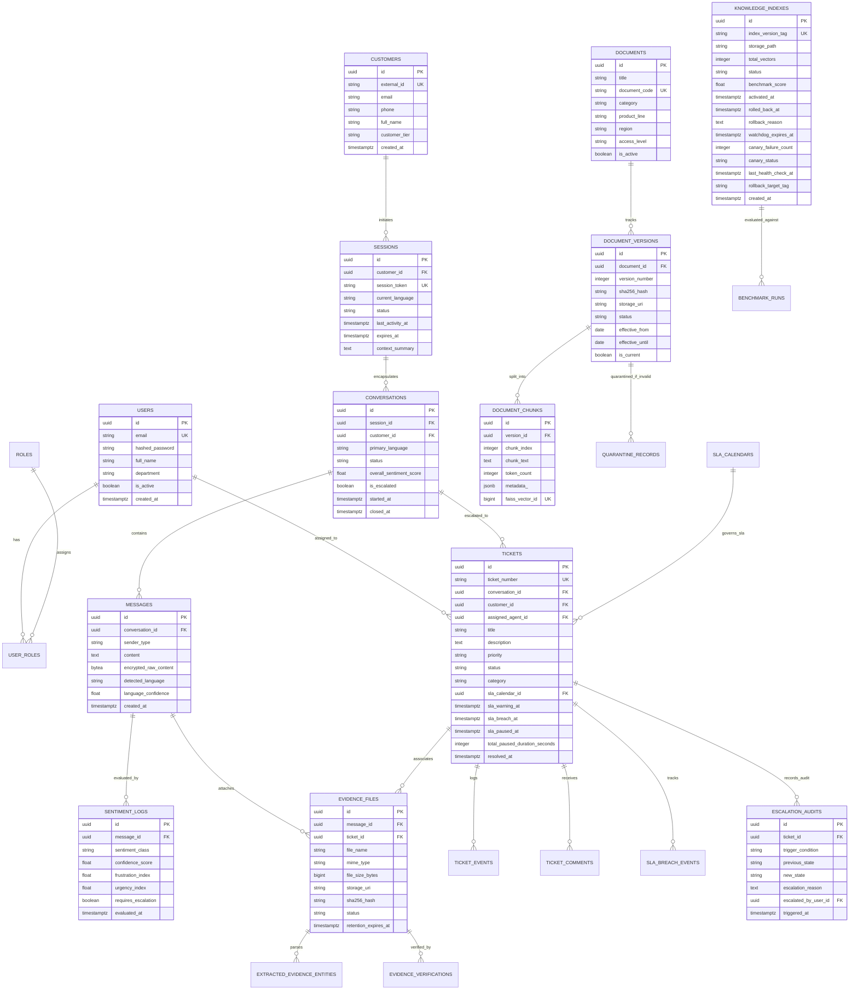

# Database Design Document
## Unified Intelligent Customer Support AI Platform

**Document Version:** 1.1.0  
**Target RDBMS:** PostgreSQL 16+  
**ORM / Data Layer:** SQLAlchemy 2.0 (AsyncIO) & Alembic Migrations  
**Status:** Approved Architectural Baseline (Day 01 Audit Corrections Applied)  

---

## 1. Database Philosophy & Design Principles

1. **Authoritative Single Source of Truth:** PostgreSQL is the only persistent, durable system of record. Vector indexes (FAISS), fast cache keys (Redis), and filesystem staging blobs are secondary projections that can be completely re-generated from PostgreSQL. Vectors map directly to 64-bit integer BIGINT primary vector IDs (`faiss_vector_id`).
2. **Strict Foreign Key Constraints & Referential Integrity:** Cascading deletes are restricted to strictly child artifacts (e.g., chunks deleted if a document version is expunged). Master transactional entities (Tickets, Conversations, Audits) use soft deletion (`is_deleted`, `deleted_at`) to preserve complete legal and operational audit trails.
3. **UUIDv4 Primary Keys & BIGINT Vector IDs:** Entity tables use universally unique identifiers (`UUIDv4`) to prevent ID enumeration attacks and simplify distributed data ingestion. Document chunks utilize a 64-bit `BIGINT` sequence for `faiss_vector_id` to integrate natively with FAISS `IndexIDMap2`.
4. **Timezone-Aware Timestamps:** Every timestamp column explicitly uses `TIMESTAMP WITH TIME ZONE` (`TIMESTAMPTZ`) initialized to UTC (`now()`).
5. **JSONB with GIN Indexing:** Flexible, semi-structured metadata (extracted evidence entities, RAG chunk metadata, ticket custom fields) is modeled using PostgreSQL `JSONB` with generalized inverted indexes (GIN) for high-performance key-value querying.
6. **Masked Content Default & Authenticated Encryption:** Dialog messages persist scrubbed/masked content by default (`content TEXT`). For compliance/forensic retention, raw content is stored in an encrypted byte column (`encrypted_raw_content BYTEA`) secured via application-layer AES-256-GCM.
7. **Durable Rollback & Watchdog Persistence:** In-memory FAISS indices are paired with persistent `knowledge_indexes` records tracking watchdog countdowns, failure counts, and canary statuses, surviving worker/process restarts.

---

## 2. Complete Entity-Relationship (ER) Diagram



---

## 3. Detailed Data Dictionaries & Table Definitions

### 3.1 Identity, RBAC & Customer Management

#### `users`
Internal enterprise users (administrators, agents, supervisors).
```sql
CREATE TABLE users (
    id UUID PRIMARY KEY DEFAULT gen_random_uuid(),
    email VARCHAR(255) NOT NULL UNIQUE,
    hashed_password VARCHAR(255) NOT NULL,
    full_name VARCHAR(255) NOT NULL,
    department VARCHAR(100) NOT NULL,
    skills TEXT[] DEFAULT '{}',
    max_active_tickets INT DEFAULT 5 NOT NULL,
    is_active BOOLEAN DEFAULT TRUE NOT NULL,
    is_on_call BOOLEAN DEFAULT FALSE NOT NULL,
    created_at TIMESTAMPTZ DEFAULT clock_timestamp() NOT NULL,
    updated_at TIMESTAMPTZ DEFAULT clock_timestamp() NOT NULL
);
CREATE INDEX idx_users_skills ON users USING GIN (skills);
CREATE INDEX idx_users_on_call ON users (is_on_call) WHERE is_active IS TRUE;
```

#### `roles` and `user_roles`
Normalized RBAC implementation supporting granular permission scopes.
```sql
CREATE TABLE roles (
    id UUID PRIMARY KEY DEFAULT gen_random_uuid(),
    name VARCHAR(50) NOT NULL UNIQUE,  -- 'ADMIN', 'SUPERVISOR', 'AGENT', 'AUDITOR'
    description TEXT,
    permissions JSONB DEFAULT '[]'::jsonb NOT NULL
);

CREATE TABLE user_roles (
    user_id UUID NOT NULL REFERENCES users(id) ON DELETE CASCADE,
    role_id UUID NOT NULL REFERENCES roles(id) ON DELETE CASCADE,
    assigned_at TIMESTAMPTZ DEFAULT clock_timestamp() NOT NULL,
    PRIMARY KEY (user_id, role_id)
);
```

#### `customers`
Customer profiles representing authenticated or recognized end-users.
```sql
CREATE TABLE customers (
    id UUID PRIMARY KEY DEFAULT gen_random_uuid(),
    external_id VARCHAR(128) UNIQUE,  -- E-commerce / CRM customer identifier
    email VARCHAR(255),
    phone VARCHAR(50),
    full_name VARCHAR(255),
    customer_tier VARCHAR(50) DEFAULT 'STANDARD' NOT NULL, -- 'STANDARD', 'VIP', 'ENTERPRISE'
    metadata_ JSONB DEFAULT '{}'::jsonb NOT NULL,
    created_at TIMESTAMPTZ DEFAULT clock_timestamp() NOT NULL,
    updated_at TIMESTAMPTZ DEFAULT clock_timestamp() NOT NULL
);
CREATE INDEX idx_customers_external_id ON customers(external_id);
CREATE INDEX idx_customers_email ON customers(email);
```

---

### 3.2 Sessions, Conversations & Real-Time Sentiment

#### `sessions`
Customer session tracking enforcing 30-minute inactivity expiration and 24-hour summary restoration.
```sql
CREATE TABLE sessions (
    id UUID PRIMARY KEY DEFAULT gen_random_uuid(),
    customer_id UUID REFERENCES customers(id) ON DELETE SET NULL,
    session_token VARCHAR(255) NOT NULL UNIQUE,
    current_language VARCHAR(10) DEFAULT 'en' NOT NULL,
    status VARCHAR(50) DEFAULT 'ACTIVE' NOT NULL, -- 'ACTIVE', 'IDLE_CLOSED', 'ARCHIVED'
    last_activity_at TIMESTAMPTZ DEFAULT clock_timestamp() NOT NULL,
    expires_at TIMESTAMPTZ NOT NULL,
    context_summary TEXT, -- Compact summary for 24h restoration
    created_at TIMESTAMPTZ DEFAULT clock_timestamp() NOT NULL
);
CREATE INDEX idx_sessions_token ON sessions(session_token);
CREATE INDEX idx_sessions_expires_at ON sessions(expires_at) WHERE status = 'ACTIVE';
```

#### `conversations`
Encapsulates an ongoing support thread within a customer session.
```sql
CREATE TABLE conversations (
    id UUID PRIMARY KEY DEFAULT gen_random_uuid(),
    session_id UUID NOT NULL REFERENCES sessions(id) ON DELETE CASCADE,
    customer_id UUID REFERENCES customers(id) ON DELETE SET NULL,
    primary_language VARCHAR(10) DEFAULT 'en' NOT NULL,
    status VARCHAR(50) DEFAULT 'OPEN' NOT NULL, -- 'OPEN', 'RESOLVED', 'ESCALATED', 'ABANDONED'
    overall_sentiment_score FLOAT DEFAULT 0.0 NOT NULL,
    is_escalated BOOLEAN DEFAULT FALSE NOT NULL,
    turn_count INT DEFAULT 0 NOT NULL,
    started_at TIMESTAMPTZ DEFAULT clock_timestamp() NOT NULL,
    last_message_at TIMESTAMPTZ DEFAULT clock_timestamp() NOT NULL,
    closed_at TIMESTAMPTZ
);
CREATE INDEX idx_conversations_status ON conversations(status);
CREATE INDEX idx_conversations_unresolved ON conversations(last_message_at) 
    WHERE status = 'OPEN' AND is_escalated IS FALSE;
```

#### `messages`
Individual dialog turns with PII redacting and language detection.
```sql
CREATE TABLE messages (
    id UUID PRIMARY KEY DEFAULT gen_random_uuid(),
    conversation_id UUID NOT NULL REFERENCES conversations(id) ON DELETE CASCADE,
    sender_type VARCHAR(20) NOT NULL, -- 'CUSTOMER', 'AI_AGENT', 'HUMAN_AGENT', 'SYSTEM'
    sender_id UUID, -- NULL if AI/SYSTEM, else references users(id) or customers(id)
    content TEXT NOT NULL, -- Masked content stored by default (GDPR / PCI-DSS compliance)
    encrypted_raw_content BYTEA, -- Optional AES-256-GCM encrypted raw content for compliance/forensic audit
    detected_language VARCHAR(10) DEFAULT 'en' NOT NULL,
    language_confidence FLOAT DEFAULT 1.0 NOT NULL,
    tokens_used INT DEFAULT 0,
    created_at TIMESTAMPTZ DEFAULT clock_timestamp() NOT NULL
);
CREATE INDEX idx_messages_conversation_created ON messages(conversation_id, created_at ASC);
```

#### `sentiment_logs`
Fine-grained multi-class sentiment predictions per customer message.
```sql
CREATE TABLE sentiment_logs (
    id UUID PRIMARY KEY DEFAULT gen_random_uuid(),
    message_id UUID NOT NULL UNIQUE REFERENCES messages(id) ON DELETE CASCADE,
    sentiment_class VARCHAR(30) NOT NULL, -- 'positive', 'neutral', 'negative', 'frustrated', 'urgent', 'sarcastic'
    confidence_score FLOAT NOT NULL,
    frustration_index FLOAT DEFAULT 0.0 NOT NULL,
    urgency_index FLOAT DEFAULT 0.0 NOT NULL,
    trajectory_slope FLOAT DEFAULT 0.0 NOT NULL, -- Slope of sentiment change over last 5 turns
    requires_escalation BOOLEAN DEFAULT FALSE NOT NULL,
    escalation_reason VARCHAR(255),
    evaluated_at TIMESTAMPTZ DEFAULT clock_timestamp() NOT NULL
);
CREATE INDEX idx_sentiment_requires_escalation ON sentiment_logs(requires_escalation) 
    WHERE requires_escalation IS TRUE;
```

---

### 3.3 Knowledge Base Governance & Vector Indexing

#### `documents` and `document_versions`
Authoritative document catalog supporting immutable versioning, temporal policies, and rollback.
```sql
CREATE TABLE documents (
    id UUID PRIMARY KEY DEFAULT gen_random_uuid(),
    title VARCHAR(500) NOT NULL,
    document_code VARCHAR(100) NOT NULL UNIQUE, -- E.g., 'POL-REFUND-US-2026'
    category VARCHAR(100) NOT NULL, -- 'POLICY', 'TROUBLESHOOTING', 'FAQ', 'PRODUCT_MANUAL'
    product_line VARCHAR(100) DEFAULT 'GLOBAL' NOT NULL,
    region VARCHAR(50) DEFAULT 'GLOBAL' NOT NULL, -- 'US', 'EU', 'APAC', 'GLOBAL'
    access_level VARCHAR(50) DEFAULT 'PUBLIC' NOT NULL, -- 'PUBLIC', 'REGISTERED', 'VIP', 'INTERNAL_AGENT'
    is_active BOOLEAN DEFAULT TRUE NOT NULL,
    created_at TIMESTAMPTZ DEFAULT clock_timestamp() NOT NULL,
    updated_at TIMESTAMPTZ DEFAULT clock_timestamp() NOT NULL
);

CREATE TABLE document_versions (
    id UUID PRIMARY KEY DEFAULT gen_random_uuid(),
    document_id UUID NOT NULL REFERENCES documents(id) ON DELETE CASCADE,
    version_number INT NOT NULL,
    sha256_hash VARCHAR(64) NOT NULL,
    storage_uri VARCHAR(1024) NOT NULL,
    status VARCHAR(50) DEFAULT 'STAGED' NOT NULL, -- 'STAGED', 'ACTIVE', 'SUPERSEDED', 'QUARANTINED'
    effective_from DATE NOT NULL,
    effective_until DATE, -- NULL indicates indefinite
    is_current BOOLEAN DEFAULT FALSE NOT NULL,
    created_by UUID REFERENCES users(id),
    created_at TIMESTAMPTZ DEFAULT clock_timestamp() NOT NULL,
    CONSTRAINT uq_doc_version UNIQUE (document_id, version_number)
);
CREATE INDEX idx_doc_versions_active ON document_versions(document_id, is_current) WHERE is_current IS TRUE;
CREATE INDEX idx_doc_versions_temporal ON document_versions(effective_from, effective_until);
```

#### `document_chunks`
Stores text segments and token-level chunking data mapped directly to 64-bit integer FAISS vector IDs.
```sql
CREATE SEQUENCE document_chunks_faiss_vector_id_seq START WITH 1 INCREMENT BY 1;

CREATE TABLE document_chunks (
    id UUID PRIMARY KEY DEFAULT gen_random_uuid(),
    version_id UUID NOT NULL REFERENCES document_versions(id) ON DELETE CASCADE,
    chunk_index INT NOT NULL,
    chunk_text TEXT NOT NULL,
    token_count INT NOT NULL,
    metadata_ JSONB NOT NULL, -- {product, region, access_level, effective_from, effective_until}
    faiss_vector_id BIGINT NOT NULL DEFAULT nextval('document_chunks_faiss_vector_id_seq') UNIQUE,
    created_at TIMESTAMPTZ DEFAULT clock_timestamp() NOT NULL
);
CREATE INDEX idx_document_chunks_version ON document_chunks(version_id);
CREATE INDEX idx_document_chunks_faiss_id ON document_chunks(faiss_vector_id);
CREATE INDEX idx_document_chunks_meta ON document_chunks USING GIN (metadata_);
```

#### `knowledge_indexes` and `benchmark_runs`
Manages FAISS snapshot promotions, golden benchmarks, and automated rollback triggers with restart-recoverable watchdog state.
```sql
CREATE TABLE knowledge_indexes (
    id UUID PRIMARY KEY DEFAULT gen_random_uuid(),
    index_version_tag VARCHAR(100) NOT NULL UNIQUE, -- E.g., 'idx_20261101_v1'
    storage_path VARCHAR(1024) NOT NULL,
    total_vectors INT NOT NULL,
    status VARCHAR(50) DEFAULT 'CANDIDATE' NOT NULL, -- 'CANDIDATE', 'CANDIDATE_READY', 'ACTIVE', 'PREVIOUS_ACTIVE', 'ROLLED_BACK'
    benchmark_score FLOAT, -- Grounding percentage from golden benchmark
    activated_at TIMESTAMPTZ,
    rolled_back_at TIMESTAMPTZ,
    rollback_reason TEXT,
    watchdog_expires_at TIMESTAMPTZ, -- Active 5-minute canary evaluation window end
    canary_failure_count INT DEFAULT 0 NOT NULL, -- Accumulated canary query failures
    canary_status VARCHAR(50) DEFAULT 'IDLE' NOT NULL, -- 'IDLE', 'MONITORING', 'PASSED', 'FAILED_ROLLED_BACK'
    last_health_check_at TIMESTAMPTZ,
    rollback_target_tag VARCHAR(100), -- Explicit snapshot tag to revert to if canary fails
    created_at TIMESTAMPTZ DEFAULT clock_timestamp() NOT NULL
);
CREATE INDEX idx_knowledge_indexes_watchdog ON knowledge_indexes(canary_status, watchdog_expires_at) 
    WHERE canary_status = 'MONITORING';

CREATE TABLE benchmark_runs (
    id UUID PRIMARY KEY DEFAULT gen_random_uuid(),
    index_id UUID NOT NULL REFERENCES knowledge_indexes(id) ON DELETE CASCADE,
    benchmark_suite_version VARCHAR(50) NOT NULL,
    total_queries INT NOT NULL,
    passed_queries INT NOT NULL,
    grounding_score FLOAT NOT NULL,
    latency_p95_ms FLOAT NOT NULL,
    is_passed BOOLEAN NOT NULL,
    diagnostics JSONB DEFAULT '{}'::jsonb NOT NULL,
    executed_at TIMESTAMPTZ DEFAULT clock_timestamp() NOT NULL
);
```

---

### 3.4 Multimodal Evidence & Verification

#### `evidence_files`
Uploaded receipts, screenshots, and PDFs with persistent staging before task dispatch and automated TTL purge.
```sql
CREATE TABLE evidence_files (
    id UUID PRIMARY KEY DEFAULT gen_random_uuid(),
    message_id UUID REFERENCES messages(id) ON DELETE SET NULL,
    ticket_id UUID, -- Linked when ticket is synthesized
    file_name VARCHAR(255) NOT NULL,
    mime_type VARCHAR(100) NOT NULL,
    file_size_bytes BIGINT NOT NULL,
    storage_uri VARCHAR(1024) NOT NULL, -- Persistently staged on disk before Celery task dispatch
    sha256_hash VARCHAR(64) NOT NULL,
    status VARCHAR(50) DEFAULT 'STAGED' NOT NULL, -- 'STAGED', 'ANALYZING', 'VERIFIED', 'CLAIM_CONFLICT', 'FLAGGED_UNSAFE', 'PURGED', 'EXPIRED'
    is_malicious BOOLEAN DEFAULT FALSE NOT NULL,
    quarantine_reason TEXT,
    retention_expires_at TIMESTAMPTZ NOT NULL, -- Configurable TTL (default now() + interval '30 days')
    created_at TIMESTAMPTZ DEFAULT clock_timestamp() NOT NULL
);
CREATE INDEX idx_evidence_retention ON evidence_files(retention_expires_at) WHERE status NOT IN ('PURGED', 'EXPIRED');
```

#### `extracted_evidence_entities` & `evidence_verifications`
Structured entities parsed by Gemini Vision / OCR and compared against claims.
```sql
CREATE TABLE extracted_evidence_entities (
    id UUID PRIMARY KEY DEFAULT gen_random_uuid(),
    evidence_file_id UUID NOT NULL REFERENCES evidence_files(id) ON DELETE CASCADE,
    extracted_order_id VARCHAR(100),
    extracted_date DATE,
    extracted_amount NUMERIC(12, 2),
    extracted_currency VARCHAR(10),
    extracted_product_sku VARCHAR(100),
    extracted_error_code VARCHAR(100),
    raw_ocr_text TEXT,
    ocr_confidence FLOAT NOT NULL,
    pii_redacted_text TEXT NOT NULL,
    extraction_metadata JSONB DEFAULT '{}'::jsonb NOT NULL,
    extracted_at TIMESTAMPTZ DEFAULT clock_timestamp() NOT NULL
);

CREATE TABLE evidence_verifications (
    id UUID PRIMARY KEY DEFAULT gen_random_uuid(),
    evidence_file_id UUID NOT NULL REFERENCES evidence_files(id) ON DELETE CASCADE,
    claim_text TEXT NOT NULL,
    matches_order_id BOOLEAN,
    matches_amount BOOLEAN,
    matches_product BOOLEAN,
    overall_match_status VARCHAR(50) NOT NULL, -- 'VERIFIED_MATCH', 'PARTIAL_MISMATCH', 'TOTAL_CONFLICT', 'LOW_QUALITY'
    clarification_prompt TEXT, -- Generated prompt if mismatch / low quality
    verified_at TIMESTAMPTZ DEFAULT clock_timestamp() NOT NULL
);
```

---

### 3.5 Intelligent Support Ticketing & SLA Engine

#### `sla_calendars`
Configuration table for excluding business non-working hours, weekends, and regional holidays.
```sql
CREATE TABLE sla_calendars (
    id UUID PRIMARY KEY DEFAULT gen_random_uuid(),
    name VARCHAR(100) NOT NULL UNIQUE, -- E.g., 'US_COMMERCIAL_HOURS'
    timezone VARCHAR(50) DEFAULT 'UTC' NOT NULL,
    work_start_time TIME DEFAULT '09:00:00' NOT NULL,
    work_end_time TIME DEFAULT '17:00:00' NOT NULL,
    work_days INT[] DEFAULT '{1,2,3,4,5}' NOT NULL, -- 1=Monday, 7=Sunday
    holidays JSONB DEFAULT '[]'::jsonb NOT NULL, -- Array of ISO dates ['2026-11-26', '2026-12-25']
    created_at TIMESTAMPTZ DEFAULT clock_timestamp() NOT NULL
);
```

#### `tickets`
Central helpdesk entity with dynamic priority, smart routing, calendar-aware SLA, and configurable `PENDING_CUSTOMER` pause handling.
```sql
CREATE TABLE tickets (
    id UUID PRIMARY KEY DEFAULT gen_random_uuid(),
    ticket_number VARCHAR(32) NOT NULL UNIQUE, -- E.g., 'TCK-202611-00042'
    conversation_id UUID REFERENCES conversations(id) ON DELETE SET NULL,
    customer_id UUID NOT NULL REFERENCES customers(id),
    assigned_agent_id UUID REFERENCES users(id) ON DELETE SET NULL,
    title VARCHAR(500) NOT NULL,
    description TEXT NOT NULL,
    masked_summary TEXT NOT NULL, -- PII-free handoff summary
    priority VARCHAR(20) DEFAULT 'MEDIUM' NOT NULL, -- 'LOW', 'MEDIUM', 'HIGH', 'CRITICAL', 'URGENT'
    priority_score FLOAT DEFAULT 2.5 NOT NULL, -- Calculated dynamic score 1.0 - 5.0
    status VARCHAR(50) DEFAULT 'OPEN' NOT NULL, -- 'OPEN', 'PENDING_CUSTOMER', 'IN_PROGRESS', 'RESOLVED', 'ESCALATED', 'CLOSED'
    category VARCHAR(100) NOT NULL,
    cluster_group_id UUID, -- For deduplication and grouping
    sla_calendar_id UUID NOT NULL REFERENCES sla_calendars(id),
    sla_target_minutes INT NOT NULL,
    sla_warning_at TIMESTAMPTZ NOT NULL, -- 75% SLA threshold
    sla_breach_at TIMESTAMPTZ NOT NULL,  -- 100% SLA deadline
    sla_warning_sent BOOLEAN DEFAULT FALSE NOT NULL,
    sla_breached BOOLEAN DEFAULT FALSE NOT NULL,
    sla_paused_at TIMESTAMPTZ, -- Timestamp when ticket entered PENDING_CUSTOMER (pausing countdown)
    total_paused_duration_seconds INT DEFAULT 0 NOT NULL, -- Cumulative pause duration added to deadlines
    resolved_at TIMESTAMPTZ,
    closed_at TIMESTAMPTZ,
    created_at TIMESTAMPTZ DEFAULT clock_timestamp() NOT NULL,
    updated_at TIMESTAMPTZ DEFAULT clock_timestamp() NOT NULL
);
CREATE INDEX idx_tickets_status ON tickets(status);
CREATE INDEX idx_tickets_assigned_agent ON tickets(assigned_agent_id) WHERE status IN ('OPEN', 'IN_PROGRESS');
CREATE INDEX idx_tickets_sla_warning ON tickets(sla_warning_at) WHERE sla_warning_sent IS FALSE AND status IN ('OPEN', 'IN_PROGRESS');
CREATE INDEX idx_tickets_sla_breach ON tickets(sla_breach_at) WHERE sla_breached IS FALSE AND status IN ('OPEN', 'IN_PROGRESS');
```

#### `escalation_audits`
Deterministic audit logging for all manual and automated ticket escalations.
```sql
CREATE TABLE escalation_audits (
    id UUID PRIMARY KEY DEFAULT gen_random_uuid(),
    ticket_id UUID NOT NULL REFERENCES tickets(id) ON DELETE CASCADE,
    trigger_condition VARCHAR(100) NOT NULL, -- 'SLA_BREACH', 'SENTIMENT_FRUSTRATION', 'HIGH_RISK_SAFETY', 'INACTIVITY_TIMEOUT', 'MANUAL_OVERRIDE'
    previous_state VARCHAR(50) NOT NULL,
    new_state VARCHAR(50) NOT NULL,
    escalation_reason TEXT NOT NULL,
    escalation_payload JSONB DEFAULT '{}'::jsonb NOT NULL,
    escalated_by_user_id UUID REFERENCES users(id), -- NULL if system-triggered
    triggered_at TIMESTAMPTZ DEFAULT clock_timestamp() NOT NULL
);
CREATE INDEX idx_escalation_audits_ticket ON escalation_audits(ticket_id);
```

---

## 4. Migration Strategy with Alembic

1. **Deterministic Branching & Revision Tree:**
   All schema modifications reside in `backend/alembic/versions/`. Migrations must declare both `upgrade()` and `downgrade()` methods.
2. **Pre-Deployment Safety Checks:**
   Migrations run automatically in CI test containers before production container startup via:
   ```bash
   alembic upgrade head
   ```
3. **Zero-Downtime Migration Policy:**
   - Additive changes (new tables, new nullable columns) are applied first.
   - Destructive operations (column drops, renames) require a two-phase rollout using database views or deprecated shadow columns.
