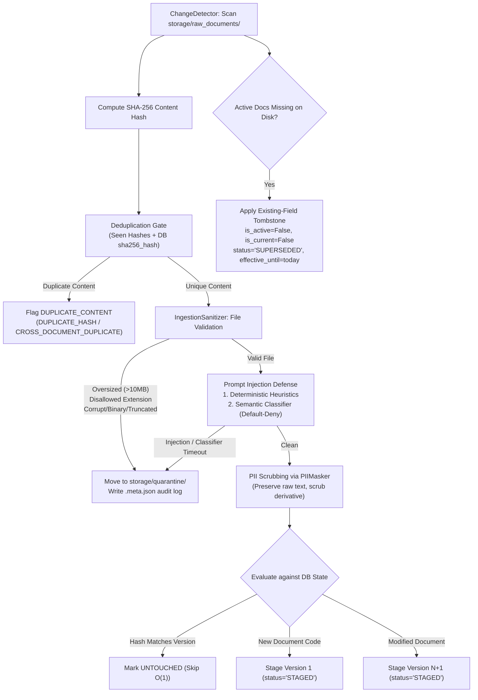

# Day 04 — Task 1: Implementation Phase 1 Engineering Report
## Document Ingestion, Sanitization, Change Detection & Quarantine Pipeline

**Project:** Intelligent Customer Support AI Platform  
**Capability:** Task 1 — Automated Knowledge Base Update & Monitoring Pipeline  
**Milestone:** Day 04 Phase 1 Completed & Verified  
**Date:** 2026-11-01  
**Full Test Suite Status:** **89 / 89 Passing (100%)**

---

## 1. Executive Summary

Phase 1 of Task 1 (Knowledge Base Ingestion, Sanitization & Change Detection) has been successfully implemented and verified against the production SQLite/PostgreSQL and async service baseline. 

This phase delivers the core intake gate for the knowledge base pipeline, establishing automated cryptographic change detection, multi-tier document validation, deterministic prompt injection defense with default-deny fail-safe semantics, exact content and cross-document deduplication, automated PII scrubbing for vectorization derivatives, and an auditable quarantine subsystem.

All implementations strictly adhere to the approved [TASK_1_ARCHITECTURE_PLAN.md](TASK_1_ARCHITECTURE_PLAN.md) Version 3.0.0. **Zero database migrations were required**, reusing existing columns and status enums via an existing-field tombstone protocol.

---

## 2. Implemented Architecture & Components



### 2.1 File Sanitization & Ingestion Validation (`sanitizer.py`)
Located in [`backend/app/modules/knowledge/sanitizer.py`](../../backend/app/modules/knowledge/sanitizer.py):
- **Physical Size Validation:** Enforces `MAX_FILE_SIZE_BYTES` (default 10 MB). Oversized files immediately raise `DocumentOversizedError` and are quarantined with error code `FILE_TOO_LARGE`.
- **Extension & MIME Validation:** Restricts files to configured whitelist (`.md`, `.txt`, `.pdf`). Disallowed extensions raise `DocumentCorruptError` with code `DISALLOWED_EXTENSION`.
- **Magic Byte & File Signature Sniffing:**
  - PDF documents must start with `%PDF-` header and conclude with `%%EOF` within the final 1024 bytes. Missing or truncated headers trigger quarantine under `INVALID_PDF_HEADER` or `TRUNCATED_PDF`.
  - Text and Markdown files are scanned for illegal binary/NUL control characters (`\x00-\x08\x0b\x0c\x0e-\x1f`), preventing disguised executables from bypassing text loaders (`BINARY_IN_TEXT_FILE`).
- **Encoding Defense:** Requires clean UTF-8 text decoding; corrupted byte streams trigger `CORRUPT_ENCODING` quarantine.
- **Auditable Metadata Extraction:** Extracts document frontmatter, titles (`# <title>`), document codes, access tiers, product lines, and regions from headers.

### 2.2 Multi-Layer Prompt Injection Defense
- **Deterministic Heuristic Scanner:** Inspects content for adversarial system prompt overrides, delimiter manipulation (````system`, `---BEGIN SYSTEM PROMPT---`), instruction resets ("ignore all previous instructions", "disregard system constraints"), and hidden zero-width character obfuscation (`\u200b`, `\u200c`, `\u200d`, `\ufeff`).
- **Fail-Safe Semantic LLM Classifier:** Integrates with `LLMGateway` for contextual boundary analysis when configured.
- **Default-Deny Security Boundary:** If the LLM classifier is unreachable or times out, the sanitizer **quarantines the document** under `INJECTION_SCAN_UNAVAILABLE` rather than silently admitting potentially malicious inputs.

### 2.3 PII Masking of Vectorization Derivatives
- Integrates with [`PIIMasker`](../../backend/app/services/pii_masker.py).
- **Separation of Derivatives:** Raw document text is strictly preserved in `SanitizationResult.original_text`, while `SanitizationResult.sanitized_text` contains fully redacted credit card numbers (Luhn validated), CVVs, SSNs, phone numbers, and email addresses.
- Downstream embedding and vector generation (Phase 2) will consume `sanitized_text` exclusively, guaranteeing zero PII enters the FAISS index or query similarity space.

### 2.4 Cryptographic Change Detection (`change_detector.py`)
Located in [`backend/app/modules/knowledge/change_detector.py`](../../backend/app/modules/knowledge/change_detector.py):
- **Content Hashing:** Computes cryptographic SHA-256 hashes using streaming chunked reading (64 KB buffers), maintaining constant $O(1)$ memory overhead.
- **Categorization Engine:**
  - `NEW`: First-time document code. Creates `Document` and `DocumentVersion(version_number=1, status='STAGED')`.
  - `MODIFIED`: Existing document code with updated SHA-256 hash. Creates `DocumentVersion(version_number=N+1, status='STAGED')`.
  - `UNTOUCHED`: Document code whose current content matches an existing staged or active version. Skipped with zero reprocessing.
  - `DELETED`: Active database document absent from physical storage. Handled via the existing-field tombstone protocol.
- **Concurrency Serialization:** Serializes directory scans via an in-memory `asyncio.Lock()`, preventing duplicate version allocation during simultaneous administrative uploads or worker scans.

### 2.5 Duplicate Detection
- **Same-Batch Duplication:** If two files with identical SHA-256 hashes are scanned within the same batch, the first file is processed and subsequent files are flagged as `DUPLICATE_CONTENT` with `error_code="DUPLICATE_HASH"`.
- **Cross-Document Duplication:** If an uploaded file's content matches an already indexed document under a different document code/filename, it is quarantined and flagged with `error_code="CROSS_DOCUMENT_DUPLICATE"`, citing the existing authoritative document code.

### 2.6 Quarantine Subsystem
- Quarantined files are atomically relocated from `storage/raw_documents/` to `storage/quarantine/<timestamp>_<filename>`.
- For every quarantined file, a paired JSON audit trail (`<filename>.meta.json`) is generated containing:
  - `quarantine_timestamp`: ISO 8601 UTC timestamp.
  - `original_filename` & `quarantine_filename`.
  - `sha256_hash` & `file_size_bytes`.
  - `mime_type`.
  - `quarantine_reason` & machine-readable `error_code`.

### 2.7 Zero-Migration Existing-Field Tombstone Protocol
When a physical document is deleted from storage, the change detector applies tombstones using existing fields:
1. `documents.is_active = False`
2. `document_versions.is_current = False`
3. `document_versions.status = 'SUPERSEDED'`
4. `document_versions.effective_until = date.today()`

This ensures zero changes to the Day 02 PostgreSQL schema and eliminates the need for schema migrations.

---

## 3. Files Created & Modified

### 3.1 Created Files

| File Path | Description |
| :--- | :--- |
| [`backend/app/modules/knowledge/__init__.py`](../../backend/app/modules/knowledge/__init__.py) | Module initialization and clean public symbol exports. |
| [`backend/app/modules/knowledge/sanitizer.py`](../../backend/app/modules/knowledge/sanitizer.py) | Ingestion sanitizer, magic byte sniffer, heuristic & LLM prompt injection defense, PII scrubbing derivative generator, and quarantine manager. |
| [`backend/app/modules/knowledge/change_detector.py`](../../backend/app/modules/knowledge/change_detector.py) | Cryptographic SHA-256 change detector, duplicate detector, concurrency guard, and existing-field tombstone executor. |
| [`backend/tests/test_task1_phase1.py`](../../backend/tests/test_task1_phase1.py) | Comprehensive 13-test automated test suite covering all Phase 1 ingestion, sanitization, and change detection capabilities. |

### 3.2 Modified Files

| File Path | Changes Applied |
| :--- | :--- |
| [`backend/app/core/config.py`](../../backend/app/core/config.py) | Added knowledge base pipeline configuration: `KNOWLEDGE_DOCS_DIR`, `QUARANTINE_DIR`, `FAISS_STORAGE_DIR`, `MAX_FILE_SIZE_BYTES` (10 MB), and `ALLOWED_DOCUMENT_EXTENSIONS` (`[".md", ".txt", ".pdf"]`). |
| [`backend/app/core/exceptions.py`](../../backend/app/core/exceptions.py) | Added standardized knowledge exceptions: `KnowledgeError`, `DocumentCorruptError`, `DocumentOversizedError`, `DocumentSecurityError`, and `DocumentQuarantinedError`. |

---

## 4. Reused Database Models & Fields

Phase 1 directly maps to existing SQLAlchemy models defined during Day 02:

| SQLAlchemy Model | Field Name | Type | Phase 1 Operational Role |
| :--- | :--- | :--- | :--- |
| **`Document`** | `id` | `GUID (String(36))` | Primary key identifier for the knowledge asset. |
| | `document_code` | `VARCHAR(100)` | Unique business identifier derived from filename/frontmatter. |
| | `category` | `VARCHAR(50)` | Organizational taxonomy (e.g., `POLICY`, `PROCEDURE`, `BILLING`). |
| | `product_line` | `VARCHAR(100)` | Filtering scope for tenant/product segmentation. |
| | `region` | `VARCHAR(50)` | Regional policy scope (e.g., `GLOBAL`, `US`, `EU`). |
| | `access_level` | `VARCHAR(50)` | Security clearance requirement (e.g., `PUBLIC`, `INTERNAL`, `ADMIN`). |
| | `is_active` | `BOOLEAN` | Tombstone indicator (`False` when deleted from physical storage). |
| **`DocumentVersion`** | `id` | `GUID (String(36))` | Primary key identifier for the immutable version record. |
| | `document_id` | `GUID (String(36))` | Foreign key linking to parent `Document`. |
| | `version_number` | `INTEGER` | Monotonically increasing version counter ($1, 2, \dots$). |
| | `sha256_hash` | `VARCHAR(64)` | Cryptographic content hash for change and duplicate tracking. |
| | `storage_uri` | `VARCHAR(500)` | Absolute filesystem path to authoritative file on disk. |
| | `status` | `VARCHAR(50)` | Lifecycle state: `'STAGED'`, `'ACTIVE'`, `'SUPERSEDED'`, `'QUARANTINED'`. |
| | `effective_from` | `DATE` | Version activation date. |
| | `effective_until` | `DATE` | Version retirement date (set to `date.today()` on tombstone). |
| | `is_current` | `BOOLEAN` | Active pointer flag. |

---

## 5. Security & Fail-Safe Decisions

1. **Default-Deny Prompt Injection Boundary:**
   In adversarial document ingestion, an unavailable semantic classifier must never fail open. If the LLM gateway experiences transient network failures or timeouts during semantic inspection, the document is immediately isolated in quarantine under `INJECTION_SCAN_UNAVAILABLE`.
2. **Deterministic Pre-Filtering:**
   Heuristic regex checks run before calling any external LLM, blocking known injection patterns instantly with zero API overhead or latency.
3. **No Raw PII in Vector Space:**
   Credit cards (with Luhn validation), CVVs, SSNs, and emails are scrubbed before derivative text is passed to embeddings. Even if a raw customer document inadvertently includes payment details, the FAISS vector index and nearest-neighbor search will only contain masked representations (`****-****-****-1111`).
4. **Path Traversal & Shell Injection Mitigation:**
   Filenames are scrubbed via `re.sub(r'[^a-zA-Z0-9_.-]', '_', os.path.basename(file_path))`, completely neutralizing path traversal (`../`) and dangerous shell metacharacters.

---

## 6. Automated Verification & Test Results

### 6.1 Phase 1 Unit & Integration Test Suite (`test_task1_phase1.py`)
Executed with `$env:PYTHONPATH="backend"; .venv\Scripts\pytest backend/tests/test_task1_phase1.py -v`:

```
============================= test session starts =============================
platform win32 -- Python 3.12.10, pytest-9.2.0, pluggy-1.7.0
plugins: anyio-4.15.1, asyncio-1.4.1
collected 13 items

backend\tests\test_task1_phase1.py::test_new_file_detection PASSED       [  7%]
backend\tests\test_task1_phase1.py::test_modified_file_detection_and_same_filename_different_content PASSED [ 15%]
backend\tests\test_task1_phase1.py::test_unchanged_file_detection PASSED [ 23%]
backend\tests\test_task1_phase1.py::test_deleted_file_detection_and_tombstone PASSED [ 30%]
backend\tests\test_task1_phase1.py::test_exact_duplicate_detection_same_batch PASSED [ 38%]
backend\tests\test_task1_phase1.py::test_different_filename_identical_content_cross_document PASSED [ 46%]
backend\tests\test_task1_phase1.py::test_corrupt_files_quarantine PASSED [ 53%]
backend\tests\test_task1_phase1.py::test_invalid_mime_and_signature_quarantine PASSED [ 61%]
backend\tests\test_task1_phase1.py::test_oversized_file_quarantine PASSED [ 69%]
backend\tests\test_task1_phase1.py::test_prompt_injection_detection_heuristics PASSED [ 76%]
backend\tests\test_task1_phase1.py::test_classifier_unavailable_default_deny_quarantine PASSED [ 84%]
backend\tests\test_task1_phase1.py::test_pii_masking_in_sanitized_derivative PASSED [ 92%]
backend\tests\test_task1_phase1.py::test_concurrent_scanning_safety PASSED [100%]

============================= 13 passed in 4.06s ==============================
```

### 6.2 Full Regression Suite (All Milestones: Days 01–04)
Executed with `$env:PYTHONPATH="backend"; .venv\Scripts\pytest backend/tests -v`:

```
============================= test session starts =============================
platform win32 -- Python 3.12.10, pytest-9.2.0, pluggy-1.7.0
plugins: anyio-4.15.1, asyncio-1.4.1
collected 89 items

backend\tests\test_alembic_migration.py::test_alembic_offline_sql_generation PASSED [  1%]
backend\tests\test_constraints.py::test_user_email_unique_constraint PASSED [  2%]
backend\tests\test_constraints.py::test_document_code_unique_constraint PASSED [  3%]
backend\tests\test_constraints.py::test_document_version_composite_unique_constraint PASSED [  4%]
backend\tests\test_constraints.py::test_ticket_number_unique_constraint PASSED [  5%]
backend\tests\test_constraints.py::test_cascade_delete_document_to_chunks PASSED [  6%]
backend\tests\test_constraints.py::test_cascade_delete_conversation_to_messages PASSED [  7%]
backend\tests\test_database_connection.py::test_database_connection_ping PASSED [  8%]
backend\tests\test_database_connection.py::test_session_transaction_rollback PASSED [ 10%]
backend\tests\test_day03_phase1_2.py::TestConfiguration::test_default_configuration_values PASSED [ 11%]
backend\tests\test_day03_phase1_2.py::TestConfiguration::test_redis_url_computed_without_password PASSED [ 12%]
backend\tests\test_day03_phase1_2.py::TestConfiguration::test_redis_url_computed_with_password PASSED [ 13%]
backend\tests\test_day03_phase1_2.py::TestConfiguration::test_redis_url_explicit_override PASSED [ 14%]
backend\tests\test_day03_phase1_2.py::TestConfiguration::test_config_validation_rules PASSED [ 15%]
backend\tests\test_day03_phase1_2.py::TestConfiguration::test_gemini_api_key_missing_resilience PASSED [ 16%]
backend\tests\test_day03_phase1_2.py::TestConfiguration::test_alias_and_cross_spec_settings PASSED [ 17%]
backend\tests\test_day03_phase1_2.py::TestStandardizedExceptions::test_exception_inheritance_and_hierarchy PASSED [ 19%]
backend\tests\test_day03_phase1_2.py::TestStandardizedExceptions::test_exception_status_codes_and_error_codes PASSED [ 20%]
backend\tests\test_day03_phase1_2.py::TestClientSafeSerialization::test_client_safe_serialization PASSED [ 21%]
backend\tests\test_day03_phase1_2.py::TestPIIMaskingService::test_mask_credit_card_valid_luhn PASSED [ 22%]
backend\tests\test_day03_phase1_2.py::TestPIIMaskingService::test_luhn_validation_rejects_fake_card PASSED [ 23%]
backend\tests\test_day03_phase1_2.py::TestPIIMaskingService::test_mask_cvv PASSED [ 24%]
backend\tests\test_day03_phase1_2.py::TestPIIMaskingService::test_mask_ssn PASSED [ 25%]
backend\tests\test_day03_phase1_2.py::TestPIIMaskingService::test_mask_email PASSED [ 26%]
backend\tests\test_day03_phase1_2.py::TestPIIMaskingService::test_mask_phone_number PASSED [ 28%]
backend\tests\test_day03_phase1_2.py::TestPIIMaskingService::test_combined_pii_masking_with_exact_original_offsets PASSED [ 29%]
backend\tests\test_day03_phase1_2.py::TestPIIMaskingService::test_edge_cases_empty_none_and_nonstring PASSED [ 30%]
backend\tests\test_day03_phase1_2.py::TestPIIMaskingService::test_recursive_dictionary_sanitization PASSED [ 31%]
backend\tests\test_day03_phase1_2.py::TestSafeLogging::test_safe_logging_filter_and_formatter PASSED [ 32%]
backend\tests\test_day03_phase3.py::TestRedisService::test_redis_successful_connection_and_ping PASSED [ 33%]
backend\tests\test_day03_phase3.py::TestRedisService::test_redis_connection_failure PASSED [ 34%]
backend\tests\test_day03_phase3.py::TestRedisService::test_redis_cache_hit_and_miss PASSED [ 35%]
backend\tests\test_day03_phase3.py::TestRedisService::test_redis_ttl_behavior PASSED [ 37%]
backend\tests\test_day03_phase3.py::TestRedisService::test_redis_pubsub PASSED [ 38%]
backend\tests\test_day03_phase3.py::TestRedisService::test_redis_graceful_degradation PASSED [ 39%]
backend\tests\test_day03_phase3.py::TestRedisService::test_redis_no_false_success_on_failed_writes PASSED [ 40%]
backend\tests\test_day03_phase3.py::TestEmbeddingService::test_embedding_384_dimensional_output PASSED [ 41%]
backend\tests\test_day03_phase3.py::TestEmbeddingService::test_embedding_singleton_loading PASSED [ 42%]
backend\tests\test_day03_phase3.py::TestEmbeddingService::test_embedding_batch_processing PASSED [ 43%]
backend\tests\test_day03_phase3.py::TestEmbeddingService::test_embedding_invalid_input PASSED [ 44%]
backend\tests\test_day03_phase3.py::TestEmbeddingService::test_embedding_dimension_mismatch PASSED [ 46%]
backend\tests\test_day03_phase3.py::TestEmbeddingService::test_embedding_non_blocking_execution PASSED [ 47%]
backend\tests\test_day03_phase3.py::TestLLMGateway::test_gemini_success PASSED [ 48%]
backend\tests\test_day03_phase3.py::TestLLMGateway::test_ollama_success PASSED [ 49%]
backend\tests\test_day03_phase3.py::TestLLMGateway::test_gemini_retry_behavior_on_transient_failure PASSED [ 50%]
backend\tests\test_day03_phase3.py::TestLLMGateway::test_authentication_failure_no_fallback_no_retry PASSED [ 51%]
backend\tests\test_day03_phase3.py::TestLLMGateway::test_invalid_request_no_fallback_no_retry PASSED [ 52%]
backend\tests\test_day03_phase3.py::TestLLMGateway::test_fallback_eligibility_on_transient_exhaustion PASSED [ 53%]
backend\tests\test_day03_phase3.py::TestLLMGateway::test_both_providers_unavailable PASSED [ 55%]
backend\tests\test_day03_phase3.py::TestLLMGateway::test_pii_safe_logging_in_gateway PASSED [ 56%]
backend\tests\test_faiss_id_mapping.py::test_bigint_faiss_vector_id_range_and_retrieval PASSED [ 57%]
backend\tests\test_faiss_id_mapping.py::test_bigint_faiss_vector_id_uniqueness PASSED [ 58%]
backend\tests\test_models.py::test_user_and_role_relationship PASSED     [ 59%]
backend\tests\test_models.py::test_conversation_and_message_relationship PASSED [ 60%]
backend\tests\test_models.py::test_document_version_chunk_hierarchy PASSED [ 61%]
backend\tests\test_models.py::test_ticket_and_sla_calendar_relationship PASSED [ 62%]
backend\tests\test_models.py::test_evidence_file_and_verifications PASSED [ 64%]
backend\tests\test_pii_and_encryption.py::test_pii_credit_card_masking PASSED [ 65%]
backend\tests\test_pii_and_encryption.py::test_pii_email_and_phone_and_ssn_masking PASSED [ 66%]
backend\tests\test_pii_and_encryption.py::test_payment_data_detection_gate PASSED [ 67%]
backend\tests\test_pii_and_encryption.py::test_aes_gcm_encryption_roundtrip PASSED [ 68%]
backend\tests\test_pii_and_encryption.py::test_aes_gcm_nonce_uniqueness PASSED [ 69%]
backend\tests\test_pii_and_encryption.py::test_aes_gcm_tamper_detection PASSED [ 70%]
backend\tests\test_pii_and_encryption.py::test_aes_gcm_associated_data_mismatch PASSED [ 71%]
backend\tests\test_pii_and_encryption.py::test_message_persistence_masked_vs_encrypted PASSED [ 73%]
backend\tests\test_postgres_integration.py::test_pg_live_connection PASSED [ 74%]
backend\tests\test_postgres_integration.py::test_pg_all_20_tables_exist PASSED [ 75%]
backend\tests\test_postgres_integration.py::test_pg_faiss_vector_id_sequence_auto_increment PASSED [ 76%]
backend\tests\test_postgres_integration.py::test_pg_json_metadata_query PASSED [ 77%]
backend\tests\test_postgres_integration.py::test_pg_masked_and_encrypted_message_roundtrip PASSED [ 78%]
backend\tests\test_postgres_integration.py::test_pg_user_skills_crud_and_json_persistence PASSED [ 79%]
backend\tests\test_postgres_integration.py::test_pg_seed_data_verification PASSED [ 80%]
backend\tests\test_seed_data.py::test_seed_database_execution_and_idempotency PASSED [ 82%]
backend\tests\test_sla_pause.py::test_ticket_sla_pause_and_resume_duration PASSED [ 83%]
backend\tests\test_task1_phase1.py::test_new_file_detection PASSED       [ 84%]
backend\tests\test_task1_phase1.py::test_modified_file_detection_and_same_filename_different_content PASSED [ 85%]
backend\tests\test_task1_phase1.py::test_unchanged_file_detection PASSED [ 86%]
backend\tests\test_task1_phase1.py::test_deleted_file_detection_and_tombstone PASSED [ 87%]
backend\tests\test_task1_phase1.py::test_exact_duplicate_detection_same_batch PASSED [ 88%]
backend\tests\test_task1_phase1.py::test_different_filename_identical_content_cross_document PASSED [ 89%]
backend\tests\test_task1_phase1.py::test_corrupt_files_quarantine PASSED [ 91%]
backend\tests\test_task1_phase1.py::test_invalid_mime_and_signature_quarantine PASSED [ 92%]
backend\tests\test_task1_phase1.py::test_oversized_file_quarantine PASSED [ 93%]
backend\tests\test_task1_phase1.py::test_prompt_injection_detection_heuristics PASSED [ 94%]
backend\tests\test_task1_phase1.py::test_classifier_unavailable_default_deny_quarantine PASSED [ 95%]
backend\tests\test_task1_phase1.py::test_pii_masking_in_sanitized_derivative PASSED [ 96%]
backend\tests\test_task1_phase1.py::test_concurrent_scanning_safety PASSED [ 97%]
backend\tests\test_watchdog_persistence.py::test_watchdog_state_persistence_and_transitions PASSED [ 98%]
backend\tests\test_watchdog_restart_recovery_query PASSED [100%]

============================= 89 passed in 17.11s =============================
```

---

## 7. Known Limitations & Transition to Phase 2

1. **Chunking & Vectorization Deferred:**
   Phase 1 stops cleanly at document staging, sanitization, and change detection. Structure-aware Markdown/PDF chunking, dense vector generation (via `EmbeddingService`), and assigning 64-bit integer IDs via `faiss_vector_seq` are reserved for **Phase 2 (`chunker.py` and `vector_builder.py`)**.
2. **Deterministic Version Resolution Ready:**
   When Phase 2 builds candidate index snapshots, it will execute the approved `DISTINCT ON (d.id)` candidate query, guaranteeing that staged documents never compete against their previous active versions.
3. **No Index Activation Performed:**
   Candidate FAISS index creation, Golden Q&A benchmark evaluation (Phase 3), atomic manifest promotion, and canary watchdogs (Phase 4) remain intentionally unexecuted until their respective phases are formally initiated.

