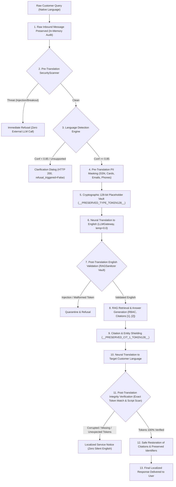
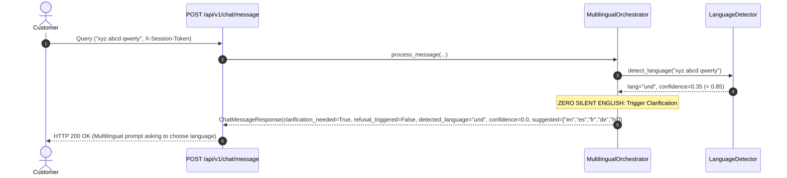
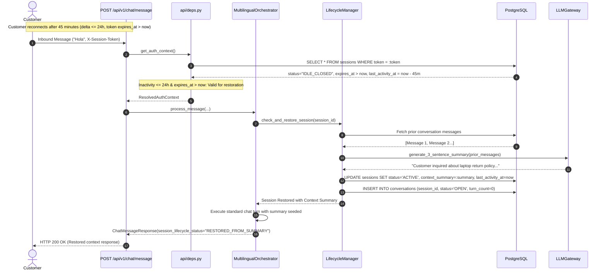

# DAY 07 — TASK 6: MULTILINGUAL SUPPORT & CONVERSATION LIFECYCLE
## Final Architecture Specification & Implementation Plan

- **Document Version:** 3.1.0 (FINAL ARCHITECTURE SPECIFICATION — APPROVED PENDING IMPLEMENTATION AUTHORIZATION)
- **Status:** APPROVED ARCHITECTURE — DOCUMENTATION COMPLETE — IMPLEMENTATION NOT AUTHORIZED
- **Target Subsystem:** `backend/app/modules/multilingual/` & `backend/app/api/v1/chat.py`
- **Scope:** Multilingual Support, Zero-Trust Security Pipeline, Strict Token vs. Context Lifecycle, Cryptographic 128-bit Placeholder Vault, Redis Isolation & Outage Resilience, Non-Destructive Archival.

---

## 1. Executive Summary & Mandatory Architectural Invariants

This specification provides the comprehensive, production-grade architecture for **Day 07 — Task 6: Multilingual Support**. It incorporates all approved decisions, corrections, and mandatory invariants from the Day 07 architectural reviews.

### 1.1. Core Approved Decisions
1. **Language Scope:** English (`en`), Spanish (`es`), French (`fr`), German (`de`), and Hindi (`hi`).
2. **Hindi Script Support:** Supports both Devanagari script (`hi-Deva`) and Romanized Hinglish (`hi-Latn`), normalizing to canonical `detected_language="hi"` for API backward compatibility while maintaining script metadata internally.
3. **Configured Confidence Threshold:** `MIN_CONFIDENCE_THRESHOLD = 0.85`. This is treated strictly as a tunable system configuration parameter, requiring empirical evaluation rather than being assumed as an inherent statistical guarantee.
4. **Clarification Protocol:** Low-confidence ($< 0.85$) or unsupported inputs trigger a polite multilingual clarification dialog returning HTTP 200 OK with `clarification_needed = true` and `refusal_triggered = false`.
5. **English Knowledge Base:** The FAISS vector index remains strictly English (`storage/indices/active_index.json`). Inbound queries translate to English before RAG; grounded responses translate back to customer languages with citations preserved.
6. **Maximum Component Reuse:** Reuses existing `LLMGateway`, `PIIMasker`, `RAGSanitizer`, `RAGOrchestrator`, Redis, and PostgreSQL models without introducing heavy local weights or new runtime packages.
7. **Conversational Memory:** Retains a sliding window of the last 10 messages.
8. **Inactivity Threshold:** 30 minutes of conversational inactivity closes the active conversation context.
9. **Summary Restoration Window:** Maximum 24 hours from last activity to restore context via a 3-sentence LLM summary.

### 1.2. Mandatory Invariants & Safety Boundaries
- **Inactivity Context Closure vs. Non-Destructive Archival:** Conversational inactivity after 30 minutes closes the active dialog thread. **Zero physical deletion:** Old dialog turns, messages, and session metadata are permanently preserved in PostgreSQL for compliance, auditing, and dispute resolution. Sessions inactive for $> 24$ hours transition to `ARCHIVED`, not deleted. No data deletion occurs without an explicit corporate data retention policy.
- **Strict Authentication Boundary:** A customer authentication token (`session_token`) is governed strictly by `expires_at`. **An expired token is never extended.** If `expires_at <= now`, authentication fails closed with HTTP 401 Unauthorized. Conversational restoration within 24 hours is permitted **only** when the token remains cryptographically valid (`expires_at > now`) and the authenticated customer identity is verified against the session owner.
- **Cryptographic 128-bit Placeholder Vault:** Business identifiers, order IDs, and inline citations are masked before translation using cryptographically secure 128-bit random tokens (`__PRESERVED_{TYPE}_{TOKEN128}__` generated via `secrets.token_hex(16)`). Placeholder counts, exact identities, and uniqueness are strictly validated post-translation; any missing, duplicated, altered, or unexpected tokens cause hard rejection and fallback to localized notices.
- **Authoritative Data & Redis Optimization:** PostgreSQL is the sole authoritative store for identity, permissions, and conversation history. Redis is strictly an ephemeral acceleration cache. Redis failure never bypasses authorization or customer isolation. Translation caching is disabled during Redis outages. PostgreSQL history fallback is invoked only after server-side ownership verification.
- **PII Protection & Restricted Output Restoration:** Raw PII is masked before any text is dispatched to external LLMs. PII is **never** restored into customer-facing output by default; only explicitly authorized and verified session-owner values may be restored in specific customer-intent flows.

---

## 2. Verified Existing Capabilities vs. Proposed Capabilities

To maintain strict architectural boundaries, existing codebase capabilities are distinguished from proposed new implementations.

### 2.1. Verified Existing Capabilities (Grounded in Codebase)

| Component / Feature | File Path & Exact Line Citation | Verified Behavior |
| :--- | :--- | :--- |
| **`Session` Database Schema** | [`backend/app/models/customer.py#L47-L77`](../../backend/app/models/customer.py#L47-L77)<br>[`backend/alembic/versions/001_initial_schema.py#L84-L98`](../../backend/alembic/versions/001_initial_schema.py#L84-L98) | Columns: `id`, `customer_id`, `session_token`, `current_language` (VARCHAR(10), default 'en'), `status` (VARCHAR(50), default 'ACTIVE'), `last_activity_at`, `expires_at`, `context_summary` (TEXT), `created_at`. |
| **`Conversation` Schema** | [`backend/app/models/customer.py#L79-L117`](../../backend/app/models/customer.py#L79-L117)<br>[`backend/alembic/versions/001_initial_schema.py#L101-L118`](../../backend/alembic/versions/001_initial_schema.py#L101-L118) | Columns: `id`, `session_id`, `customer_id`, `primary_language` (VARCHAR(10), default 'en'), `status` (default 'OPEN'), `turn_count` (INTEGER, default 0), `started_at`, `last_message_at`. |
| **`Message` Schema** | [`backend/app/models/customer.py#L119-L152`](../../backend/app/models/customer.py#L119-L152)<br>[`backend/alembic/versions/001_initial_schema.py#L120-L136`](../../backend/alembic/versions/001_initial_schema.py#L120-L136) | Columns: `id`, `conversation_id`, `sender_type`, `sender_id`, `content` (TEXT, masked), `encrypted_raw_content` (LargeBinary), `detected_language` (VARCHAR(10)), `language_confidence` (FLOAT), `tokens_used`. |
| **Customer Session Auth** | [`backend/app/api/deps.py#L182-L218`](../../backend/app/api/deps.py#L182-L218) | Validates `X-Session-Token`. Rejects request if `sess_record.status != "ACTIVE"` or `sess_record.expires_at <= now` with HTTP 401 Unauthorized. |
| **Security Context Resolver** | [`backend/app/modules/rag/security.py#L132-L180`](../../backend/app/modules/rag/security.py#L132-L180) | Server-side identity resolution enforcing `sess_record.status == "ACTIVE"` and `sess_record.expires_at > now`. Client-supplied role/tier overrides are strictly ignored. |
| **English Input Sanitizer** | [`backend/app/modules/rag/sanitizer.py#L115-L240`](../../backend/app/modules/rag/sanitizer.py#L115-L240) | Strips zero-width chars, normalizes NFKC, detects base64, scans for English injection directives, masks PII, and preserves order IDs (`ORD-`), policy codes, dates. |
| **Multi-Provider LLM Gateway** | [`backend/app/services/llm_gateway.py#L350-L450`](../../backend/app/services/llm_gateway.py#L350-L450) | Primary Gemini provider with transient retry logic and automatic failover to local Ollama; temperature=0.0 available for deterministic translation/summarization. |
| **Canonical Chat API** | [`backend/app/api/v1/chat.py#L147-L260`](../../backend/app/api/v1/chat.py#L147-L260) | Endpoint `POST /api/v1/chat/message` with Pydantic request/response validation, latency tracking, and RAG execution. |

### 2.2. Proposed New Capabilities (To Be Built in Task 6)

1. **Multilingual Detection & Clarification:**
   - Multi-feature Latin-script detector (n-gram statistical profiles + stopword frequency analysis) paired with an LLM fallback classifier.
   - Script tagging: `hi-Deva` (Devanagari) vs `hi-Latn` (Romanized Hinglish), surfaced canonically as `hi`.
   - Distinct clarification semantics: `clarification_needed = True`, `refusal_triggered = False`.
2. **Cryptographic 128-bit Placeholder Security Vault:**
   - Tokens generated using `secrets.token_hex(16)` (128-bit entropy).
   - Strict bi-directional validation (exact count, identity, and uniqueness). Corrupted or unexpected tokens cause hard rejection.
3. **Session Lifecycle Reconciliation:**
   - Reconcile the 30-minute inactivity boundary and 24-hour summary restoration with `deps.py:206` and `security.py:158` (handling `IDLE_CLOSED` state without violating token authentication).
4. **Redis Ephemeral Cache & Fallback Circuit:**
   - Customer-isolated namespacing (`session:{customer_id}:{session_id}:turns`).
   - Translation caching restricted to PII-free, entity-neutral text.
   - Outage circuit breaker disabling translation cache and falling back to PostgreSQL.
5. **Fail-Closed Translation Protocol:**
   - Localized pre-rendered service notices in Spanish, French, German, or Hindi on provider outage or token corruption. Zero silent English.

---

## 3. Language Detection Strategy, Evaluation Metrics & Script Handling

### 3.1. Realistic Latin-Script Detection Strategy
Relying solely on diacritics or basic regex is mathematically insufficient to distinguish English, Spanish, French, and German, especially for short queries or queries where users omit diacritics (e.g., *"como cancelar mi orden"*).

We implement a robust, multi-stage detection engine:
1. **Tier 1A — Script Recognition (Unicode Block Analysis):**
   - Evaluates characters against the Devanagari Unicode block (`[\u0900-\u097F]`).
   - If Devanagari character ratio $\ge 0.20$ of alphabetic text $\rightarrow$ Detected as `hi-Deva`, mapped to canonical `hi` (Confidence: 0.99).
2. **Tier 1B — N-Gram Profile & Lexical Analysis (Latin Script):**
   - Pre-computed trigram language profiles and high-frequency stopword lexicons for English, Spanish, French, German, and Romanized Hindi (Hinglish):
     - **Hinglish (`hi-Latn`):** Specific verbal and pronominal markers (`mera`, `meri`, `kya`, `nahi`, `chahiye`, `hoga`, `hai`, `karo`, `bhai`, `kitna`, `kab`, `kripya`, `kaise`).
     - **Spanish (`es`):** Characteristic trigrams (`que`, `ion`, `ado`, `est`) and stopword sets (`para`, `como`, `este`, `devolución`, `pedido`, `cuenta`).
     - **French (`fr`):** Trigrams (`ent`, `que`, `ous`, `est`) and stopword sets (`avec`, `pour`, `dans`, `remboursement`, `commande`).
     - **German (`de`):** Trigrams (`sch`, `der`, `ein`, `ich`) and stopword sets (`nicht`, `bitte`, `haben`, `Rückerstattung`, `Bestellung`).
     - **English (`en`):** Trigrams (`the`, `and`, `ing`, `ion`) and stopword sets (`with`, `this`, `return`, `order`, `refund`).
   - Computes out-of-place rank distance against target profiles. If distance indicates a dominant language with high margin $\rightarrow$ Assign language and calculated confidence score.
3. **Tier 2 — Deterministic Fast LLM Classifier (Fallback for Short / Ambiguous Queries):**
   - Invoked when Tier 1 confidence is $< 0.85$ or lexical overlap is ambiguous.
   - Dispatches a compact, structured classification prompt to `LLMGateway` (`temperature=0.0`, `max_output_tokens=15`):
     ```
     Identify the ISO 639-1 language code (en, es, fr, de, hi) and script (Latn, Deva) for the customer inquiry below.
     Format: <code>:<script>:<confidence_float_0_to_1>.
     Inquiry: "{query}"
     ```

### 3.2. Hindi Script Handling (`hi-Deva` vs. `hi-Latn`)
- **Internal Model:** Language detector tags both language code and script variant (`hi-Deva` vs. `hi-Latn`).
- **External API Compatibility:** For all existing API clients, `detected_language` is normalized to canonical `"hi"`. The detailed script is surfaced in metadata as `detected_script="Deva"` or `"Latn"`.
- **Hinglish Processing:** When `hi-Latn` is detected, the translation engine uses an LLM system prompt specialized in Romanized Hindi code-switching to translate colloquial syntax into formal English without phonetic distortion.

### 3.3. Evaluation Dataset, Precision/Recall & Threshold Validation
- **Threshold as Configuration:** `MIN_CONFIDENCE_THRESHOLD = 0.85` is explicitly treated as a configurable engineering threshold, not an assumed statistical fact.
- **Pre-Implementation Benchmark Dataset:**
  - Before Phase 4 release, a curated benchmark dataset of 500 representative customer support utterances (100 per language, including 50 pure Devanagari and 50 mixed Hinglish utterances, plus 50 out-of-scope/unsupported samples) must be evaluated.
  - Generates an empirical confusion matrix calculating **Precision**, **Recall**, and **F1-Score** per language class.
  - Acceptance Gate: Precision $\ge 0.95$ and Recall $\ge 0.92$ on supported languages at the configured 0.85 threshold.

### 3.4. Explicit Language Preference Hierarchy
Clients may supply an optional `preferred_language` parameter in `ChatMessageRequest`:
1. If client supplies valid `preferred_language` $\in \{"en", "es", "fr", "de", "hi"\}$:
   - Evaluated as a strong prior. If incoming text is compatible or ambiguous, `preferred_language` governs.
   - If incoming text is clearly and confidently in another supported language with confidence $\ge 0.95$ (e.g., user configured Spanish profile but typed in German), the detected language governs to prevent incomprehensible output.
2. If `preferred_language` is omitted or `None`:
   - System relies strictly on detection.
   - If confidence $< 0.85$, trigger language clarification.

---

## 4. Security Pipeline & Cryptographic 128-Bit Placeholder Vault



### 4.1. Cryptographic 128-Bit Random Placeholders
To eliminate predictable token attacks and accidental collisions with customer text:
- **Token Generation:** Generated via `secrets.token_hex(16)` providing 128 bits of cryptographic entropy:
  - Order IDs: `ORD-12345` $\rightarrow$ `__PRESERVED_ORDER_9f8c2b1a4e6d3c7b5a0e1f2d8c4b6a9e__`
  - Policy / SKU Codes: `POL-RET-2026` $\rightarrow$ `__PRESERVED_CODE_3d7e1a0b5c9f8e2d4a6b1c7e9f0a2d4b__`
  - Dates: `2026-03-01` $\rightarrow$ `__PRESERVED_DATE_7a1b2c3d4e5f6a7b8c9d0e1f2a3b4c5d__`
  - Monetary Amounts: `$49.99` $\rightarrow$ `__PRESERVED_AMT_1e2d3c4b5a6f7e8d9c0b1a2f3e4d5c6b__`
  - Inline Citations: `[1]` $\rightarrow$ `__PRESERVED_CIT_1_4b5a6c7d8e9f0a1b2c3d4e5f6a7b8c9d__`

### 4.2. Strict Placeholder Validation & Isolation
- **Request Isolation:** Placeholder mappings are stored in an ephemeral, request-scoped `EntityPreservationVault` instantiated strictly within the execution context of the correlation ID (`request_id`). No global or cross-request shared maps exist.
- **Bi-Directional Verification Rules:**
  1. **Exact Count Match:** Count of placeholders in translated text must exactly equal the number of registered placeholders.
  2. **Exact Identity Match:** Every unique 128-bit hex string registered in the vault must appear verbatim in the output.
  3. **No Duplications:** A single placeholder token must never appear more than once in the translated output.
  4. **No Unexpected Tokens:** The output is scanned for regex `__PRESERVED_[A-Z0-9_]+__`. If an unrecognized placeholder appears, it is flagged as an adversary injection attempt.
- **Failure Action:** If any validation rule fails, the translation is classified as untrusted. **The system never attempts to restore values into corrupted text.** It aborts and falls back to a pre-rendered localized service notice.

### 4.3. PII Masking & Restricted Output Restoration Policy
- **Masking Boundary:** [`PIIMasker`](../../backend/app/services/pii_masker.py) replaces all SSNs, credit cards, emails, and phone numbers before any text leaves the server.
- **Zero Raw PII to External LLM:** The translation prompt sent to `LLMGateway` contains only generic masks (`[SSN]`, `[CREDIT_CARD]`, `[EMAIL_ADDRESS]`, `[PHONE_NUMBER]`).
- **Restricted Output Restoration Policy:**
  - **Invariant:** PII is **NEVER** restored into customer-facing output by default.
  - Grounded RAG knowledge base answers do not contain customer PII.
  - If a specialized account flow requires echoing a customer's verified data (e.g., confirming shipping address), restoration is permitted **only** if:
    1. The customer is cryptographically authenticated via `X-Session-Token`.
    2. The customer ID matches the session owner in PostgreSQL.
    3. The specific intent is an authorized account verification flow.
  - Raw PII is never written to application logs, Redis translation caches, or external provider prompts.

---

## 5. Session Lifecycle, Inactivity Boundaries & Archive Retention

### 5.1. Non-Destructive Archival vs. Conversational Inactivity
To maintain strict compliance with data retention, auditing, and financial regulatory requirements, the platform enforces **zero physical deletion** of customer dialogs:

| Inactivity Window | State | System Behavior |
| :--- | :--- | :--- |
| $\Delta t \le 30 \text{ minutes}$ | `ACTIVE` | Normal multi-turn conversation. Turns appended to current conversation. `last_activity_at = now`. |
| $30 \text{ min} < \Delta t \le 24 \text{ hours}$ | `IDLE_CLOSED`<br>(Restorable) | Active conversation thread is closed (`conversations.status = 'RESOLVED'`). If customer returns with valid token (`expires_at > now`), system generates a 3-sentence summary in `sessions.context_summary`, reactivates session (`status = 'ACTIVE'`), and starts a new conversation thread seeded with the summary. |
| $\Delta t > 24 \text{ hours}$ | `ARCHIVED`<br>(Non-Destructive) | Session status transitions to `'ARCHIVED'`. **No records are deleted.** All conversations, messages, and timestamps remain preserved in PostgreSQL. The session is closed to new turns. Client token fails closed (HTTP 401). |

### 5.2. Strict Authentication Expiry vs. Inactivity Context Expiry
- `sessions.expires_at`: Absolute cryptographic expiration of the authentication token.
- `sessions.last_activity_at`: Timestamp of the most recent customer message.
- **Fail-Closed Rule:** If `now >= sessions.expires_at`, authentication **strictly fails closed** with HTTP 401 Unauthorized. **An expired token is never extended, reopened, or revived.**
- **Cross-Session Resumption:** If a customer's token expires (`expires_at <= now`) but they re-authenticate to obtain a *new* session token within 24 hours of their last activity, the system may link and restore the previous conversation summary **only after database verification confirms the exact same `customer_id`**.

### 5.3. Database Authentication Reconciliation Logic
Existing code in [`backend/app/api/deps.py#L206`](../../backend/app/api/deps.py#L206) and [`backend/app/modules/rag/security.py#L158`](../../backend/app/modules/rag/security.py#L158) is reconciled as follows:
```python
now = datetime.now(timezone.utc)

# 1. Cryptographic expiry check (ABSOLUTE: NEVER EXTEND EXPIRED TOKEN)
if sess_record.expires_at <= now:
    raise HTTPException(status_code=401, detail="Customer session token has expired.")

# 2. Permanent archive check
if sess_record.status == "ARCHIVED":
    raise HTTPException(status_code=401, detail="Customer session is permanently archived.")

# 3. Idle restoration check (within 24 hours)
if sess_record.status == "IDLE_CLOSED":
    inactivity_delta = now - sess_record.last_activity_at
    if inactivity_delta > timedelta(hours=24):
        # Auto-transition to ARCHIVED; fail closed
        sess_record.status = "ARCHIVED"
        await db.commit()
        raise HTTPException(status_code=401, detail="Customer session has expired due to 24-hour inactivity.")
    # Eligible for restoration within 24h: allow authentication to proceed
```

---

## 6. Redis Key Isolation, Invalidation & Outage Resilience

### 6.1. Redis Namespacing & Tenant Isolation
Redis is an ephemeral cache, never an authoritative store. Keys strictly enforce customer isolation:

```
1. Hot Conversation History (Sliding Window):
   Key: session:{authenticated_customer_id}:{session_id}:turns
   Type: Redis LIST (LPUSH / LRANGE / LTRIM)
   TTL: 3600 seconds (1 hour, refreshed on each turn)
   Payload: JSON list of last 10 dialog turns containing canonical English and native text.

2. Shared Translation Cache:
   Key: trans:{src_lang}:{tgt_lang}:{sha256(canonical_pii_free_text)}
   Type: Redis STRING (GET / SETEX)
   TTL: 86400 seconds (24 hours)
   Payload: Translated string.
```

- **Invariant:** Customer parameters from client headers are never used directly. Only verified `customer_id` and `session_id` from `ResolvedAuthContext` are incorporated into Redis keys.
- **PII-Free Cache Invariant:** The translation cache key is generated **strictly from PII-masked, entity-neutral text** (`__PRESERVED_ORDER_X__`). Raw customer data or specific entity IDs are never stored in shared translation cache keys.

### 6.2. Redis Outage Circuit Breaker & Fallback
- All Redis operations are wrapped in a resilient circuit breaker: `try / except (RedisError, ConnectionError, asyncio.TimeoutError)`.
- **Behavior during Redis Outage:**
  1. System logs a structured warning and bypasses Redis cache.
  2. **Translation Caching Disabled:** Translation queries execute directly against `LLMGateway`.
  3. **PostgreSQL History Fallback:** Retrieves the last 10 turns directly from PostgreSQL `messages` table:
     ```sql
     SELECT m.content, m.detected_language, m.sender_type, m.created_at
     FROM messages m
     JOIN conversations c ON m.conversation_id = c.id
     WHERE c.session_id = :session_id AND c.customer_id = :authenticated_customer_id
     ORDER BY m.created_at DESC LIMIT 10;
     ```
  4. Database ownership verification guarantees zero cross-customer data leakage during outages.

---

## 7. API Semantics & Clarification vs. Refusal Separation

### 7.1. Semantic Distinction: Clarification vs. Refusal
To maintain clear API semantics and avoid misleading observability metrics:
- **Language Clarification (`clarification_needed = True`):**
  - Triggered when language detection confidence is $< 0.85$ or the language is unsupported.
  - Represents a normal conversational clarification step, **not a policy violation or refusal**.
  - **API Contract:** `clarification_needed = True`, `refusal_triggered = False`, `refusal_reason = None`, `clarification_reason = "LANGUAGE_CLARIFICATION_REQUIRED"`.
- **Security Policy Refusal (`refusal_triggered = True`):**
  - Triggered when a prompt injection, delimiter breakout, access tier restriction, or temporal policy abstention occurs.
  - **API Contract:** `refusal_triggered = True`, `refusal_reason = "<REASON_CODE>"`, `clarification_needed = False`.

### 7.2. Safe Defaults for Low-Confidence Responses
To prevent misrepresenting an unrecognized language as English with high confidence:
- When `clarification_needed = True`:
  - `detected_language = "und"` (ISO 639-2 code for Undetermined / Undefined).
  - `language_confidence = 0.0`.
  - The system **never** silently defaults to `"en"` with `confidence = 1.0`.

### 7.3. Enhanced API Schemas (`backend/app/api/v1/chat.py`)

```python
class ChatMessageRequest(BaseModel):
    model_config = {
        "extra": "forbid",
        "str_strip_whitespace": True,
        "populate_by_name": True,
    }

    message: str = Field(
        ...,
        min_length=1,
        max_length=2000,
        alias="query",
        description="Natural language customer inquiry in supported language (en, es, fr, de, hi)",
        examples=["Mera order ORD-991 kab tak deliver hoga?"],
    )
    conversation_id: Optional[uuid.UUID] = Field(
        default=None,
        description="Optional conversation thread UUID for multi-turn correlation",
    )
    effective_as_of_date: Optional[date] = Field(
        default=None,
        description="Historical policy evaluation date (YYYY-MM-DD)",
    )
    product_line: Optional[str] = Field(
        default=None,
        max_length=100,
        description="Optional product line filter",
    )
    document_code: Optional[str] = Field(
        default=None,
        max_length=100,
        description="Optional policy code pin",
    )
    preferred_language: Optional[str] = Field(
        default=None,
        max_length=10,
        description="Optional customer explicit language preference ('en', 'es', 'fr', 'de', 'hi')",
    )


class ChatMessageData(BaseModel):
    message_id: str = Field(default_factory=lambda: str(uuid.uuid4()))
    reply_text: str = Field(..., description="Localized grounded answer, clarification prompt, or refusal notice")
    is_resolved: bool
    refusal_triggered: bool = Field(default=False, description="True if query triggered policy refusal/abstention")
    refusal_reason: Optional[str] = Field(default=None, description="Standardized refusal classification reason code")
    citations: List[CitationDTO] = Field(default_factory=list)
    confidence_score: float = Field(..., ge=0.0, le=1.0)
    effective_as_of_date_applied: str
    suggested_ticket_category: Optional[str] = None
    claim_verification: ClaimVerificationDTO
    model_used: str
    retrieval_latency_ms: float
    generation_latency_ms: float
    total_latency_ms: float

    # Task 6 Multilingual Additions
    detected_language: str = Field(default="en", description="Detected ISO-639-1 code (or 'und' if undetermined)")
    detected_script: Optional[str] = Field(default=None, description="Detected script variant (e.g. 'Deva', 'Latn')")
    language_confidence: float = Field(default=1.0, ge=0.0, le=1.0)
    clarification_needed: bool = Field(default=False, description="True if language detection confidence < 0.85")
    clarification_reason: Optional[str] = Field(default=None, description="Standardized clarification reason code")
    suggested_languages: Optional[List[str]] = Field(default=None)
    translation_applied: bool = Field(default=False)
    translation_latency_ms: float = Field(default=0.0)
    session_lifecycle_status: str = Field(
        default="ACTIVE",
        description="'ACTIVE', 'RESTORED_FROM_SUMMARY', or 'NEW_CONTEXT'",
    )


class ChatMessageResponse(BaseModel):
    success: bool = True
    data: ChatMessageData
    meta: ResponseMeta
```

---

## 8. Sequence Diagrams

### 8.1. Language Clarification Flow (`clarification_needed = True`, `refusal_triggered = False`)



### 8.2. Session Lifecycle: 30m Inactivity Closure & 24h Restoration



---

## 9. Complete Proposed File Inventory

### 9.1. New Subsystem Files (`backend/app/modules/multilingual/`)
1. [`backend/app/modules/multilingual/__init__.py`](../../backend/app/modules/multilingual/__init__.py): Clean public exports (`MultilingualOrchestrator`, `LanguageDetector`, `EntityPreserver`, `Translator`, `SessionMemory`, `LifecycleManager`).
2. [`backend/app/modules/multilingual/config.py`](../../backend/app/modules/multilingual/config.py): Constants: `SUPPORTED_LANGUAGES`, `MIN_CONFIDENCE_THRESHOLD = 0.85`, `IDLE_TIMEOUT_MINUTES = 30`, `RESTORATION_WINDOW_HOURS = 24`, Redis key templates, and static localized service notices.
3. [`backend/app/modules/multilingual/security_scanner.py`](../../backend/app/modules/multilingual/security_scanner.py): Pre-translation prompt injection scanner for Spanish, French, German, and Hindi/Hinglish directive overrides.
4. [`backend/app/modules/multilingual/entity_preserver.py`](../../backend/app/modules/multilingual/entity_preserver.py): Cryptographically collision-resistant entity masking (`__PRESERVED_{TYPE}_{TOKEN128}__`), citation shielding, token presence validation, and deterministic restoration.
5. [`backend/app/modules/multilingual/language_detector.py`](../../backend/app/modules/multilingual/language_detector.py): Multi-feature Latin-script detector (n-gram statistical profiles + stopword frequency analysis) + Devanagari script analyzer + Tier 2 LLM classifier, enforcing the 0.85 confidence threshold.
6. [`backend/app/modules/multilingual/translator.py`](../../backend/app/modules/multilingual/translator.py): Neural translation via `LLMGateway` (`temperature=0.0`), PII-free Redis caching, and localized error degradation.
7. [`backend/app/modules/multilingual/session_memory.py`](../../backend/app/modules/multilingual/session_memory.py): 10-turn hot window in Redis with synchronous PostgreSQL persistence and automatic PostgreSQL fallback when Redis is offline.
8. [`backend/app/modules/multilingual/lifecycle_manager.py`](../../backend/app/modules/multilingual/lifecycle_manager.py): 30-minute idle state detection, 24-hour summary generation (`sessions.context_summary`), non-destructive archival logic (`ARCHIVED`).
9. [`backend/app/modules/multilingual/orchestrator.py`](../../backend/app/modules/multilingual/orchestrator.py): Master `MultilingualOrchestrator` coordinating lifecycle, security scanning, language detection, translation, RAG execution, and response localization.

### 9.2. Existing Files to Adapt (Non-Breaking Modifications)
1. [`backend/app/api/deps.py`](../../backend/app/api/deps.py):
   - In `get_auth_context()`, adjust session token resolution to permit resumption for `status == "IDLE_CLOSED"` sessions where `now - last_activity_at <= 24 hours` and `expires_at > now`. Never extend expired tokens.
2. [`backend/app/modules/rag/security.py`](../../backend/app/modules/rag/security.py):
   - Mirror `deps.py` reconciliation in `SecurityContextResolver.resolve_from_customer_session()`.
3. [`backend/app/api/v1/chat.py`](../../backend/app/api/v1/chat.py):
   - Update `ChatMessageRequest` and `ChatMessageData` schemas with multilingual fields.
   - Route incoming chat turns through `MultilingualOrchestrator`.

### 9.3. Dedicated Test Suite
1. [`backend/tests/test_task6_multilingual.py`](../../backend/tests/test_task6_multilingual.py): Complete test matrix covering all 14 verification areas.

---

## 10. Implementation Phases & Target Acceptance Criteria

*Note: These criteria represent forward-looking verification targets to be tested and achieved during subsequent implementation stages. They are not claimed as currently satisfied.*

### Phase 1: Security Scanner, 128-Bit Preserver & Language Detector
- **Deliverables:** `config.py`, `security_scanner.py`, `entity_preserver.py`, `language_detector.py`.
- **Target Acceptance Criteria:**
  - Devanagari script queries detect `hi-Deva` mapped to `hi` with confidence $\ge 0.98$.
  - Hinglish queries (*"Mera refund status kya hai"*) detect `hi-Latn` mapped to `hi` with confidence $\ge 0.90$.
  - Low-confidence ($< 0.85$) or unsupported inputs return `clarification_needed = True`, `refusal_triggered = False`, `detected_language = "und"`, `confidence = 0.0`.
  - Non-English prompt injections (Spanish, French, German, Hindi) trigger immediate quarantine without LLM calls.
  - 128-bit placeholders (`__PRESERVED_*__`) mask and restore orders, SKUs, and amounts with 100% precision. Missing or unexpected placeholders trigger hard rejection.

### Phase 2: Translation Service, Redis Isolation & Resilience
- **Deliverables:** `translator.py`, `session_memory.py`.
- **Target Acceptance Criteria:**
  - Bidirectional translation functions accurately across `es`, `fr`, `de`, `hi` $\leftrightarrow$ `en`.
  - Shared translation cache stores only PII-free, entity-neutral text.
  - Redis outage circuit breaker falls back to PostgreSQL without crashing or leaking cross-customer data.
  - Translation failure never outputs English to a non-English user; returns localized service notice.

### Phase 3: Lifecycle Management & Context Summarization
- **Deliverables:** `lifecycle_manager.py`.
- **Target Acceptance Criteria:**
  - 30-minute inactivity transitions conversational state to `IDLE_CLOSED` (non-destructive archival; no physical deletion).
  - Reconnection $\le 24$ hours with valid token synthesizes a 3-sentence summary in `sessions.context_summary` and reactivates session.
  - Reconnection $> 24$ hours transitions session to `'ARCHIVED'` and fails closed (HTTP 401).
  - Reconnection past `expires_at` fails closed with HTTP 401 Unauthorized. Never extends expired tokens.
  - Multi-turn language switching preserves the 10-turn window in unified canonical English.

### Phase 4: Master Orchestrator, API Router & Regression Audit
- **Deliverables:** `orchestrator.py`, router adaptation in `backend/app/api/v1/chat.py`, `deps.py` reconciliation.
- **Target Acceptance Criteria:**
  - End-to-end `POST /api/v1/chat/message` executes full pipeline with citation and refusal preservation.
  - All new tests pass in `backend/tests/test_task6_multilingual.py`.
  - All 314 baseline regression tests continue to pass with 0 errors and 0 warnings.

---

## 11. Expanded Test Matrix (14 Mandatory Test Groups)

The test file `backend/tests/test_task6_multilingual.py` will implement:

1. **Test Group 1 — Concurrent Requests & Lifecycle Races:**
   - Multiple rapid concurrent requests on the same session at the 30-minute and 24-hour boundaries. Verify database row locking and state transition idempotency.
2. **Test Group 2 — Cross-Customer Session & Redis Cache Isolation:**
   - Concurrent requests from Customer A and Customer B sending identical queries. Verify Redis keys `session:{cust_id}:{sess_id}:turns` are strictly isolated with zero data cross-talk.
3. **Test Group 3 — Authentication Expiry Boundary Precision:**
   - Test authentication at `expires_at - 1s` (valid), exactly at `expires_at` (fails closed 401), and `expires_at + 1s` (fails closed 401). Verify tokens are never extended.
4. **Test Group 4 — `IDLE_CLOSED` Restoration (Valid vs. Expired Authentication):**
   - Session with status `IDLE_CLOSED`:
     - Case A: `expires_at > now` and inactivity $\le 24$h $\rightarrow$ succeeds, restores context summary.
     - Case B: `expires_at <= now` and inactivity $\le 24$h $\rightarrow$ fails closed (HTTP 401).
     - Case C: `expires_at > now` and inactivity $> 24$h $\rightarrow$ fails closed (HTTP 401, session marked `ARCHIVED`).
5. **Test Group 5 — 24-Hour Restoration Boundary Precision:**
   - Test reconnection at `24h - 1s` (restores summary) vs. `24h + 1s` (fails closed, archives session).
6. **Test Group 6 — PII Leakage Prevention Across External LLM Boundaries:**
   - Inbound queries with SSNs, credit cards, emails, and phone numbers. Verify mock `LLMGateway` inspection confirms 100% masked tokens and zero plain PII received.
7. **Test Group 7 — Cryptographic 128-Bit Placeholder Integrity:**
   - Test placeholder corruption, omitted placeholders, duplicated placeholders, and unexpected token injections. Verify all malformed states trigger hard rejection and localized notices.
8. **Test Group 8 — Multi-Turn Language Switching (10+ Messages):**
   - 12 turns alternating Spanish, English, and Hinglish. Verify sliding window retains exactly 10 turns, FIFO prunes Turn 1, and canonical English context maintains reference resolution.
9. **Test Group 9 — Translation Provider Timeout & Outage (Zero Silent English):**
   - Mock simultaneous Gemini and Ollama failure. Verify customer querying in Spanish receives Spanish service notice, never English text.
10. **Test Group 10 — Clarification vs. Refusal Semantics:**
    - Test low-confidence inputs: verify `clarification_needed = True`, `refusal_triggered = False`, `detected_language = "und"`, `confidence = 0.0`.
    - Test prompt injection: verify `refusal_triggered = True`, `clarification_needed = False`.
11. **Test Group 11 — Pre-Translation Multilingual Injection Scanner:**
    - Adversarial directive overrides in Spanish, French, German, and Hindi rejected before external LLM dispatch.
12. **Test Group 12 — Post-Translation English Injection Catch:**
    - Payloads disguised in foreign languages caught by `RAGSanitizer` post-translation.
13. **Test Group 13 — Existing RAG Boundaries, Citations & Temporal Pinning:**
    - Grounded citations (`[1]`, `[2]`), temporal `effective_as_of_date` filtering, and RBAC tiers strictly preserved across multilingual translation.
14. **Test Group 14 — API Backward Compatibility & Regression Baseline:**
    - Verify existing English chat requests execute without regression. Verify all 314 baseline regression tests pass.

---

## 12. Residual Operational Risks & Assumptions

| Risk / Assumption | Impact | Architecture Mitigation |
| :--- | :--- | :--- |
| **Double-Hop Translation Latency** | Inbound query translation + outbound response translation adds latency | Redis translation cache (24h TTL) for frequent static phrases; low `temperature=0.0` and tight `max_output_tokens` bounds in `LLMGateway`. |
| **High Redis Write Concurrency** | Fast successive turns from multiple customers could cause Redis contention | Redis pipeline batching for list updates; asynchronous non-blocking connection pool via `redis.asyncio`. |
| **Ollama Local Provider Latency** | If Gemini Cloud API fails, local Ollama model may experience cold-start latency | Ollama model is pre-warmed during application startup; fallback timeout capped at 5 seconds before triggering localized fallback notice. |
| **Pre-Implementation Benchmark Assumption** | Assumes precision/recall benchmarks will be met by hybrid n-gram + LLM Tier 2 | Phase 1 exit gate requires validation against 500-sample benchmark dataset before proceeding to API integration. |
