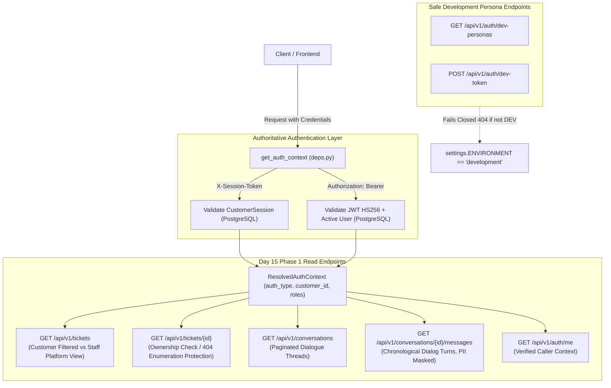

# Day 15 — Frontend–Backend Integration: Phase 1 Implementation Report

**Milestone:** Day 15 — Frontend–Backend Integration (Phase 1: Backend Read APIs & Safe Development Authentication)  
**Date:** November 2026  
**Status:** COMPLETED, AUDITED & VERIFIED (807 / 807 Tests Passing, 0 Regressions)  
**Author:** AI Engineering Team  
**Repository Working Directory:** `c:\Users\bhavs\OneDrive\Desktop\AI-Customer-Support-Platform`

---

## 1. Executive Summary

Day 15 Phase 1 successfully establishes the backend read infrastructure and developer authentication bridging the backend modular monolith with the React 18 TypeScript frontend. Prior to Phase 1, the ticketing and conversation domains provided creation and synthesis mutations but lacked general-purpose paginated read APIs for tickets, conversations, and historical message streams, as well as an authoritative mechanism for frontend developers to pair with authenticated customer and staff personas.

Phase 1 resolves these architectural gaps under strict Ponytail principles (minimum working code, zero speculative abstractions, maximum reuse of existing database models and authentication dependencies) and rigorous security invariants:

1. **Paginated Ticket Read Endpoints:** Implemented `GET /api/v1/tickets` and `GET /api/v1/tickets/{id}` with deterministic multi-column ordering, status/priority/category filtering, and strict customer isolation.
2. **Conversational Dialog & Message History Endpoints:** Implemented `GET /api/v1/conversations`, `GET /api/v1/conversations/{id}`, and `GET /api/v1/conversations/{id}/messages` with chronological turn ordering and ownership checks.
3. **Safe Local Development Persona Authentication:** Implemented `/api/v1/auth/dev-personas`, `/api/v1/auth/dev-token`, and `/api/v1/auth/me`, issuing authentic, verifiable PostgreSQL-backed credentials without bypassing cryptographic JWT validation or database session lookups.
4. **Strict Production Fail-Closed Security:** Development auth endpoints are inaccessible outside local development (`ENVIRONMENT == "development"` and `ENABLE_DEV_AUTH_ENDPOINTS == True`), failing closed with HTTP 404 Not Found to prevent credential enumeration or privileged token issuance in staging/production.
5. **100% Verification Baseline:** Authored 17 dedicated unit/integration tests in [`backend/tests/test_phase1_read_apis.py`](../../backend/tests/test_phase1_read_apis.py). The entire platform test suite expanded from **790 to 807 passing tests** with zero failures, zero errors, and zero regressions.

---

## 2. Architectural & Endpoint Specification



### 2.1 Ticket Read APIs (`backend/app/api/v1/tickets.py`)

- **`GET /api/v1/tickets`**:
  - **Query Parameters:** `status` (string), `priority` (string), `category` (string), `customer_id` (UUID, staff-only), `limit` (int, default 50, max 100), `offset` (int, default 0).
  - **Ordering:** Deterministic ordering by `Ticket.created_at.desc(), Ticket.id.asc()`.
  - **Multi-Tenancy & Isolation:** If caller is a customer (`SESSION_TOKEN`), the query is unconditionally scoped to `Ticket.customer_id == auth.customer_id`. Staff callers (`JWT`) see all tickets or may filter by a target `customer_id`.
  - **Response Model:** `TicketListResponse` containing `items: List[TicketListItem]`, `total_count: int`, `limit: int`, `offset: int`.

- **`GET /api/v1/tickets/{ticket_id}`**:
  - **Path Parameter:** `ticket_id: uuid.UUID`.
  - **Security Invariant:** Customer callers can only retrieve tickets they own. If the ticket does not exist or belongs to another customer, the endpoint returns `404 Not Found` (never `403`), preventing malicious enumeration of internal ticket IDs.
  - **Response Model:** `TicketDetailResponse` containing complete operational state, SLA breach/warning deadlines, pause duration, dynamic priority score, priority explanation, synthesis status, routing status, and resolution status.

### 2.2 Conversation & Message Read APIs (`backend/app/api/v1/conversations.py`)

- **`GET /api/v1/conversations`**:
  - **Query Parameters:** `status` (string), `customer_id` (UUID, staff-only), `limit` (int, default 50, max 100), `offset` (int, default 0).
  - **Ordering:** Deterministic ordering by `Conversation.last_message_at.desc(), Conversation.id.asc()`.
  - **Customer Isolation:** Customers only receive their own conversation threads; cross-customer records are omitted.
  - **Response Model:** `ConversationListResponse` containing `items: List[ConversationListItem]`, `total_count: int`, `limit: int`, `offset: int`.

- **`GET /api/v1/conversations/{conversation_id}`**:
  - **Path Parameter:** `conversation_id: uuid.UUID`.
  - **Security Check:** Fails closed with `404 Not Found` if unowned by the calling customer.

- **`GET /api/v1/conversations/{conversation_id}/messages`**:
  - **Path Parameter:** `conversation_id: uuid.UUID`.
  - **Query Parameters:** `limit` (int, default 100, max 500), `offset` (int, default 0).
  - **Ordering:** Strictly chronological: `Message.created_at.asc(), Message.id.asc()`.
  - **PII Compliance:** Returns `Message.content` (which is zero-logging PII-masked by default per GDPR/PCI-DSS standards). Raw encrypted content remains safely sealed in binary storage.

### 2.3 Safe Development Persona Authentication (`backend/app/api/v1/auth.py`)

Provides a safe local mechanism for frontend integration without mocking or bypassing server-side security checks:

- **`GET /api/v1/auth/dev-personas`**:
  - Returns metadata for 5 developer test personas:
    1. `customer`: Alice Customer (Standard retail tier, session-based).
    2. `customer_vip`: Bob VIP Customer (VIP tier, session-based).
    3. `agent`: Hardware Specialist Agent (Frontline support, Tier-1, JWT with `AGENT` role).
    4. `supervisor`: Operations Supervisor (Tier-2 supervisor, JWT with `SUPERVISOR` role).
    5. `admin`: Platform Administrator (Enterprise administrator, JWT with `ADMIN` role).

- **`POST /api/v1/auth/dev-token`**:
  - **Request:** `{"persona": "<key>"}`.
  - **Entity Provisioning:** Automatically provisions or loads real PostgreSQL database records (`Customer`, `CustomerSession`, `User`, `Role`, `UserRole`).
  - **Cryptographic Rigor:** Signs real HS256 JWTs for staff using `settings.SECRET_KEY` and creates valid `CustomerSession` records in PostgreSQL.
  - **Response:** Returns `DevTokenResponse` with `header_name`, `header_value`, `token`, `user_id_or_email`, `customer_id`, `roles`, and expiration.

- **`GET /api/v1/auth/me`**:
  - Authenticated endpoint protected by `get_auth_context`.
  - Returns verified server-side caller identity (`auth_type`, `user_id_or_email`, `customer_id`, `session_id`, `roles`).

- **Production Fail-Closed Enforcement:**
  ```python
  def _check_dev_mode() -> None:
      if not getattr(settings, "ENABLE_DEV_AUTH_ENDPOINTS", False) or settings.ENVIRONMENT != "development":
          raise HTTPException(
              status_code=status.HTTP_404_NOT_FOUND,
              detail="Development persona authentication endpoints are disabled.",
          )
  ```

---

## 3. Verification & Test Suite Summary

### 3.1 Dedicated Phase 1 Test Suite
File: [`backend/tests/test_phase1_read_apis.py`](../../backend/tests/test_phase1_read_apis.py)  
Result: **17 / 17 PASSED** in 23.08s.

| Test Function | Verification Scope | Status |
|---|---|---|
| `test_get_tickets_pagination_and_ordering` | Verifies limits, offsets, total counts, and descending chronological ordering | PASSED |
| `test_get_tickets_filtering` | Validates `status`, `priority`, and `category` query filters on ticket lists | PASSED |
| `test_get_tickets_customer_isolation` | Proves Customer A cannot see Customer B's tickets via session token | PASSED |
| `test_get_tickets_staff_customer_filter` | Proves staff can view all tickets and filter by target customer UUID | PASSED |
| `test_get_tickets_unauthorized_and_conflicts` | Confirms missing/conflicting auth headers fail closed with HTTP 401 | PASSED |
| `test_get_ticket_detail_positive` | Validates full SLA, priority, and routing metadata for single ticket retrieval | PASSED |
| `test_get_ticket_detail_customer_isolation_and_404` | Proves cross-customer detail request returns 404 (enumeration protection) | PASSED |
| `test_get_ticket_detail_staff_access` | Proves staff JWT can access any customer's ticket details | PASSED |
| `test_get_conversations_customer_isolation_and_pagination` | Verifies conversation pagination and customer isolation | PASSED |
| `test_get_single_conversation_and_isolation` | Proves single conversation endpoint enforces customer ownership | PASSED |
| `test_get_conversation_messages_chronological` | Proves conversation messages return in chronological turn order | PASSED |
| `test_get_conversation_messages_isolation` | Verifies cross-customer message request returns 404; staff returns 200 | PASSED |
| `test_dev_auth_personas_list` | Verifies `/dev-personas` lists all 5 dev personas with metadata | PASSED |
| `test_dev_auth_issue_customer_token` | Proves dev session token authenticates via `deps.py` and accesses tickets | PASSED |
| `test_dev_auth_issue_staff_tokens` | Proves dev JWT issuance for AGENT, SUPERVISOR, ADMIN passes RBAC | PASSED |
| `test_dev_auth_invalid_persona` | Verifies unknown dev persona returns HTTP 400 Bad Request | PASSED |
| `test_dev_auth_disabled_outside_development` | Proves endpoints fail closed with 404 when disabled or in production | PASSED |

### 3.2 Full Platform Regression Suite
- Execution command: `.venv\Scripts\python.exe -m pytest backend/tests/ -q`
- Previous baseline: 790 passed
- New baseline: **807 passed in 173.26s (100% pass rate, 0 regressions)**

---

## 4. Git & Workspace Preservation Audit

In strict compliance with workspace preservation rules:
- **Zero Files Staged:** `git diff --cached` is completely empty.
- **Frontend Untouched:** All 11 modified frontend files and untracked components remain preserved in place.
- **Gitignore Preserved:** `.gitignore` updates remain untouched.
- **No Git State Commands:** Zero `git add`, `git commit`, `git push`, `git reset`, `git checkout .`, `git clean`, or `git stash` were run.

