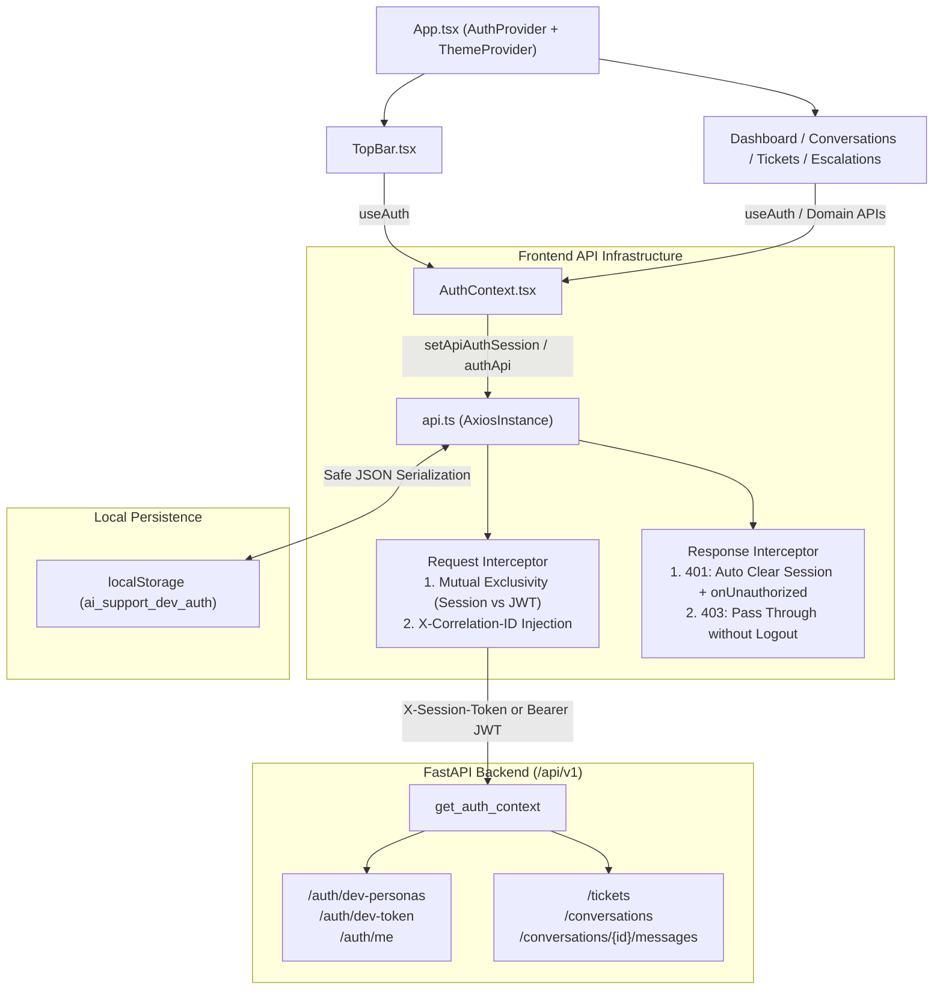

# Day 15 — Frontend–Backend Integration: Phase 2 Implementation Report

**Milestone:** Day 15 — Frontend–Backend Integration (Phase 2: Frontend API Infrastructure & Authentication Context)  
**Date:** November 2026  
**Status:** COMPLETED, AUDITED & VERIFIED  
**Frontend Tests:** **9 / 9 PASSED** (0 failures, 348ms)  
**Backend Regression Suite:** **807 / 807 PASSED** (100% green, 0 regressions)  
**TypeScript & Vite Production Build:** Clean build in 876ms  
**Author:** AI Engineering Team  
**Repository Working Directory:** `c:\Users\bhavs\OneDrive\Desktop\AI-Customer-Support-Platform`

---

## 1. Executive Summary

Day 15 Phase 2 implements the frontend API communication infrastructure and development persona authentication lifecycle connecting the React 18 TypeScript frontend to the Phase 1 backend read and authentication APIs.

Phase 2 fulfills all security and architectural invariants without introducing speculative abstractions:
1. **Centralized API Client (`frontend/src/services/api.ts`):** Standardized Axios instance with automatic request and response interceptors, correlation ID distributed tracing, and centralized handling of HTTP 401, 403, and network errors.
2. **Strict Identity Mutual Exclusivity:** The request interceptor guarantees that `X-Session-Token` (customer) and `Authorization: Bearer <token>` (staff) are never transmitted in the same request.
3. **Authentication Context (`frontend/src/context/AuthContext.tsx`):** Provides reactive authentication state across the frontend application tree. Discovers development personas (`/auth/dev-personas`), requests authentic tokens (`/auth/dev-token`), verifies server-side identity (`/auth/me`), and persists sessions securely.
4. **UI Integration in TopBar (`frontend/src/components/layout/TopBar.tsx`):** Replaced the static role tag with a compact glassmorphism persona selector dropdown displaying the active persona name, role/tier, loading indicator, and error notifications while strictly preserving existing design, liquid glass styling, health indicator, and theme toggling.
5. **Production Guard & Safety:** Development persona switching is strictly limited to development (`import.meta.env.DEV`). In production mode or when disabled on the backend, dev auth falls back cleanly to verified static role tags without leaking development endpoints.

---

## 2. Architecture & Component Details

### 2.1 Centralized API Client (`frontend/src/services/api.ts`)
- **Base URL:** `/api/v1` (proxied via Vite dev server to backend on port 8000).
- **Request Interceptor Invariant:**
  - When `session.auth_type === 'SESSION_TOKEN'`: sets `X-Session-Token: <token>` and explicitly removes `Authorization`.
  - When `session.auth_type === 'JWT'`: sets `Authorization: Bearer <token>` and explicitly removes `X-Session-Token`.
  - When unauthenticated: removes both headers.
- **Correlation ID Header:** Automatically generates and attaches matching `X-Correlation-ID` and `X-Request-ID` headers for end-to-end request tracing.
- **Response Interceptor:**
  - Intercepts HTTP 401 Unauthorized: automatically removes stored credentials via `clearApiAuthSession()` and triggers registered `onUnauthorized` callbacks to redirect/reset auth state.
  - Intercepts HTTP 403 Forbidden: preserves user credentials, passing through the error for view-level permission messaging.
- **Service Interfaces:** Exported typed service wrappers:
  - `authApi`: `getDevPersonas()`, `issueDevToken(persona)`, `getCurrentUser()`.
  - `ticketsApi`: `listTickets(params)`, `getTicket(id)`.
  - `conversationsApi`: `listConversations(params)`, `getConversation(id)`, `getConversationMessages(id, params)`.

### 2.2 Authentication Context (`frontend/src/context/AuthContext.tsx`)
- **State Management:** Manages `activeSession`, `currentUser`, `devPersonas`, `isLoading`, `error`, and `isDevAuthAvailable`.
- **Persona Switching:** `switchPersona(personaKey)` invokes `/auth/dev-token` $\rightarrow$ sets API session $\rightarrow$ verifies identity via `/auth/me` $\rightarrow$ updates context.
- **Production Guard:** Evaluates `Boolean(import.meta.env.DEV)`. If false, suppresses dev persona discovery and avoids exposing dev tooling.
- **Session Rehydration:** Rehydrates from `localStorage` on initial mount, verifying token validity against `/auth/me`. If invalid or expired, gracefully purges credentials.

### 2.3 TopBar Integration (`frontend/src/components/layout/TopBar.tsx`)
- **Compact Persona Selector:** Rendered in the top right control cluster.
- **Interactive State:** Shows active persona name and tier/role (e.g. `Alice (STANDARD)`, `Bob (VIP)`, `Agent (AGENT)`, `Supervisor (SUPERVISOR)`, `Admin (ADMIN)`).
- **Glassmorphism Dropdown:** Displays available personas with role badges and descriptions, styled using standard liquid glass variables (`var(--surface-glass-elevated)`, `var(--border-card)`, `var(--radius-lg)`).
- **Accessibility & Outside Click:** Listens to outside clicks via `useRef` to dismiss the menu. Includes `aria-expanded` and `aria-haspopup` attributes.
- **Graceful Fallback:** If dev auth is unavailable or running in production, renders a static verified role tag (`Role: AGENT` / `Role: CUSTOMER`).

---

## 3. Verification & Quality Gates

### 3.1 Frontend Test Suite (`frontend/tests/api_auth.test.ts`)
Run via `npm --prefix frontend test`:
- **9 / 9 PASSED** in 348ms.
- Test Scenarios:
  1. `Customer session token sets X-Session-Token and removes Authorization`: PASSED.
  2. `Staff JWT sets Authorization: Bearer and removes X-Session-Token`: PASSED.
  3. `Unauthenticated state removes both Authorization and X-Session-Token`: PASSED.
  4. `Request interceptor generates and injects correlation ID headers`: PASSED.
  5. `Correlation ID generator produces unique non-empty identifiers`: PASSED.
  6. `setApiAuthSession persists to localStorage and getApiAuthSession rehydrates correctly`: PASSED.
  7. `HTTP 401 clears active session and invokes onUnauthorized callback`: PASSED.
  8. `HTTP 403 passes through without destroying the active session`: PASSED.
  9. `Persona role mapping maintains strict customer and staff role invariants`: PASSED.

### 3.2 Frontend Build & TypeScript Verification
- Run via `npm --prefix frontend run build`:
  - `tsc`: Type-check succeeded with zero errors.
  - `vite build`: Transformed 115 modules into production bundle in 876ms (`dist/assets/index-DZdTTGnI.js` 333 kB).

### 3.3 Full Backend Platform Regression Baseline
- Run via `.venv\Scripts\python.exe -m pytest backend/tests/ -q`:
  - **807 / 807 PASSED** in 138.51s (100% green, 0 failures, 0 regressions).

---

## 4. Git & Workspace Preservation Audit

- **Zero Staged Changes:** `git diff --cached` remains completely empty.
- **Frontend Preserved:** All 11 existing modified frontend files, custom components, and liquid styling preserved.
- **No Git Commands Executed:** Zero `git add`, `git commit`, `git push`, `git reset`, `git checkout .`, `git clean`, or `git stash`.

