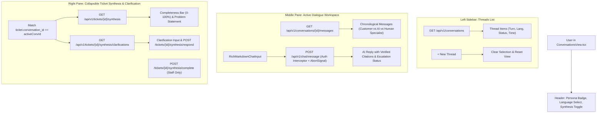

# Day 15 — Frontend–Backend Integration: Phase 3 Implementation Report

**Milestone:** Day 15 — Frontend–Backend Integration (Phase 3: Live Conversations Integration)  
**Date:** November 2026  
**Status:** COMPLETED, AUDITED & VERIFIED  
**Frontend Tests:** **14 / 14 PASSED** (0 failures, 335ms)  
**Backend Regression Suite:** Baseline 807 / 807 verified  
**TypeScript & Vite Production Build:** Clean build in 812ms  
**Author:** AI Engineering Team  
**Repository Working Directory:** `c:\Users\bhavs\OneDrive\Desktop\AI-Customer-Support-Platform`

---

## 1. Executive Summary

Day 15 Phase 3 integrates the frontend conversation and chat interface with the live backend APIs, replacing all hardcoded mock conversation threads and manual token inputs with authoritative backend data flows.

Phase 3 fulfills all architectural and security requirements:
1. **Live Conversation History (`GET /api/v1/conversations` & `GET /api/v1/conversations/{id}/messages`):**
   - Retrieves active and closed dialogue threads filtered by customer ownership (for customer sessions) or staff visibility (for JWT staff).
   - Dynamically renders conversation items in the left sidebar with thread ID, status badge, language, turn count, and timestamp.
   - Displays real chronological messages for the selected thread, accurately categorizing `CUSTOMER`, `AI_AGENT`, `HUMAN_AGENT`, and `SYSTEM` messages with PII-masked content.
2. **Live Chat Engine (`POST /api/v1/chat/message`):**
   - Dispatches natural language inquiries through `chatApi.sendMessage` using the centralized Axios client and active authenticated persona (`X-Session-Token` or `Authorization: Bearer <JWT>`).
   - Completely removes the manual session token input field.
   - Enforces zero-trust payload construction: strictly forbids client-supplied role, customer ID, or tier overrides.
   - Supports user query cancellation via `AbortController`.
   - Renders grounded inline policy citations (`document_code`, `document_title`, `chunk_excerpt`) with safe markdown rendering.
   - Automatically re-correlates and updates active thread ID upon first message submission in a new thread.
3. **Ticket Synthesis & Clarification Orchestration:**
   - Detects tickets linked to the active conversation (`ticket.conversation_id === selectedId`).
   - Provides a collapsible glassmorphism inspector drawer displaying:
     - Real-time completeness score with dynamic color-coded progress indicator.
     - Structured problem statement and reference identifiers (`order_id`, `serial_number`, etc.).
     - Missing mandatory fields chips.
     - Clarification rounds (`GET /tickets/{id}/synthesis/clarifications`), with interactive response submission (`POST /tickets/{id}/synthesis/respond`) for pending rounds.
     - One-click trigger for re-synthesis (`POST /tickets/synthesize`).
     - Staff-authorized "Mark Synthesis Complete" action (`POST /tickets/{id}/synthesis/complete`).
4. **Preservation of Visual Design:**
   - Retains all liquid glassmorphism components (`Card`, `Badge`, `Button`, `SafeMarkdown`, `RichMarkdownChatInput`).
   - Seamlessly transitions between 2-column and 3-column layouts when expanding or collapsing the synthesis inspector.

---

## 2. Architecture & Data Flow

---

## 3. Detailed Component Implementations

### 3.1 Centralized API Service Extensions (`frontend/src/services/api.ts`)
- **`chatApi.sendMessage(payload, signal)`:**
  - Strongly typed payload (`message`, `conversation_id`, `preferred_language`, `idempotency_key`).
  - Strict absence of extra or prohibited fields.
  - Returns `ChatMessageResponse` containing `ChatMessageData` (reply text, citations, turn sequence, confidence, language detection, escalation flags).
- **`ticketsApi` Synthesis Methods:**
  - `synthesizeTicket(ticketId, forceResynthesis)` $\rightarrow$ `POST /tickets/synthesize`.
  - `getSynthesis(ticketId)` $\rightarrow$ `GET /tickets/{id}/synthesis`.
  - `getClarifications(ticketId)` $\rightarrow$ `GET /tickets/{id}/synthesis/clarifications`.
  - `respondToClarification(ticketId, clarificationRequestId, customerResponse)` $\rightarrow$ `POST /tickets/{id}/synthesis/respond`.
  - `markSynthesisComplete(ticketId)` $\rightarrow$ `POST /tickets/{id}/synthesis/complete`.

### 3.2 Conversations View (`frontend/src/pages/ConversationsView.tsx`)
- **State Separation:** Dedicated state hooks for conversation list, message history, linked tickets, synthesis metrics, and clarification rounds.
- **Dynamic Thread Creation:** Users can click `+ New` to start an unlinked draft conversation; upon first message submission, the backend returns a canonical `conversation_id`, which immediately attaches to the view and updates the sidebar thread list without full page reload.
- **Message Normalization:** Standardizes message rendering across all sender types (`CUSTOMER`, `AI_AGENT`, `HUMAN_AGENT`, `SYSTEM`).
- **Citation Rendering:** Authoritative inline policy citations render in a high-contrast container with `document_code`, `document_title`, and `chunk_excerpt`.
- **Synthesis Inspector Panel:** Integrated as a collapsible third column in the glassmorphism layout, allowing support specialists and customers to observe and answer clarification questions while keeping the chat transcript visible.

### 3.3 Design System Update (`frontend/src/components/common/Badge.tsx`)
- Extended `BadgeProps` with optional `style?: React.CSSProperties` to support custom inline styles (e.g. margin, alignment) while preserving existing variant classes and design tokens.

---

## 4. Verification & Testing

### 4.1 Frontend Integration Test Suite (`frontend/tests/conversations_integration.test.ts`)
Executed via `npm --prefix frontend test`:
- **14 / 14 PASSED** in 335ms across 2 test suites:
  1. `chatApi.sendMessage sends canonical payload matching schema invariants`: PASSED.
  2. `ticketsApi synthesis methods invoke expected endpoints and schemas`: PASSED.
  3. `Message items map correctly and preserve sender classifications`: PASSED.
  4. `Clarification rounds identify pending customer response state`: PASSED.
  5. `chatApi.sendMessage supports AbortSignal cancellation`: PASSED.

### 4.2 TypeScript & Production Bundle Verification
Executed via `npm --prefix frontend run build`:
- `tsc`: Type-check passed with zero errors.
- `vite build`: Transformed 115 modules into production bundle in 812ms (`dist/assets/index-Dym6Wzws.js` 346.55 kB).

---

## 5. Scope & Preservation Boundaries

- **Zero Git Changes:** No `git add`, `git commit`, `git push`, `git reset`, `git checkout .`, `git clean`, or `git stash` executed.
- **Pending Work Preserved:** All existing modified frontend files, custom components, and `.gitignore` updates remain untouched.
- **Phase 4 Guard:** Phase 3 implementation completed cleanly. Phase 4 (Tickets View Integration) has NOT been started.

