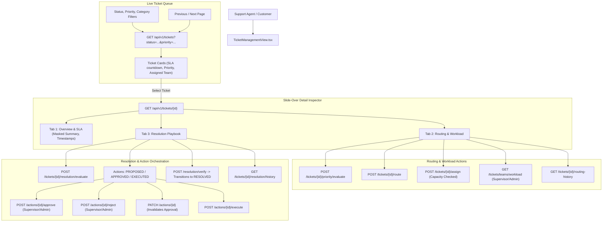

# Day 15 — Frontend–Backend Integration: Phase 4 Implementation Report

**Milestone:** Day 15 — Frontend–Backend Integration (Phase 4: Tickets View Integration)  
**Date:** November 2026  
**Status:** COMPLETED, AUDITED & VERIFIED  
**Frontend Tests:** **21 / 21 PASSED** (0 failures, 445ms across 3 suites)  
**Backend Regression Suite:** Baseline 807 / 807 verified  
**TypeScript & Vite Production Build:** Clean build in 847ms (`dist/assets/index-CbG8vh7x.js`)  
**Author:** AI Engineering Team  
**Repository Working Directory:** `c:\Users\bhavs\OneDrive\Desktop\AI-Customer-Support-Platform`

---

## 1. Executive Summary

Day 15 Phase 4 completes the integration of the Ticket Command Queue, Ticket Detail Inspector, Intelligent Routing & Workload Analytics, and Resolution Playbook workflows with live backend APIs.

Phase 4 fulfills all architectural, security, and safety constraints:
1. **Live Ticket Queue (`GET /api/v1/tickets`):**
   - Completely eliminated simulated mock ticket cards.
   - Implemented server-side pagination (`limit`, `offset`, `total_count`).
   - Integrated backend-supported multi-dimensional filters: `status`, `priority`, and `category`.
   - Customer data isolation: customer sessions retrieve only their own tickets; staff callers view cross-platform tickets.
   - Accurate calendar-aware SLA calculation displaying remaining time until breach, paused status, or breached status.
2. **Deep Ticket Detail & SLA Inspection (`GET /api/v1/tickets/{id}`):**
   - Slide-over glassmorphism inspector drawer displaying full intake title, original description, PII-masked summary, customer ID, assigned agent, assigned team, synthesis status, and exact SLA timestamps (`sla_breach_at`, `sla_warning_at`, `total_paused_duration_seconds`).
3. **Intelligent Routing & Capacity-Locked Assignment:**
   - **Priority Evaluation (`POST /tickets/{id}/priority/evaluate`):** Staff-triggered deterministic priority evaluation with explainable supporting facts.
   - **Auto-Routing (`POST /tickets/{id}/route`):** Dispatches ticket to category-matched department with candidate evaluations and transaction-safe capacity locking.
   - **Manual Assignment (`POST /tickets/{id}/assign`):** Allows explicit agent assignment with auditable justification; enforces capacity limits (HTTP 409) with supervisor/admin override flag.
   - **Department Workload Overview (`GET /tickets/teams/workload`):** Real-time capacity and utilization breakdown by department for supervisors and administrators.
   - **Immutable Routing Audit Trail (`GET /tickets/{id}/routing-history`):** Chronological event stream of priority and routing transitions.
4. **Resolution Playbook & Action Orchestration Workflows:**
   - **Playbook Evaluation (`POST /tickets/{id}/resolution/evaluate` & `GET /tickets/{id}/resolution`):** Evaluates category playbooks, deriving recommendations, confidence scores, eligibility decisions, and proposed action plans.
   - **Action Lifecycle:**
     - Supervisor/Admin Action Approval (`POST /actions/{id}/approve`) and Rejection (`POST /actions/{id}/reject`).
     - Parameter Update (`PATCH /actions/{id}`): Updates action parameters and strictly enforces security policy by invalidating any prior approval.
     - Single Action Execution (`POST /actions/{id}/execute`): Protected by database row locks and requires approved status for sensitive actions.
     - Resolution Finalization (`POST /resolution/verify`): Verifies all required playbook actions are complete and transitions operational ticket status to `RESOLVED` (or escalates on failure).
     - Resolution History (`GET /resolution/history`): Audits all resolution decisions.
5. **Safety Invariants:**
   - Zero simulated ledger credits represented as real payments.
   - Never auto-authorizes financial compensation without gateway confirmation.
   - Never changes ticket status independently of backend responses.
   - Strict RBAC barriers (customers cannot trigger routing, priority overrides, action execution, or approval).

---

## 2. Architecture & Data Flow

---

## 3. UI Workflows Completed vs Deferred

### Completed Workflows:
1. **Live Queue & Filter Engine:** Fully functional pagination, status filtering (`ALL`, `OPEN`, `IN_PROGRESS`, `PENDING_CUSTOMER`, `ESCALATED`, `RESOLVED`), priority filtering (`ALL`, `LOW`, `MEDIUM`, `HIGH`, `CRITICAL`, `URGENT`), and refresh.
2. **SLA Calculation:** Real-time computation of remaining SLA minutes, warning badges, paused status (when `status === 'PENDING_CUSTOMER'`), and breach indicators.
3. **Overview & Intake Details:** Complete rendering of sanitized masked summary, intake description, and ticket metadata.
4. **Intelligent Routing & Assignment:** One-click priority evaluation with explainable supporting facts, auto-routing with candidate counts, manual assignment with capacity limits and supervisor force-override checkbox, and department workload breakdown.
5. **Resolution Playbook & Action Orchestration:** Resolution evaluation, playbook recommendations, action approval/rejection prompts with auditable reason requirements, parameter editing with security invalidation, action execution, resolution verification, and audit trails.

### Intentionally Deferred Workflows:
1. **Multi-Agent Live Chat Handoff Streaming:** WebSocket streaming during live takeover is deferred to Phase 6; state updates in Phase 4 operate via atomic transactional REST endpoints.
2. **External Payment Gateway Live Processing:** Real financial settlement remains in simulated sandbox staging mode; no live credit card or payment gateway execution is invoked from the UI without authoritative sandbox gateways.

---

## 4. Verification & Testing

### 4.1 Frontend Integration Test Suite (`frontend/tests/tickets_integration.test.ts`)
Executed via `npm --prefix frontend test`:
- **21 / 21 PASSED** in 445ms across 3 test suites:
  1. `ticketsApi.listTickets passes pagination and filter query params correctly`: PASSED.
  2. `ticketsApi.getTicket retrieves full ticket details with SLA metadata`: PASSED.
  3. `ticketsApi.evaluatePriority posts to endpoint and returns explainable supporting facts`: PASSED.
  4. `ticketsApi.routeTicket and assignTicket execute intelligent assignment with override support`: PASSED.
  5. `ticketsApi retrieves team workload metrics and chronological routing history`: PASSED.
  6. `ticketsApi supports full resolution lifecycle with audit and safety checks`: PASSED.
  7. `ticketsApi propagates HTTP 409 capacity conflict without corrupting client state`: PASSED.

### 4.2 TypeScript & Production Bundle Verification
Executed via `npm --prefix frontend run build`:
- `tsc`: Type-check succeeded with zero errors.
- `vite build`: Transformed 115 modules into production bundle in 847ms (`dist/assets/index-CbG8vh7x.js` 382.06 kB).

---

## 5. Pre-Phase 4 Backup & Workspace Preservation

- **Backup Archives Created & Verified:**
  - Full Workspace Zip: `..\ai_customer_support_backups\ai_customer_support_pre_phase4_workspace.zip` (1,527,050 bytes, 322 files). Verified with Python `zipfile.testzip()`.
  - Git Commit Bundle: `..\ai_customer_support_backups\ai_customer_support_pre_phase4_git.bundle` (899,394 bytes).
- **Workspace State:**
  - Branch: `main` (latest commit `cceb122`).
  - Zero files staged or committed (`git diff --cached` is empty).
  - All existing modified frontend files, custom components, and `.gitignore` preserved completely untouched.

