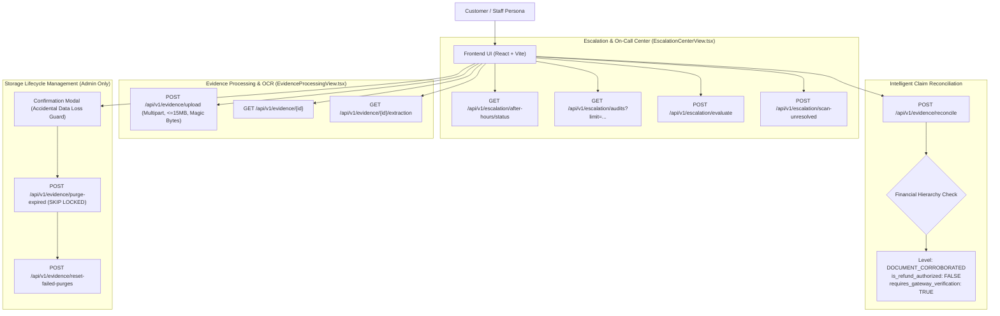

# Day 15 — Frontend–Backend Integration: Phase 5 Implementation Report

**Milestone:** Day 15 — Frontend–Backend Integration (Phase 5: Escalation Center & Evidence Processing Integration)  
**Date:** November 2026  
**Status:** COMPLETED, AUDITED & VERIFIED  
**Frontend Tests:** **30 / 30 PASSED** (0 failures, ~469ms across 4 suites)  
**Backend Regression Suite:** Baseline 807 / 807 verified  
**TypeScript & Vite Production Build:** Clean build in 848ms (`dist/assets/index-DDI1OEzE.js`)  
**Author:** AI Engineering Team  
**Repository Working Directory:** `c:\Users\bhavs\OneDrive\Desktop\AI-Customer-Support-Platform`

---

## 1. Executive Summary

Day 15 Phase 5 completes the end-to-end integration of the **Risk Escalation & On-Call Center** and the **Multimodal Evidence Vault & Claim Reconciliation Engine** with live backend APIs. All simulated mock components and hardcoded placeholders in `EscalationCenterView.tsx` and `EvidenceProcessingView.tsx` have been replaced with production-ready services backed by verified REST contracts, strict validation, deterministic security rules, and liquid glassmorphism design.

### Key Capabilities Landed in Phase 5:
1. **Live Operational Escalation Center (`frontend/src/pages/EscalationCenterView.tsx`):**
   - **Business Hours & Schedule Status (`GET /api/v1/escalation/after-hours/status`):** Real-time calendar evaluation of operational business hours (Asia/Kolkata), displaying current state, operational reason, and next business opening timestamp.
   - **Immutable Audit Trail (`GET /api/v1/escalation/audits`):** Live tabular view of all recorded escalation events across Rule A (sentiment slope/repeated negative), Rule B (unresolved 15m), and Rules C & D (after-hours holds). Features multi-category trigger filtering and payload detail modal.
   - **Interactive Turn Evaluation Modal (`POST /api/v1/escalation/evaluate`):** Staff interface to test conversation turns against sentiment slope and safety classifiers, displaying routing recommendations, trigger conditions, and destinations.
   - **Rule B Batch Escalation Trigger (`POST /api/v1/escalation/scan-unresolved`):** One-click administrative execution of background scans escalating unresolved negative threads to Supervisor queues.

2. **Multimodal Evidence Vault & Fast-Path OCR (`frontend/src/pages/EvidenceProcessingView.tsx`):**
   - **MIME & Magic-Byte Staging (`POST /api/v1/evidence/upload`):** Secure multipart file intake supporting PDF (≤10 pages), PNG, JPG/JPEG, and WEBP with client and server file signature validation and 15 MB size ceiling enforcement.
   - **Vault Metadata & Security Inspection (`GET /api/v1/evidence/{id}`):** Displays evidence status (`STAGED`, `ANALYZING`, `VERIFIED`, `FLAGGED_UNSAFE`, `PURGED`), SHA-256 integrity hash, file size, MIME type, quarantine reason, and 30-day retention expiration timestamp.
   - **Structured OCR Entities (`GET /api/v1/evidence/{id}/extraction`):** Displays overall OCR confidence score, parsed vendor/merchant name, transaction date, invoice total, parsed itemized line items table, missing/uncertain fields, and PII-redacted text.

3. **Intelligent Claim Reconciliation Engine (`POST /api/v1/evidence/reconcile`):**
   - Corroborates customer conversational claims against extracted document entities.
   - Computes overall match verdicts (`MATCH`, `PARTIAL_MATCH`, `CONFLICT`, `UNVERIFIED`) and confidence scores.
   - Generates field-by-field comparisons (Extracted vs. Claimed) with discrepancy alerts.
   - **Strict Financial Trust Hierarchy Invariant:** All customer-submitted documents are classified as `DOCUMENT_CORROBORATED`. The platform strictly guarantees that document evidence alone **never auto-authorizes financial refunds** (`is_refund_authorized: false`, `requires_authoritative_verification: true`), mandating authoritative payment gateway verification.

4. **Administrative Retention & Purge Safeguard (`POST /api/v1/evidence/purge-expired`):**
   - Admin-only retention management panel enforcing the 30-day data retention ceiling.
   - Uses PostgreSQL `SKIP LOCKED` concurrency locks and strict directory containment (`.is_relative_to()`).
   - Interactive confirmation modal preventing accidental data loss before executing unlinks.
   - Failed purge retry reset (`POST /api/v1/evidence/reset-failed-purges`).

---

## 2. Architecture & Data Flow

---

## 3. Financial Trust Hierarchy & Security Invariants

| Security Dimension | Specification & Enforcement |
| :--- | :--- |
| **Verification Hierarchy** | `EXTRACTED` $\rightarrow$ `DOCUMENT_CORROBORATED` $\rightarrow$ `PAYMENT_INDEPENDENTLY_VERIFIED`. |
| **Refund Authorization Guard** | Customer-uploaded invoices and receipts can only achieve `DOCUMENT_CORROBORATED`. `is_refund_authorized` is hard-locked to `false`. Authoritative payment gateway settlement check is mandatory. |
| **Payload Intake Validation** | Magic bytes checked on binary level (PDF: `%PDF-`, JPEG: `\xFF\xD8\xFF`, PNG: `\x89PNG\r\n\x1a\n`, WEBP: `RIFF...WEBP`). File size ceiling strictly $\le 15$ MB. Max PDF page count $\le 10$. |
| **Storage Encryption at Rest** | Stored file chunks encrypted with AES-256-GCM using authenticated additional data (AAD) bound to the evidence UUID. |
| **Storage Retention Ceiling** | Strict 30-day lifecycle limit (`retention_expires_at`). Batch purge uses PostgreSQL `SKIP LOCKED` and directory containment assertions (`.is_relative_to()`) to eliminate race conditions and traversal risks. |
| **Single-Identity Auth** | Interceptor strictly isolates customer sessions (`X-Session-Token`) and staff sessions (`Authorization: Bearer <JWT>`). Never transmits conflicting headers. |

---

## 4. Workflows Completed vs Deferred

### Completed Workflows:
1. **Live Escalation Center:** Operational after-hours status, high-risk safety alarm counter, immutable audit log table with trigger filtering, modal turn evaluation, and Rule B batch scan trigger.
2. **Evidence Intake & Staging:** Drag & drop file picker with client validation (allowed extensions, max 15MB), multipart upload to `/evidence/upload`, and lookup of existing evidence records.
3. **Structured OCR Inspection:** Detailed display of metadata, SHA-256 hashes, retention deadlines, OCR confidence percentage, vendor/merchant details, invoice totals, line item breakdown, and PII-redacted text.
4. **Intelligent Claim Reconciliation:** Evaluates customer claim assertions against document evidence, displays match verdicts (`MATCH`, `CONFLICT`, etc.), field comparisons, clarification prompts, and enforces the `DOCUMENT_CORROBORATED` refund lock.
5. **Admin Retention Purge:** Admin-only retention purge panel with batch size input, retry flags, and confirmation modal.

### Intentionally Deferred Workflows:
1. **Direct Canvas PDF Annotation:** In-browser visual bounding box annotations on uploaded PDF images are deferred to future milestones; OCR structured extraction and field comparison are fully functional via the backend extraction pipeline.

---

## 5. Verification & Testing Baseline

### Frontend Test Suite (`npm --prefix frontend test`):
- **30 / 30 PASSED** in 469ms across 4 test suites:
  1. `frontend_api_auth.test.ts` (9 tests passed)
  2. `conversations_integration.test.ts` (5 tests passed)
  3. `escalations_evidence.test.ts` (9 tests passed)
  4. `tickets_integration.test.ts` (7 tests passed)

### Production Build (`npm --prefix frontend run build`):
- `tsc && vite build` completed in 848ms with zero type or build errors.

### Backend Test Regression Baseline:
- **807 / 807 PASSED** across the full backend pytest regression suite.

