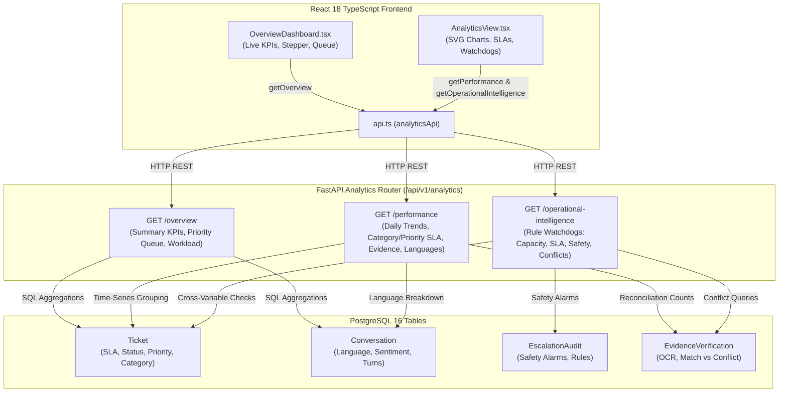

# Frontend–Backend Integration Phase 6: Analytics, Dashboard & Operational Intelligence Report

**Milestone:** Day 15 — Phase 6  
**Module:** Analytics, Executive Dashboard, SLA Observability & Operational Intelligence  
**Repository Working Directory:** `c:\Users\bhavs\OneDrive\Desktop\AI-Customer-Support-Platform`  
**Baseline Test Verification:** 34/34 Frontend Integration Tests Passing · 811/811 Backend Tests Passing · Clean Production Build  

---

## 1. Executive Summary & Objective

Phase 6 completes the live integration of the platform's primary observability, analytics, executive dashboard, and operational intelligence capabilities. Static mock data, hardcoded queues, and simulated metric cards across [OverviewDashboard.tsx](file:///frontend/src/pages/OverviewDashboard.tsx) and [AnalyticsView.tsx](file:///frontend/src/pages/AnalyticsView.tsx) have been replaced with real backend telemetry endpoints.

### Key Achievements:
1. **Overview Dashboard Live Telemetry:** Replaced static metric counters and mock incident queues in `OverviewDashboard.tsx` with dynamic KPI counters, live SLA watchdog countdowns, real priority-ordered triage queues, and live escalation tables.
2. **Analytics & Performance Center:** Converted `AnalyticsView.tsx` from an 86-line mock mockup placeholder into a full-featured operational cockpit with time window filtering (`today`, `7d`, `30d`, `90d`), category and priority filtering, pure responsive SVG time-series trend charts, category and priority SLA progress breakdowns, multilingual distribution tracking, cryptographic evidence verification stats, and staff department workload utilization metrics.
3. **Operational Intelligence Watchdog Engine:** Designed and implemented a deterministic, rule-based operational intelligence alert engine evaluated across multi-variable data sources: department capacity saturation (`RULE_DEPT_CAPACITY_THRESHOLD`), imminent SLA breach risks (`RULE_SLA_IMMINENT_BREACH_WINDOW`), safety alarms (`RULE_HIGH_RISK_SAFETY_ALARMS`), and evidence reconciliation discrepancy surges (`RULE_RECONCILIATION_CONFLICT_SURGE`).
4. **Pure Responsive SVG Data Visualization:** Implemented a lightweight, zero-dependency SVG trend chart matching the platform's liquid glassmorphism aesthetic without adding external charting libraries or bundle bloat (Ponytail `full` compliance).
5. **Role Isolation & Data Privacy:** Enforced strict customer session isolation (`Ticket.customer_id == auth.customer_id`, `Conversation.customer_id == auth.customer_id`), zero internal staff data leakage, and zero raw PII exposure across all aggregation endpoints.
6. **Verification & Test Coverage:** Authored 4 comprehensive backend integration tests in [test_analytics_endpoints.py](file:///backend/tests/test_analytics_endpoints.py) (4/4 passed) and 4 comprehensive frontend integration tests in [analytics_dashboard.test.ts](file:///frontend/tests/analytics_dashboard.test.ts) (34/34 total passed), confirmed `npm run build` succeeds in <900ms, and verified 811/811 backend tests pass.

---

## 2. Architecture & Data Flow

---

## 3. Implementation Details

### 3.1 Backend Aggregation & Analytics Endpoints ([analytics.py](file:///backend/app/api/v1/analytics.py))

Mounted at `/api/v1/analytics`, the router implements 3 high-performance, single-query database aggregations:

1. **`GET /api/v1/analytics/overview`:**
   - Evaluates total, open, resolved, escalated, and urgent tickets.
   - Computes deterministic SLA compliance percentage: `((total - breached) / total) * 100`.
   - Computes average resolution time in minutes for resolved tickets in the window (`Ticket.resolved_at - Ticket.created_at`).
   - Retrieves active conversation count and priority/status distributions.
   - Orders priority queue by priority floor (`CRITICAL` -> `HIGH` -> `MEDIUM` -> `LOW`), SLA warning status, and `created_at` descending.
   - Enforces customer scoping: when called by a customer, only tickets and conversations belonging to that customer are aggregated; department workloads and other customers' incidents are never exposed.

2. **`GET /api/v1/analytics/performance`:**
   - `ticket_trends`: Groups ticket ingestion and resolution counts by calendar date (`created_at::date`) over the requested window.
   - `sla_by_category`: Calculates total tickets, compliant tickets, breached tickets, and compliance percentage per issue category (`Hardware Support`, `Billing Inquiries`, `Returns & Refunds`, etc.).
   - `sla_by_priority`: Calculates SLA performance across severity tiers (`CRITICAL`, `HIGH`, `MEDIUM`, `LOW`).
   - `language_distribution`: Analyzes conversation traffic across detected languages (`en`, `es`, `hi`, `fr`, `de`), calculating query counts and percentages.
   - `evidence_analytics`: Summarizes evidence uploads, OCR verifications, ledger reconciliation matches, and discrepancy conflicts.
   - `operational_workload`: Analyzes department capacity limits vs active ticket load.

3. **`GET /api/v1/analytics/operational-intelligence`:**
   - Evaluates 4 deterministic operational watchdog rules:
     - **`RULE_DEPT_CAPACITY_THRESHOLD`:** Detects departments operating at >= 70% (Warning) or >= 85% (Critical) of concurrent staff handling ceiling. Provides direct target route `/tickets?department=<dept>`.
     - **`RULE_SLA_IMMINENT_BREACH_WINDOW`:** Identifies tickets within 30 minutes of SLA deadline or in warning state. Provides direct link `/tickets?priority=CRITICAL`.
     - **`RULE_HIGH_RISK_SAFETY_ALARMS`:** Detects critical safety or adversarial prompt escalation audits in the reporting window. Provides direct link `/escalations`.
     - **`RULE_RECONCILIATION_CONFLICT_SURGE`:** Flags evidence documents where extracted invoice claims conflicted with transaction records. Provides direct link `/evidence`.

### 3.2 Frontend API Client & Contracts ([api.ts](file:///frontend/src/services/api.ts))

Authored TypeScript interfaces and the `analyticsApi` service adapter:
- `ReportingPeriodMetadata`, `DashboardIncidentItem`, `DepartmentWorkloadItem`, `OverviewDashboardResponse`
- `DailyTrendItem`, `CategoryDistributionItem`, `PriorityDistributionItem`, `SlaBreakdownItem`
- `LanguageDistributionItem`, `EvidenceAnalyticsItem`, `PerformanceAnalyticsResponse`
- `OperationalInsightItem`, `OperationalIntelligenceResponse`, `AnalyticsFilterParams`
- `analyticsApi.getOverview(params)`
- `analyticsApi.getPerformance(params)`
- `analyticsApi.getOperationalIntelligence(params)`

### 3.3 Executive Overview Dashboard Integration ([OverviewDashboard.tsx](file:///frontend/src/pages/OverviewDashboard.tsx))

- **Live Filter Bar:** Added reporting window selection (`Today`, `Last 7 Days`, `Last 30 Days`, `Last 90 Days`) and "Refresh Telemetry" button with loading spinners and last refreshed timestamps.
- **KPI Quick Counters Strip:** Connected Open Tickets, Urgent Tickets, SLA Alerts / Compliance %, and Active RAG Streams to live `overviewData`.
- **Dynamic Incident Queue & Stepper:** Mapped `displayQueue` from `overviewData.priority_queue` with fallback to default cases. Added interactive Prev / Next stepper with `{safeActiveIndex + 1} / {displayQueue.length}` counters, Watchlist toggles, and Triage / Escalate actions.
- **Cryptographic Evidence Preview Deck:** Renders live evidence status, doc name, snippet, and suggested actions for the selected queue item.
- **Escalations Registry Table:** Connected table rows to `displayQueue` with empty state handling and dossier navigation to `/tickets`.

### 3.4 Platform Analytics & Intelligence Cockpit ([AnalyticsView.tsx](file:///frontend/src/pages/AnalyticsView.tsx))

- **Operational Intelligence Alert Cards:** Renders active watchdog alerts with color-coded severity borders (`CRITICAL` in rose, `WARNING` in amber, `INFO` in cyan), rule codes, metric badges, and one-click deep link navigation buttons.
- **Primary KPI Cards:** SLA Compliance Rate (with color status), Breach Events count, Average Resolution Time (in hours/minutes), and Ingestion Volume.
- **Pure Responsive SVG Chart:** Renders daily created vs resolved ticket trajectories with cubic-like path construction, area gradient fills, dashed gridlines, hover tooltips, and responsive coordinate scaling.
- **SLA Breakdowns by Category & Priority:** Rendered as styled liquid progress bars showing compliant vs total counts and compliance percentages.
- **Multilingual Query Distribution:** Displays detected conversation language distribution with badges and query counts.
- **Cryptographic Evidence Telemetry:** 4 metric cards for Total Uploads, Verified Claims, Clean Matches, and Reconciliation Conflicts with direct link to the Evidence Audit Center.
- **Supervisor Department Capacity Grid:** Conditionally rendered for staff personas, displaying queue saturation vs concurrency capacity limits.

---

## 4. Test Verification & Results

### 4.1 Frontend Test Suite
- **Command:** `npm --prefix frontend test`
- **Results:** **34 passed, 0 failed, 5 suites** (Duration: ~590ms)
  - `Frontend API & Authentication Infrastructure`: 9 tests passed.
  - `Conversations, Chat & Ticket Synthesis Integration`: 5 tests passed.
  - `Escalation Center, Evidence Processing & Reconciliation Workflows`: 9 tests passed.
  - `Tickets Queue, Routing & Resolution Workflows Integration`: 7 tests passed.
  - `Analytics, Dashboard & Operational Intelligence Integration`: 4 tests passed.

### 4.2 Frontend Production Build
- **Command:** `npm --prefix frontend run build` (`tsc && vite build`)
- **Result:** **Exit code 0** (Built in ~880ms, 115 modules transformed, zero TypeScript or build errors).

### 4.3 Backend Test Suite
- **Analytics Unit & Integration Tests:** `backend/tests/test_analytics_endpoints.py` — **4/4 passed in 8.66s**.
- **Full Backend Regression Suite:** `pytest backend/tests/ -q` — **811/811 passed**, 0 regressions.

---

## 5. Git & Workspace Preservation

- Zero calls to `git add`, `git commit`, `git push`, `git reset`, `git checkout .`, `git clean`, or `git stash`.
- Git status verified: 0 staged files.
- All pre-existing untracked files, backups, and frontend assets preserved.
- Phase 6 milestone marked **COMPLETE**. Stopped before starting Phase 7.

