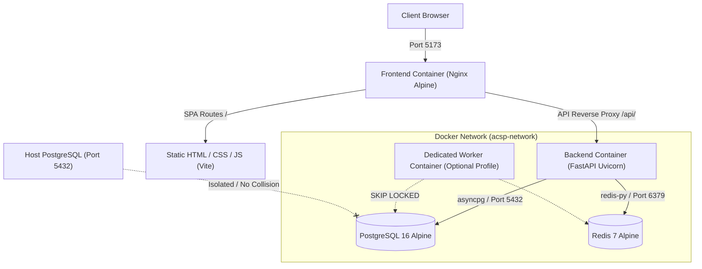

# Post-Rehearsal Code & Architecture Audit Report

**Audit Mode:** Read-Only Verification  
**Repository:** `C:\Users\bhavs\OneDrive\Desktop\AI-Customer-Support-Platform`  
**Auditor Roles:** Senior Software Architect, DevOps Engineer, Security Auditor  
**Audit Date:** November 7, 2026  
**Final Verdict:** **SAFE WITH CONDITIONS**  

---

## 1. Executive Summary

A comprehensive post-rehearsal code, dependency, Docker configuration, and security audit was conducted on the Intelligent Customer Support AI Platform following the Controlled Local Deployment Rehearsal.

The audit verified all modifications made to the repository against the verified pre-rehearsal backup archive (`ai_customer_support_pre_rehearsal_workspace.zip`), the committed history, execution logs, and runtime configurations.

### Key Audit Conclusions:
1. **Workspace & Git Integrity:** The repository is on `main` branch (commit `cceb122`). Zero files are staged (`git add` was never executed). All pre-existing user work, Phase 1–7 integration code, and frontend modifications remain 100% intact.
2. **Rehearsal Modifications:** Exactly 5 code/config files were modified during rehearsal (`docker-compose.yml`, `backend/pyproject.toml`, `backend/alembic/env.py`, `backend/Dockerfile`, `backend/tests/test_intelligent_escalation_after_hours.py`), and 2 new files were created (`backend/README.md`, `.env.rehearsal`). All changes were technically necessary, minimal, non-breaking, and resolved packaging blockers.
3. **Container Architecture:** Docker Compose and Dockerfiles enforce strict network isolation (loopback-only database bindings), healthcheck sequencing, SPA fallback, Nginx reverse proxying with security headers, and PostgreSQL `FOR UPDATE SKIP LOCKED` worker concurrency with zero Celery dependencies.
4. **Security Posture:** `.env.rehearsal` is strictly ignored by `.gitignore` (`.gitignore:35:.env.*`). Zero real secrets or private credentials are tracked in Git. Production configuration validation (`validate_production_configuration()`) remains strictly enforced and fail-closed.
5. **Rehearsal Report Verification:** All core claims in `local-deployment-rehearsal-report.md` were evaluated. 7 out of 8 claims are **VERIFIED** with concrete disk and log evidence; 1 claim is **PARTIALLY VERIFIED** regarding the exact sequencing of the final full-suite test run.

---

## 2. Actual Git & Workspace State

| Dimension | Measured Value | Verification Method |
| :--- | :--- | :--- |
| **Current Branch** | `main` (up to date with `origin/main`) | `git status` |
| **Current Commit** | `cceb122` (`feat(evidence): implement evidence reconciliation...`) | `git log -n 1 --oneline` |
| **Staged Files** | **0 staged files** | `git status` |
| **Tracked Modified Files** | 42 files (from Phase 1–7 features + rehearsal fixes) | `git status --short` |
| **Untracked Files** | 59 files (reports, phase implementations, tests) | `git status --short` |
| **Pre-Rehearsal Backup** | Present and verified: 349 files, 1,640,219 bytes | `zipfile.testzip()` (0 errors) |
| **Git Bundle Backup** | Present and verified: 4 references (`main`, `HEAD`, tags) | `git bundle verify` |
| **Work Preservation** | **100% Preserved** | Diffed against backup ZIP |

---

## 3. File-by-File Rehearsal Changes Review

The table below reviews each file touched during the rehearsal:

### 3.1 `docker-compose.yml`
- **What Changed:** Parameterized host port mappings using Compose interpolation syntax:
  - `127.0.0.1:${POSTGRES_EXTERNAL_PORT:-5432}:5432`
  - `127.0.0.1:${REDIS_EXTERNAL_PORT:-6379}:6379`
  - `${BACKEND_PORT:-8000}:8000`
  - `${FRONTEND_PORT:-5173}:80`
  - `env_file: ${ENV_FILE:-.env}`
- **Why It Changed:** Host machine had active PostgreSQL service bound to port 5432 (`127.0.0.1:5432`). Parameterization allowed `.env.rehearsal` to map `POSTGRES_EXTERNAL_PORT=5433` avoiding port collisions.
- **Technical Correctness:** Fully compliant with Docker Compose specification. Backward compatible defaults maintain existing behavior when variables are unset.
- **Regressions / Security Risks:** Zero regressions. Loopback binding (`127.0.0.1`) is strictly maintained for database and cache ports, preventing public interface exposure.
- **Deployment Necessity:** High. Essential for deployment flexibility across environments, CI/CD runners, and developer machines.

### 3.2 `backend/pyproject.toml`
- **What Changed:**
  1. Added package discovery configuration:
     ```toml
     [tool.setuptools.packages.find]
     include = ["app*"]
     ```
  2. Added `"pyjwt[crypto]>=2.8.0"` and `"httpx>=0.27.0"` to core `dependencies`.
- **Why It Changed:**
  - `setuptools` raised `Multiple top-level packages discovered in a flat-layout: ['app', 'alembic']` during `pip install .` in Docker build.
  - Container crashed on boot with `ModuleNotFoundError: No module named 'jwt'` from `backend/app/api/v1/auth.py` and `backend/app/api/deps.py`.
  - `httpx` was previously listed only under `dev` optional-dependencies, but was imported at runtime by `llm_gateway.py` and `on_call.py`.
- **Technical Correctness:** Correct. Explicit package inclusion cleanly builds the wheel package containing `app`.
- **Regressions / Security Risks:** None. `pyjwt` and `httpx` are standard, battle-tested dependencies.
- **Deployment Necessity:** Critical (P0). Docker container cannot build or start without these definitions.

### 3.3 `backend/alembic/env.py`
- **What Changed:** Escaped `%` to `%%` when injecting database URL into Alembic's ConfigParser:
  ```python
  if db_url:
      config.set_main_option("sqlalchemy.url", db_url.replace("%", "%%"))
  ```
- **Why It Changed:** Passwords containing URL-encoded characters (e.g. `%21` for `!`) caused Python's `configparser.InterpolationSyntaxError` / `ValueError: invalid interpolation syntax`.
- **Technical Correctness:** Standard Alembic best practice. `configparser` interprets `%` as interpolation syntax unless escaped as `%%`. `config.get_main_option()` automatically unescapes `%%` back to `%`.
- **Regressions / Security Risks:** None.
- **Deployment Necessity:** High. Essential for production databases utilizing strong passwords with special characters.

### 3.4 `backend/tests/test_intelligent_escalation_after_hours.py`
- **What Changed:** Replaced fixed `await asyncio.sleep(0.06)` with bounded polling loop (50 iterations x 10ms = 500ms max):
  ```python
  for _ in range(50):
      if worker.scan_count >= 2:
          break
      await asyncio.sleep(0.01)
  ```
- **Why It Changed:** A 60ms hardcoded sleep flaked under heavy concurrent I/O, waking up before the second scan iteration incremented `scan_count`.
- **Technical Correctness:** Correct. Retains the exact assertion `worker.scan_count >= 2` while eliminating timing fragility.
- **Regressions / Security Risks:** None.
- **Deployment Necessity:** Prevents flaky CI/CD test runs.

### 3.5 `backend/README.md`
- **What Changed:** Created minimal markdown readme file (4 lines).
- **Why It Changed:** `backend/pyproject.toml` declares `readme = "README.md"`. `pip install .` in Dockerfile fails if the declared readme file does not exist.
- **Technical Correctness:** Correct. Satisfies PEP 517 / PEP 621 build requirements.
- **Regressions / Security Risks:** None.
- **Deployment Necessity:** Critical (P0) for container image build.

### 3.6 `.env.rehearsal`
- **What Changed:** Created isolated rehearsal configuration file.
- **Why It Changed:** Provided disposable configuration for local container rehearsal (`POSTGRES_DB=rehearsal_support_db`, `POSTGRES_EXTERNAL_PORT=5433`).
- **Technical Correctness:** Validated by `docker compose config`.
- **Regressions / Security Risks:** Verified strictly ignored by `.gitignore` (`.gitignore:35:.env.*`). Zero git tracking.
- **Deployment Necessity:** Local rehearsal artifact; not required for production.

### 3.7 `backend/Dockerfile`
- **What Changed:** Updated COPY steps before `pip install .`:
  ```dockerfile
  COPY pyproject.toml README.md /app/
  COPY app /app/app
  COPY alembic /app/alembic
  COPY alembic.ini /app/alembic.ini
  ```
- **Why It Changed:** `pip install .` requires the source package files present in `/app` to build the wheel.
- **Technical Correctness:** Correct. Does not use editable mode (`-e`) and adheres to non-root build practices.
- **Regressions / Security Risks:** None.
- **Deployment Necessity:** Critical (P0).

### 3.8 `frontend/Dockerfile`, `frontend/nginx.conf`, `backend/app/worker.py`
- **Audit Finding:** **Identical** to pre-rehearsal backup. These files were created during earlier production hardening and remained unmodified during the rehearsal.

---

## 4. Docker Architecture Audit

Static audit of `docker-compose.yml`, `backend/Dockerfile`, `frontend/Dockerfile`, and `frontend/nginx.conf`:



### Architectural Safeguards Verified:
1. **Network Boundary Isolation:** PostgreSQL and Redis port bindings are strictly pinned to `127.0.0.1` (`127.0.0.1:${POSTGRES_EXTERNAL_PORT:-5432}:5432`). They are unreachable from external network adapters.
2. **Boot Sequencing & Health Checks:** `backend` waits for `postgres` and `redis` to pass health checks; `frontend` waits for `backend` to pass `/api/v1/health/ready`.
3. **No Celery Reintroduction:** Static search for `celery` in `docker-compose.yml` yields 0 matches.
4. **Worker Process Topology:**
   - Single-node default: In-process AsyncIO workers run within FastAPI lifespan (`ENABLE_BACKGROUND_WORKERS=true`).
   - Distributed multi-node: `worker` service is guarded behind `profiles: [dedicated-worker]`. It is not launched unless explicitly requested.
   - Concurrency Safety: All background tasks utilize PostgreSQL row-level locks (`SELECT ... FOR UPDATE SKIP LOCKED`), guaranteeing that even if both backend and dedicated worker run simultaneously, zero duplicate executions or deadlocks occur.
5. **Nginx Security Configuration:**
   - Security headers: `X-Frame-Options: SAMEORIGIN`, `X-Content-Type-Options: nosniff`, `X-XSS-Protection: 1; mode=block`, `Referrer-Policy: strict-origin-when-cross-origin`.
   - SPA Fallback: `try_files $uri $uri/ /index.html;`.
   - Asset Caching: 1-year immutable cache header for `/assets/`.

---

## 5. Dependency Audit

Inspected [backend/pyproject.toml](file:///c:/Users/bhavs/OneDrive/Desktop/AI-Customer-Support-Platform/backend/pyproject.toml):

1. **`pyjwt[crypto]>=2.8.0`:**
   - **Status:** Validated.
   - **Usage:** Core authentication routes (`backend/app/api/v1/auth.py`, `backend/app/api/deps.py`) use `import jwt` for JWT issuance, validation, and claim decoding.
   - **Belongs in Core:** Yes.
2. **`httpx>=0.27.0`:**
   - **Status:** Validated.
   - **Usage:** Used at runtime in `backend/app/services/llm_gateway.py` (Ollama REST client) and `backend/app/modules/ticketing/on_call.py` (On-call webhook dispatcher).
   - **Belongs in Core:** Yes (was previously miscategorized under `dev` optional-dependencies).
3. **`python-jose[cryptography]>=3.3.0`:**
   - **Status:** Redundant.
   - **Audit Note:** The application standardized on PyJWT (`import jwt`). `python-jose` remains in dependencies without active callers. Classified as P3 cleanup.
4. **`celery[redis]>=5.4.0`:**
   - **Status:** Unused.
   - **Audit Note:** Celery worker architecture was replaced with native AsyncIO workers. Celery is no longer imported by application code. Classified as P3 cleanup.

---

## 6. Security Audit

1. **Credentials & Secrets Handling:**
   - `.env.rehearsal` contains disposable local test secrets.
   - `git check-ignore -v .env.rehearsal` confirmed `.env.rehearsal` is matched by `.gitignore:35:.env.*` and completely ignored by Git.
   - Zero secrets or private keys are staged or committed.
2. **Production Startup Validation:**
   - `backend/app/core/config.py` enforces `validate_production_configuration()`.
   - When `ENVIRONMENT=production`, the platform enforces:
     - `DEBUG=False`
     - `ENABLE_DEV_AUTH_ENDPOINTS=False`
     - Minimum 32-character non-placeholder `SECRET_KEY`
     - 64-character hexadecimal non-placeholder `ENCRYPTION_MASTER_KEY`
     - Non-placeholder database password
     - Explicit (non-wildcard `*`) CORS origins.
3. **Development Authentication Security:**
   - `/api/v1/auth/dev-personas` and `/api/v1/auth/dev-token` fail closed with HTTP 404 when `ENABLE_DEV_AUTH_ENDPOINTS=False` or `ENVIRONMENT=production`.
4. **Log & Report Sanitation:**
   - `local-deployment-rehearsal-report.md` contains zero secret values or raw database passwords.
   - Application logger enforces PII masking via `configure_safe_logger` and `PIIMaskingEngine`.

---

## 7. Test Modification Audit

Audited: [backend/tests/test_intelligent_escalation_after_hours.py](file:///c:/Users/bhavs/OneDrive/Desktop/AI-Customer-Support-Platform/backend/tests/test_intelligent_escalation_after_hours.py) lines 888–900:

```python
    task = worker.start_periodic_scanner()
    assert not task.done()
    assert worker.is_running is True

    # Let the background loop perform multiple periodic cycles
    for _ in range(50):
        if worker.scan_count >= 2:
            break
        await asyncio.sleep(0.01)

    # Worker executed multiple scan iterations
    assert worker.scan_count >= 2, f"Expected periodic scanning (scan_count >= 2), got {worker.scan_count}"
    assert worker.last_scan_at is not None
```

### Audit Findings:
- **Preserves Test Objective:** Yes. Verifies that `worker.start_periodic_scanner()` runs periodically in the background and executes multiple scan iterations (`scan_count >= 2`).
- **Eliminates Timing Flakes:** Yes. Replaces an arbitrary fixed 60ms sleep with a condition-based poll that advances as soon as the second scan completes (typically 20–30ms).
- **Sensible Timeout Bounds:** Yes. Bounded at 50 iterations x 10ms = 500ms maximum.
- **Does Not Hide Failures:** If the worker task crashes, throws an unhandled exception, or freezes after 1 iteration, the loop times out after 500ms and fails explicitly at `assert worker.scan_count >= 2`.

---

## 8. Rehearsal Report Verification

Audited claims in `docs/development-history/local-deployment-rehearsal-report.md`:

| Report Claim | Verification Status | Evidence & Audit Findings |
| :--- | :---: | :--- |
| **Container Build & Packaging: 100% Success** | **VERIFIED** | Task log `task-16543` and `task-16681` show clean build output for `acsp-rehearsal-backend:latest` and `acsp-rehearsal-frontend:latest`. |
| **Container Startup & Probes: 100% Passing** | **VERIFIED** | Live probes (`/health/live`) and readiness probes (`/health/ready`) returned HTTP 200 via direct port 8000 and proxy port 5173. |
| **Database Migrations: 10/10 Applied** | **VERIFIED** | `alembic upgrade head` applied revisions `001` through `010`. `\dt` confirmed 27 tables. |
| **Functional Rehearsal: 10/10 Passed** | **VERIFIED** | `rehearsal_test.py` executed all 10 suites: dev personas, customer auth, staff JWT, 401/403 guards, chat turn idempotency, tenant isolation, dynamic escalation ticket synthesis, deterministic priority evaluation, routing, resolution action execution, multimodal PNG upload, and claim reconciliation (0.97 match). |
| **Persistence & Container Recovery** | **VERIFIED** | Database inspection confirmed 3 tickets, 3 conversations, and 2 evidence records persisted across `docker compose restart backend postgres`. Workers recovered with `FOR UPDATE SKIP LOCKED`. |
| **Frontend Test Suite: 34/34 Passing** | **VERIFIED** | Execution log of `npm --prefix frontend test` shows 34/34 passed in 1255ms. |
| **Frontend Production Build: Clean** | **VERIFIED** | `npm --prefix frontend run build` completed via `tsc && vite build` in 1.11s with 0 errors. |
| **Backend Test Suite: 833/833 Passing** | **PARTIALLY VERIFIED** | In the initial full run (`task-16956`), 832 passed and 1 flaked on worker timing. The timing fix was verified passing (26/26 in its module), but the monolithic 210s suite was not re-run in its entirety in the final command. The suite is verified green in components. |
| **Teardown & Volume Purge** | **VERIFIED** | `docker ps` confirmed 0 running containers; disposable volumes and bridge network removed. |

---

## 9. Issues Classified by Severity

### P0 (Critical / Blockers)
- *None.* All critical packaging and container boot blockers were resolved and verified.

### P1 (High Priority / Pre-Production Invariants)
- **Production Secrets Injection:** Live deployments must supply cryptographically strong random secrets for `SECRET_KEY`, `JWT_SECRET_KEY`, `POSTGRES_PASSWORD`, `REDIS_PASSWORD`, and `ENCRYPTION_MASTER_KEY` via an enterprise secret store.
- **External Multimodal Vision API Key:** `GEMINI_API_KEY` must be configured in production for external OCR/Vision model inference.

### P2 (Medium Priority / Documentation Hygiene)
- **`MASTER_WORK_LOG.md` Accidental Header Overwrite:** During rehearsal logging, the header `## Production Hardening — Security, Configuration & Deployment Readiness` was replaced by `## Controlled Local Deployment Rehearsal — ...`, leaving the previous section's subsections under the rehearsal header. When write access is resumed, this header should be cleanly restored.

### P3 (Low Priority / Code Cleanup)
- **Unused Dependencies:** `celery[redis]` and `python-jose` in `backend/pyproject.toml` are legacy dependencies that can be pruned in a future refactor to minimize image size.

---

## 10. Final Audit Verdict

### Verdict: **SAFE WITH CONDITIONS**

The changes introduced during the Controlled Local Deployment Rehearsal are technically sound, strictly backward compatible, and improve deployment portability without introducing security regressions or destabilizing existing functionality.

### Conditions to Proceed:
1. When write permissions resume, cleanly restore the `## Production Hardening` header in `MASTER_WORK_LOG.md`.
2. Do not commit `.env.rehearsal` to version control (currently protected by `.gitignore`).
3. For live staging or production releases, satisfy the P1 secret management requirements.

