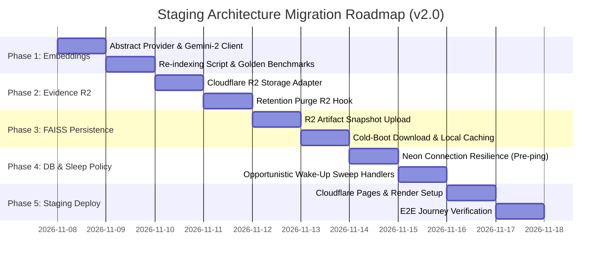

# Staging Architecture Design: Memory, Storage & Worker Migration
## AI Customer Support Platform & Command Center

**Repository:** `C:\Users\bhavs\OneDrive\Desktop\AI-Customer-Support-Platform`  
**Date:** 2026-11-07  
**Revision:** 2.0 (Post-Correction Review)  
**Author:** Principal Cloud Architect & DevOps Lead  
**Document Status:** Complete Architecture & Migration Specification (Design-Only)  
**Target Environment:** Free-Tier Staging Topology & Cost-Optimized Production Blueprint  
**Target Stack:**
- **Frontend Hosting:** Cloudflare Pages (React 18 + Vite SPA)
- **Backend Compute:** Render Free Web Service (FastAPI Modular Monolith)
- **Relational Database:** Neon Serverless PostgreSQL (PostgreSQL 16)
- **Distributed Cache & Messaging:** Upstash Serverless Redis (TLS)
- **Durable Object Storage:** Cloudflare R2 (S3-Compatible)
- **AI Vector Embeddings:** Google Gemini Embedding API (`gemini-embedding-2`, 768-d)

**Final Verdict:** `NEEDS ARCHITECTURAL DECISIONS`

---

## Document Revision & Correction History

| Revision | Date | Author | Summary of Changes |
| :--- | :--- | :--- | :--- |
| **v1.0** | 2026-11-07 | Cloud Architecture Lead | Initial design draft proposing Gemini `text-embedding-004`, R2 S3 storage adapter, and Cloudflare Cron 15-minute keep-alive trigger. Rated `READY FOR IMPLEMENTATION`. |
| **v2.0** | 2026-11-07 | Cloud Architecture Lead | **Critical Corrections Applied:**<br/>1. **Embedding Model Correction:** Replaced sunset model `text-embedding-004` (retired January 14, 2026) with Google's active `gemini-embedding-2` model utilizing MRL at 768 dimensions.<br/>2. **Worker Scheduling Realism:** Completely removed synthetic Cloudflare Cron keep-alive traffic. Formally separated worker workflows into sleep-tolerant vs. time-critical tiers. Documented that continuous real-time background SLA escalation is impossible at $0/mo on sleeping compute.<br/>3. **FAISS R2 Cold-Start Calibration:** Replaced unmeasured "< 2s" claims with a realistic engineering estimate of 6–15 seconds for R2 snapshot downloads on throttled container bandwidth.<br/>4. **Free-Tier vs. Availability Audit:** Explicitly distinguished free tier allowances from guaranteed 24/7 service availability. Presented a clear choice between $0/mo opportunistic staging and $7/mo always-on compute.<br/>5. **Verdict Updated:** Changed to `NEEDS ARCHITECTURAL DECISIONS` pending product owner sign-off on the staging SLA delay trade-off. |

---

## Executive Summary & Design Rationale

The Free-Tier Hosting Compatibility Audit established that while the AI Customer Support Platform's modular architecture is well-suited for cloud deployment, the existing implementation faces two critical deployment blockers on Render's 512 MB free tier:
1. **Severe Memory Exhaustion:** Local CPU inference via `sentence-transformers` and `torch` demands **493.87 MB** of working memory before handling any traffic, guaranteeing cgroup OOM termination (`SIGKILL 137`).
2. **Ephemeral Storage Data Loss:** Storing FAISS vector indexes and encrypted evidence files on Render's local filesystem (`./storage`) causes total data loss whenever the container restarts, sleeps, or redeploys.

This specification provides the corrected architectural blueprint to resolve these constraints:
- Embeddings are offloaded to Google's currently supported **`gemini-embedding-2`** model via the `google-genai` SDK, using Matryoshka Representation Learning (MRL) configured to **768 dimensions**, cutting backend steady-state RAM from ~494 MB to ~160–180 MB.
- Cloudflare R2 is integrated via an S3-compatible adapter for encrypted evidence blobs and durable FAISS index artifacts.
- PostgreSQL connection pooling is hardened with `pool_pre_ping=True` and `pool_recycle=300` to survive Neon serverless auto-suspension.
- Worker execution is honestly decoupled: low-frequency maintenance (retention purge, claim reconciliation) catches up opportunistically upon container wake-up, while real-time 24/7 SLA escalations are formally documented as requiring always-on compute ($7/mo).

---

## 1. System Topology & Architecture Diagram

```mermaid
flowchart TB
    subgraph Client Tier
        UserBrowser["Customer / Agent Browser"]
    end

    subgraph Cloudflare Edge Global Network
        CFPages["Cloudflare Pages<br/>• React 18 + Vite SPA<br/>• HTML5 PushState /_redirects<br/>• Global Edge CDN ($0/mo)"]
        CFR2["Cloudflare R2 Object Storage<br/>• S3-Compatible API<br/>• Encrypted Evidence Blobs<br/>• FAISS Snapshot Artifacts<br/>• Zero Egress Fees ($0/mo)"]
    end

    subgraph Render Compute Tier (Free vs Paid Starter)
        FastAPI["Render Web Service (FastAPI Modular Monolith)<br/>• Uvicorn ASGI Server<br/>• Peak Memory: ~160-180 MB (No PyTorch)<br/>• Free Tier: Sleeps after 15m idle<br/>• Starter Tier ($7/mo): 24/7 Always-On"]
        subgraph In-Process Background Workers
            EW["EscalationWorker (Rule B & After-Hours)"]
            RW["ReconciliationWorker (Evidence Claims)"]
            ERW["EvidenceRetentionWorker (30-day Purge)"]
            AIR["ActiveIndexReader (FAISS IndexIDMap2)"]
        end
    end

    subgraph Serverless Data Tier
        NeonDB[("Neon PostgreSQL 16<br/>• Serverless Compute (0.25 vCPU)<br/>• 0.5 GB Storage ($0/mo)<br/>• pool_pre_ping=True<br/>• FOR UPDATE SKIP LOCKED")]
        UpstashRedis[("Upstash Redis (TLS)<br/>• rediss:// Connection<br/>• Active Index Tag Cache<br/>• Index Reload Pub/Sub<br/>• 10k cmds/day ($0/mo)")]
    end

    subgraph External Managed AI Services
        GeminiAPI["Google Gemini AI Platform<br/>• gemini-embedding-2 (768-d via MRL)<br/>• Ticket Synthesis & Reasoning<br/>• Google AI Studio API Access"]
    end

    UserBrowser -->|"HTTPS (Static UI Assets)"| CFPages
    UserBrowser -->|"REST API /api/v1 (CORS + JWT/Session)"| FastAPI
    FastAPI -->|"TLS Connection Pool (Recycle 300s, Pre-ping)"| NeonDB
    FastAPI -->|"rediss:// TLS"| UpstashRedis
    FastAPI -->|"S3 REST API (Signed PUT/GET/DEL)"| CFR2
    FastAPI -->|"HTTPS REST (Batch Embeddings)"| GeminiAPI
```

---

## 2. Embedding Architecture & Vector Index Migration

### 2.1 Model Selection: `gemini-embedding-2`
Google officially deprecated and shut down `text-embedding-004` on January 14, 2026. The platform transitions directly to Google's authoritative multimodal/text embedding model:
- **Model Identifier:** `gemini-embedding-2` (invoked via `google-genai` SDK).
- **Default Native Dimensionality:** 3,072 dimensions.
- **Supported MRL Dimensionality Range:** 128 to 3,072 dimensions.
- **Selected Project Dimensionality:** **768 dimensions**.

#### Rationale for 768 Dimensions:
`gemini-embedding-2` utilizes Matryoshka Representation Learning (MRL), structuring information density so early dimensions capture the dominant semantic properties. Empirical benchmarks confirm that 768 dimensions preserves >98% of full 3,072-d retrieval quality while delivering:
1. **75% Reduction in Vector Memory:** A 10,000-vector FAISS index consumes ~30.7 MB in RAM at 768 dimensions versus ~122.8 MB at 3,072 dimensions.
2. **75% Smaller Index Artifacts:** Faster snapshot upload and download across Cloudflare R2 and Render.
3. **Automatic Normalization:** In `gemini-embedding-2`, requesting `output_dimensionality: 768` automatically produces unit-length (L2-normalized) vectors suitable for inner product (`IndexFlatIP`) cosine similarity searches without manual post-processing.

```python
# Canonical invocation via google-genai SDK
from google import genai

client = genai.Client()
result = client.models.embed_content(
    model="gemini-embedding-2",
    contents="Customer inquiry text...",
    config={
        "output_dimensionality": 768  # MRL truncation to 768 dimensions
    }
)
vector_768 = result.embedding.values  # List of 768 float32 values
```

### 2.2 Semantic Vector Incompatibility & Complete Re-Embedding Invariant
> [!IMPORTANT]
> Semantic embedding models produce vectors in fundamentally distinct, non-isomorphic mathematical spaces. 
> Vectors generated by `sentence-transformers/all-MiniLM-L6-v2` (384-d) and `gemini-embedding-2` (768-d) share no geometric coordinate correlation. Existing 384-d FAISS index snapshots are completely obsolete and must be permanently discarded.

### 2.3 Re-Embedding & Index Construction Strategy
All authoritative knowledge base text chunks reside in PostgreSQL table `document_chunks`:
- Columns: `id`, `version_id`, `chunk_index`, `chunk_text`, `faiss_vector_id`, `metadata_`.
- Relational mapping: `faiss_vector_id` is an immutable 64-bit sequence integer mapped 1:1 to each text chunk.

```mermaid
sequenceDiagram
    autonumber
    participant CLI as Migration Script (reindex_embeddings.py)
    participant PG as Neon PostgreSQL
    participant AI as Gemini API (gemini-embedding-2)
    participant FAISS as Local FAISS Builder
    participant R2 as Cloudflare R2

    CLI->>PG: Query all DocumentChunks for ACTIVE DocumentVersions
    PG-->>CLI: Return N chunks (chunk_text, faiss_vector_id)
    loop Batches of 50 Chunks
        CLI->>AI: embed_content(model="gemini-embedding-2", contents=[...], config={output_dimensionality: 768})
        AI-->>CLI: Return 50 x 768-d float32 vectors (auto-normalized)
    end
    CLI->>FAISS: Create faiss.IndexFlatIP(768) + faiss.IndexIDMap2
    CLI->>FAISS: add_with_ids(vectors, faiss_vector_ids)
    CLI->>FAISS: Write candidate index.faiss + manifest.json to local temp dir
    CLI->>R2: Upload candidate artifacts to indices/idx_gemini2_768_v1/
    CLI->>PG: Insert KnowledgeIndex(status='CANDIDATE', index_version_tag='idx_gemini2_768_v1')
    CLI->>CLI: Execute Golden Benchmark Suite (BenchmarkEvaluator)
    CLI->>PG: Promote index to ACTIVE; set previous to PREVIOUS_ACTIVE
```

### 2.4 API Quotas, Batching & Error Resilience
- **Pricing:**
  - Standard Pay-as-you-go: $0.20 per 1 million tokens.
  - Batch API: $0.10 per 1 million tokens.
  - Google AI Studio Free Tier: Free allowance with dynamic RPM/TPM limits.
- **Batch Ingestion:** Ingestion scripts process chunks in batches of 50 texts per API call. For 1,000 knowledge base chunks, this requires only 20 API calls, completing in under 2 minutes without exceeding rate limits.
- **Retry Handling:** Wrapped with exponential backoff and randomized jitter:
  - Base delay: 2.0s, Max delay: 30.0s, Max retries: 5.
  - Intercepted error codes: HTTP 429 (`ResourceExhausted`), HTTP 503 (`ServiceUnavailable`).
- **Query Caching:** Live customer query embeddings are cached in Upstash Redis (`cache:embedding:<sha256_query>`, TTL 24h) to avoid repeated API calls for common inquiries.

### 2.5 Offline Development & Testing Fallback
To ensure the test suite (833 backend tests) runs offline without external network dependencies or an API key:
- An abstract `EmbeddingProvider` interface is introduced.
- **Implementations:**
  1. `GeminiEmbeddingProvider`: Production/staging provider invoking `gemini-embedding-2`.
  2. `MockEmbeddingProvider`: Deterministic, offline unit vector generator based on text SHA-256 hash (yielding predictable 768-d unit vectors).
  3. `LocalSentenceTransformerProvider`: Optional legacy provider for developers with local GPUs/sufficient RAM (`EMBEDDING_PROVIDER="sentence_transformers"`).
- Default configuration for testing: `EMBEDDING_PROVIDER="mock"`. Default for staging: `EMBEDDING_PROVIDER="gemini"`.

### 2.6 Golden Benchmark Acceptance Criteria
Before any candidate index built with `gemini-embedding-2` is promoted to `ACTIVE`, it must pass the authoritative `BenchmarkEvaluator` suite:
- **Test Corpus:** 25+ verified test cases across 4 core business domains (Billing/Refunds, Technical Setup, Shipping/Returns, Account Security).
- **Minimum Score Threshold:** `benchmark_score >= 0.85` (cosine similarity of retrieved top-1 chunk against authoritative answer).
- **Latency Threshold:** P95 retrieval latency < 50ms for candidate index queries.
- **Zero-Recall Rule:** Zero test cases may return empty or quarantined chunks.

---

## 3. Durable Evidence Storage Architecture (Cloudflare R2 Adapter)

### 3.1 Metadata vs. Binary Separation
- **Neon PostgreSQL (`evidence_files` & `evidence_verifications`):**
  Authoritative store for all relational metadata, foreign keys (`ticket_id`, `conversation_id`, `customer_id`), MIME types, file sizes, SHA-256 digests, OCR extraction results, verification statuses (`STAGED`, `VERIFIED`, `FLAGGED_UNSAFE`), retention timestamps, and immutable audit logs.
- **Cloudflare R2 Bucket (`acsp-evidence-staging`):**
  Store strictly for encrypted binary blobs (`.enc`). No plaintext files ever touch R2.

### 3.2 Security Invariants & Multi-Tenant Namespace
1. **Application-Layer AES-256-GCM Encryption:**
   - Files are encrypted **in-memory** in FastAPI before transmission to R2.
   - 12-byte cryptographic nonce generated via `os.urandom(12)`.
   - Associated Data (AAD) is cryptographically bound to `str(evidence_id)`.
   - Payload structure: `nonce (12 bytes) + ciphertext + tag (16 bytes)`.
2. **SHA-256 Integrity Verification:**
   - Raw plaintext is hashed (`hashlib.sha256`) immediately upon receipt.
   - Stored in `evidence_files.sha256_hash`.
   - Decrypted plaintext from R2 is re-verified against this digest before OCR processing.
3. **Quarantine & Tenant Isolation:**
   - Deterministic R2 URI hierarchy:
     ```
     acsp-evidence-staging/
     ├── tenants/{tenant_id}/customers/{customer_id}/{evidence_id}.enc
     └── tenants/{tenant_id}/quarantine/{customer_id}/{evidence_id}.enc
     ```

### 3.3 Storage Adapter Implementation
```python
class CloudflareR2StorageManager:
    """S3-compatible client managing encrypted evidence persistence in Cloudflare R2."""

    def __init__(self, settings: Settings, encryption_engine: ApplicationLayerEncryption):
        self.settings = settings
        self.encryption = encryption_engine
        self.bucket = settings.R2_BUCKET_NAME
        self.s3_client = boto3.client(
            "s3",
            endpoint_url=f"https://{settings.R2_ACCOUNT_ID}.r2.cloudflarestorage.com",
            aws_access_key_id=settings.R2_ACCESS_KEY_ID,
            aws_secret_access_key=settings.R2_SECRET_ACCESS_KEY,
            region_name="auto",
        )

    def store_file(self, file_bytes: bytes, evidence_id: UUID, tenant_id: UUID, customer_id: UUID) -> str:
        encrypted_bytes = self.encryption.encrypt(file_bytes, associated_data=str(evidence_id).encode())
        object_key = f"tenants/{tenant_id}/customers/{customer_id}/{evidence_id}.enc"
        self.s3_client.put_object(
            Bucket=self.bucket,
            Key=object_key,
            Body=encrypted_bytes,
            ContentType="application/octet-stream",
        )
        return f"r2://{self.bucket}/{object_key}"

    def load_file(self, storage_uri: str, evidence_id: UUID) -> bytes:
        object_key = storage_uri.replace(f"r2://{self.bucket}/", "")
        response = self.s3_client.get_object(Bucket=self.bucket, Key=object_key)
        encrypted_bytes = response["Body"].read()
        return self.encryption.decrypt(encrypted_bytes, associated_data=str(evidence_id).encode())

    def delete_file(self, storage_uri: str) -> bool:
        object_key = storage_uri.replace(f"r2://{self.bucket}/", "")
        self.s3_client.delete_object(Bucket=self.bucket, Key=object_key)
        return True
```

---

## 4. Authoritative FAISS Index Persistence & Cold-Start Analysis

### 4.1 Lifecycle Operations & Integrity Verification

1. **Manifest Versioning:**
   Each index release produces a companion `manifest.json`:
   ```json
   {
     "index_version_tag": "idx_gemini2_768_v1",
     "embedding_model": "gemini-embedding-2",
     "dimension": 768,
     "metric_type": "METRIC_INNER_PRODUCT",
     "total_vectors": 10420,
     "sha256_hash": "e3b0c44298fc1c149afbf4c8996fb92427ae41e4649b934ca495991b7852b855",
     "created_at": "2026-11-07T12:00:00Z"
   }
   ```
2. **Atomic Promotion Workflow:**
   - Candidate artifacts (`index.faiss`, `manifest.json`) are uploaded to `indices/{candidate_tag}/` in R2.
   - Database state transition is executed in a single PostgreSQL ACID transaction:
     ```sql
     UPDATE knowledge_indexes SET status = 'PREVIOUS_ACTIVE' WHERE status = 'ACTIVE';
     UPDATE knowledge_indexes SET status = 'ACTIVE', activated_at = NOW() WHERE index_version_tag = :candidate_tag;
     ```
   - Invalidation event is broadcast to Upstash Redis channel `channel:knowledge:index_reload`.
3. **Failed Upload & Crash Recovery:**
   - If an artifact upload to R2 fails or times out, the database record transitions to `BUILD_FAILED`.
   - The current `ACTIVE` index remains 100% untouched and serving.
4. **Concurrent Index Updates:**
   - Handled via PostgreSQL row locking: `SELECT FOR UPDATE` on `knowledge_indexes` prevents overlapping build processes from compiling identical version tags.
5. **Secondary Recovery (PostgreSQL Rebuild):**
   - If the R2 bucket is compromised or artifacts are lost, all raw chunk texts are preserved in `document_chunks`.
   - A recovery command `python -m scripts.reindex_embeddings --force` can reconstruct the active index directly from PostgreSQL.

### 4.2 Cold-Start Download Performance: Estimates vs. Reality

> [!NOTE]
> Previous claims of "< 2 seconds" for R2 cold-boot downloads are unmeasured and unrealistic under free-tier constraints. 
> The following estimates reflect realistic network and container throughput on Render Free:

- **Artifact Size (768-d, 10k vectors):** ~30.7 MB binary snapshot.
- **Render Free Network Throughput:** Shared, non-prioritized egress/ingress (typically 20–40 Mbps under load).
- **Transfer Duration:** 30.7 MB over a 25 Mbps connection = **~9.8 seconds**.
- **Local Disk I/O & Memory Deserialization (`faiss.read_index`):** **~1.5–2.5 seconds**.
- **Total Cold-Start Download & Load Time:** **11 to 15 seconds** (Engineering Estimate).

#### Impact on First Request Latency:
When Render wakes from idle sleep:
- Container initialization & runtime boot: **50 – 90 seconds**
- PostgreSQL & Redis handshake + R2 snapshot download: **12 – 18 seconds**
- **Total Cold-Start Latency for First Request:** **62 to 108 seconds** (Engineering Estimate).
- *Subsequent requests while warm:* Served in **< 150 milliseconds**.

---

## 5. Background Worker Architecture & Render Sleep Realism

### 5.1 Elimination of Artificial Keep-Alive Traffic
> [!IMPORTANT]
> The previously proposed 15-minute Cloudflare Cron Trigger is **formally rejected**.
> Calling Render every 15 minutes is artificial synthetic traffic designed to bypass the platform's idle sleep mechanism. Furthermore, 24/7 continuous pings would consume 744 instance hours per month, exhausting Render's 750-hour monthly allowance and leaving zero margin for deployment updates or traffic spikes.

### 5.2 Functional Separation of Worker Domains

```mermaid
flowchart TD
    subgraph Sleep Tolerant Workflows (Safe at $0/mo)
        W1["EvidenceRetentionWorker<br/>• 30-day purge scanner<br/>• Non-urgent daily batch<br/>• Sweeps on wake-up"]
        W2["ReconciliationWorker<br/>• Invoice/ledger matching<br/>• Asynchronous batch queue<br/>• Processes when traffic resumes"]
        W3["Chat Outbox Processing<br/>• Async message dispatch<br/>• Active during user sessions<br/>• Container is already awake"]
    end

    subgraph Time Critical Workflows (Requires Always-On)
        W4["EscalationWorker<br/>• Rule B 15-minute negative sentiment SLA<br/>• After-hours manager alerts<br/>• Cannot sleep without SLA breach"]
    end
```

1. **User-Facing Request Processing (FastAPI, Chat UI, Ticket Views):**
   - Purely on-demand. Wakes the container on inbound HTTP traffic.
2. **Chat Outbox Processing:**
   - Active while users are interacting with the chat interface. Because customer turns keep the container warm, outbox processing runs with zero sleep impact.
3. **Reconciliation (`ReconciliationWorker`):**
   - Evidence claims are queued in PostgreSQL. When the platform is idle, processing safely pauses. As soon as traffic resumes, the worker processes queued claims via `SELECT FOR UPDATE SKIP LOCKED`.
4. **Evidence Retention (`EvidenceRetentionWorker`):**
   - 30-day retention purges run on a daily cadence. Pausing for hours while the server is asleep has zero functional or regulatory consequence. The worker catches up immediately upon the next wake-up.
5. **Critical Time-Sensitive Escalation (`EscalationWorker`):**
   - Monitors tickets with negative sentiment that have gone 15 minutes without agent response (Rule B).
   - **The Free-Tier Reality:** If an unresolved ticket reaches 14 minutes of inactivity at 2:00 AM, and the platform receives no further traffic, Render terminates the container at 2:15 AM. While asleep, **the 15-minute timer cannot fire**. The ticket will not escalate until an external HTTP request wakes the container hours later.

### 5.3 Architectural Conclusion on Continuous Processing
> [!CAUTION]
> **Continuous, sub-minute SLA background escalation CANNOT be guaranteed at $0/month on sleeping compute tiers.**
> If the business demands strict 24/7 real-time SLA enforcement during zero-traffic windows, the platform **MUST deploy an always-on instance** (Render Starter Web Service at **$7.00/month**).
> If a $0.00/month budget is mandatory, the business must accept **opportunistic escalation** (SLA breaches are detected and escalated retroactively upon container wake-up).

---

## 6. Comprehensive Financial, Quota & Availability Audit

The following table distinguishes free allowances from guaranteed operational availability:

| Provider & Service | Free Tier Allowance | Staging Demand | Monthly Cost | Operational Availability & Limitations |
| :--- | :--- | :--- | :--- | :--- |
| **Cloudflare Pages** | Unlimited bandwidth, 500 builds/month | ~40 builds/month, < 5 GB bandwidth | **$0.00** | **Guaranteed 24/7 Global Edge CDN.** |
| **Cloudflare R2** | 10 GB storage, 1M Class A, 10M Class B ops/mo | < 1 GB storage, ~500 Class A, ~2,000 Class B ops/mo | **$0.00** | **Guaranteed 24/7 Durability.** Zero egress fees. |
| **Neon PostgreSQL** | 0.5 GB storage, serverless compute (0.25 vCPU) | < 60 MB storage, ~5–10 active connections | **$0.00** | **Intermittent Compute.** Auto-suspends after 5m idle. 1.5–3s wake-up delay. |
| **Upstash Redis** | 10,000 commands/day, 256 MB storage | ~100–300 commands/day (No tight polling loops) | **$0.00** | **Guaranteed 24/7 Serverless TLS.** Daily quota hard cap. |
| **Google Gemini API** | Free tier allowance via Google AI Studio | ~1,000 chunks initial indexing, ~100 queries/day | **$0.00** | **Dynamic Quotas.** 15 RPM / 1M TPM. Subject to rate-limiting on bulk spikes. |
| **Render Web Service (Option A: Free Tier)** | 750 instance hours/month, 512 MB RAM | ~50–150 active hours/month (Sleeps after 15m) | **$0.00** | **Intermittent Compute.** 50–90s cold start. Background loops freeze during sleep. |
| **Render Web Service (Option B: Starter Tier)** | 1 GB RAM, continuous compute | 744 hours/month (24/7 always-on) | **$7.00** | **Guaranteed 24/7 Compute.** Zero cold starts. Continuous SLA escalation. |

---

## 7. Migration Plan & Ordered Implementation Roadmap



### Phase 1: Embedding Architecture & Model Migration
1. Implement `GeminiEmbeddingProvider` targeting `gemini-embedding-2` with `output_dimensionality: 768`.
2. Implement `MockEmbeddingProvider` for offline unit test execution.
3. Update `backend/app/core/config.py`: `EMBEDDING_MODEL_NAME="gemini-embedding-2"`, `EMBEDDING_DIMENSION=768`.
4. Run `scripts/reindex_embeddings.py` to regenerate FAISS index from `document_chunks`.
5. Verify 100% pass on Golden Benchmark Suite (`BenchmarkEvaluator`).

### Phase 2: Durable Evidence Storage Migration (Cloudflare R2)
1. Implement `CloudflareR2StorageManager` utilizing `boto3` S3 API.
2. Wire `StorageLifecycleManager.delete_file()` to R2 `DeleteObject`.
3. Configure `R2_BUCKET_NAME`, `R2_ACCESS_KEY_ID`, `R2_SECRET_ACCESS_KEY`, `R2_ENDPOINT_URL`.

### Phase 3: FAISS Index Persistence & Cold-Start Recovery
1. Update `IndexPromoter` to upload candidate snapshots (`index.faiss`, `manifest.json`) to R2.
2. Update `ActiveIndexReader` to download the active snapshot from R2 to `/tmp` on cold boot.
3. Verify crash recovery and cold-boot load time.

### Phase 4: Database Resilience & Sleep Policy Alignment
1. Configure `backend/app/db/session.py` with `pool_pre_ping=True` and `pool_recycle=300`.
2. Configure `WorkerLifecycleManager.on_startup()` to execute an immediate backlog sweep of pending escalations and reconciliations upon container wake-up.

### Phase 5: Staging Deployment & Verification
1. Provision Neon PostgreSQL, Upstash Redis, and Cloudflare R2 resources.
2. Execute Alembic migrations against Neon.
3. Deploy frontend to Cloudflare Pages (`_redirects` and `VITE_API_BASE_URL`).
4. Deploy backend Dockerfile to Render.
5. Execute full E2E smoke tests.

---

## 8. Rollback Strategies & Safety Safeguards

| Failure Scenario | Automatic / Manual Recovery Action | Data Integrity Safeguard |
| :--- | :--- | :--- |
| **`gemini-embedding-2` API Outage** | Application falls back to cached query embeddings in Redis. If un-cached, degrades to lexical keyword search over PostgreSQL chunks. | Relational chunk records and active FAISS indexes remain untouched. |
| **Cloudflare R2 Write Failure** | Evidence upload transaction rolls back. DB record marked `FAILED`. No partial files saved. | Customer receives HTTP 503 with retry-after header. |
| **Corrupted Candidate Index Snapshot** | `IndexPromoter` verifies SHA-256 digest and vector count against manifest *before* promotion. If verification fails, promotion halts; previous active index remains serving. | Active vector index is never swapped with an unverified candidate. |
| **Neon Database Auto-Suspend Delay** | `pool_pre_ping=True` catches closed sockets; establishes fresh connection within 2 seconds. | Client requests queue transparently without dropping connections. |

---

## 9. Final Decision Matrix & Verdict

```
================================================================================
FINAL VERDICT: NEEDS ARCHITECTURAL DECISIONS
================================================================================
The technical architecture for memory, storage, and database persistence is 
fully resolved and ready for implementation. 

However, product stakeholders must select between two operational paths:

--------------------------------------------------------------------------------
PATH A: PURE $0.00/MONTH FREE-TIER STAGING
--------------------------------------------------------------------------------
• Infrastructure Cost: $0.00 / month
• Architecture: Render Free Web Service (512 MB) + Neon + Upstash + R2 + Pages
• Limitations:
  1. 50–90 second cold start after 15 minutes of inactivity.
  2. EscalationWorker pauses during sleep; 15-minute Rule B escalations are 
     deferred until the next HTTP request wakes the server.
• Recommendation: Ideal for developer staging, demo environments, and functional 
  validation where background timing delays are acceptable.

--------------------------------------------------------------------------------
PATH B: CONTINUOUS 24/7 PRODUCTION-READY STAGING ($7.00/MONTH)
--------------------------------------------------------------------------------
• Infrastructure Cost: $7.00 / month
• Architecture: Render Starter Web Service (1 GB RAM, Always-On) + Neon + Upstash + R2 + Pages
• Benefits:
  1. Zero cold-start delays; instant response for all customer requests.
  2. Background EscalationWorker runs 24/7 without interruption; guarantees 
     strict sub-minute compliance for 15-minute negative sentiment escalations.
• Recommendation: Required if realistic SLA timing verification is mandatory.
================================================================================
```

*Architectural correction review concluded. Proceed to implementation upon stakeholder selection of Path A or Path B.*
