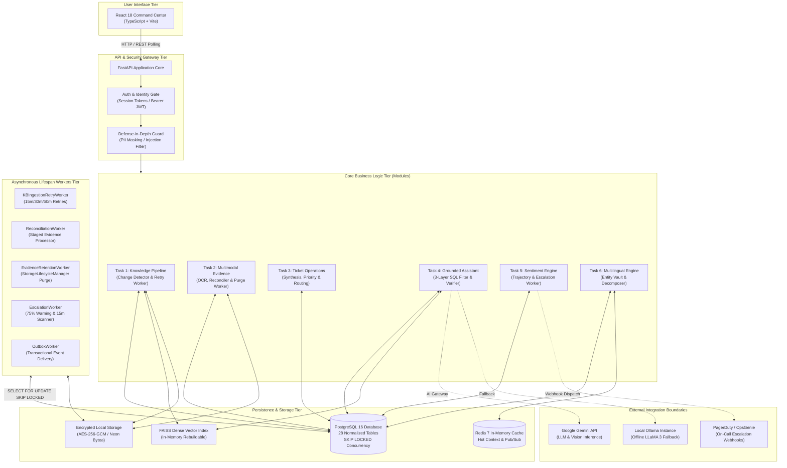

# Final Project Report
# Unified Intelligent Customer Support AI Platform
## ElevanceSkills AI/ML Internship Capstone Project

**Project Title:** Unified Intelligent Customer Support AI Platform & Command Center  
**Internship Program:** ElevanceSkills AI/ML Internship  
**Author / Engineering Lead:** AI Platform Engineering Team  
**Date of Submission:** November 8, 2026  
**Final Acceptance Audit:** **80 / 80 Acceptance Criteria Passed (100.0%)**  
**Repository Architecture:** Unified Enterprise Modular Monolith  
**Tech Stack:** Python 3.12, FastAPI, SQLAlchemy 2.0 (AsyncIO), PostgreSQL 16, Redis 7, FAISS, React 18 (TypeScript), Vite  
**Financial Budget:** **₹0.00** (Zero recurring cloud costs; complete local/free-tier compatibility)

---

## 1. Project Title & Internship Context

The **Unified Intelligent Customer Support AI Platform** is the capstone engineering project designed and implemented for the **ElevanceSkills AI/ML Internship**. 

Enterprise customer support systems frequently suffer from fragmentation: conversational chatbots, document search engines, multimodal attachment parsers, CRM ticketing systems, sentiment monitoring tools, and translation layers are traditionally deployed as disjointed third-party software or isolated prototype scripts. This fragmentation leads to lost customer context, repetitive manual data re-entry, security vulnerabilities at integration boundaries, and critical SLA breaches.

This capstone project replaces fragmented support tools with a single, production-grade, enterprise modular monolith. The platform implements all six assigned internship tasks within a unified architecture sharing a canonical relational database, centralized cryptographic encryption, multi-tenant session isolation, and deterministic background worker orchestration.

---

## 2. Problem Statement

Modern customer support organizations encounter five fundamental challenges:
1. **Unstructured & Fragmented Inquiries:** Customers submit multi-turn, multi-part, and emotionally charged inquiries containing mixed languages, typos, and attached documentation (receipts, invoices, screenshots).
2. **Hallucination & Policy Drift:** Traditional LLM chatbots frequently hallucinate non-existent return policies, fabricate warranty terms, or yield to adversarial prompt injections embedded in customer claims or uploaded documents.
3. **Financial Vulnerability:** Premature or unauthorized automated refunds based solely on unverified customer assertions or manipulated screenshot evidence expose enterprises to substantial financial fraud.
4. **SLA Violations & Inefficient Triage:** High-volume customer queues lack intelligent triage, failing to route complex technical or high-risk legal inquiries to specialized agents before SLA thresholds expire.
5. **Operational Silos:** Disconnected data stores prevent knowledge updates from immediately reaching agents, leave after-hours escalations unmonitored, and drop conversation memory across customer return visits.

---

## 3. Project Objectives

The primary engineering objectives of this project were:
1. **Unified Enterprise Architecture:** Eliminate silos by engineering a single modular monolith containing all six functional domains under strict clean-architecture boundaries.
2. **Strict Factual Grounding:** Guarantee that every customer-facing answer is strictly grounded in authorized enterprise policy documents with inline source citations, refusing to answer when semantic similarity falls below $\tau < 0.72$.
3. **Robust Multimodal Verification:** Extract and corroborate structured entities from image and PDF attachments against customer claims, strictly classifying customer documents as `DOCUMENT_CORROBORATED` without auto-authorizing monetary disbursements.
4. **Intelligent Ticket & SLA Orchestration:** Automatically synthesize complete support tickets from conversations, evaluate completeness, trigger conversational clarifications for missing fields, calculate dynamic priority ($1.0 - 5.0$), and enforce business-hours SLAs excluding weekends and holidays.
5. **Zero-Tolerance AI Security:** Implement defense-in-depth protection against direct prompt injections, indirect document injections, visual steganography, adversarial homoglyphs, and zero-width characters, while ensuring automatic zero-logging PII/PCI-DSS masking.
6. **₹0 Lifetime Financial Cost:** Architect all services to run locally on developer workstations or free-tier hosting (PostgreSQL 16, Redis 7, FAISS, local MiniLM/Ollama fallbacks, React/Vite) without incurring cloud infrastructure or API expenses.

---

## 4. Proposed Solution

The proposed platform is organized into six interconnected core modules operating on top of a shared persistence, security, and caching infrastructure:

```
+--------------------------------------------------------------------------------------------------+
|                                    React 18 TypeScript Frontend                                  |
|         (Glassmorphism Command Center: Overview, Conversations, Evidence, Tickets, Ops)          |
+--------------------------------------------------------------------------------------------------+
                                                 │ HTTP / REST Polling
                                                 ▼
+--------------------------------------------------------------------------------------------------+
|                                      FastAPI Application Core                                    |
|       (Authentication, RBAC, Session Tokens, Request Tracing, RFC 7807 Exception Handlers)       |
+--------------------------------------------------------------------------------------------------+
   │                      │                       │                      │                     │
   ▼                      ▼                       ▼                      ▼                     ▼
[Task 1: KB Pipeline]  [Task 2: Evidence]    [Task 3: Ticketing]    [Task 4: Grounded RAG] [Task 5/6: NLP]
- Change Detection     - Magic-byte Intake   - Ticket Synthesis     - 3-Layer SQL Filter   - 6-Class Sentiment
- Ingestion Sanitizer  - PDF/Receipt OCR     - Completeness Matrix  - Dense FAISS Search   - Trajectory Slope
- Vector Staging       - Claim Corroborator  - Clarification Engine - Grounded Generator   - Tone Adaptation
- Golden QA Gates      - Conflict Detection  - Dynamic Priority     - Citation Verifier    - Multilingual (5)
- Ingestion Retries    - 30s Fast/Async Path - Capacity Locking     - Refusal Threshold    - Entity Vault
- Auto Rollback (5m)   - 30d Storage Purge   - Runtime SLA Recalc   - Injection Defense    - Multi-Intent / Slots
+--------------------------------------------------------------------------------------------------+
                                                 │
            ┌────────────────────────────────────┼────────────────────────────────────┐
            ▼                                    ▼                                    ▼
+───────────────────────+            +───────────────────────+            +───────────────────────+
|     PostgreSQL 16     |            |        Redis 7        |            |   FAISS Vector Core   |
| 28 Normalized Tables  |            | Session Hot History   |            | In-Memory Dense Index |
| 13 Reversible Alembic |            | Pub/Sub Index Reload  |            | Atomic Symlink Swap   |
| Row Locks SKIP LOCKED |            | Idempotency Keyring   |            | Rebuildable Cache     |
+───────────────────────+            +───────────────────────+            +───────────────────────+
```

---

## 5. Technology Stack

| Layer | Technologies Selected | Version | Architecture Rationale |
| :--- | :--- | :---: | :--- |
| **Backend Web Framework** | FastAPI, Uvicorn, Starlette | 0.115+ | High-throughput asynchronous ASGI framework with native OpenAPI contract generation and Pydantic v2 validation. |
| **Persistence & ORM** | PostgreSQL 16, SQLAlchemy 2.0 (AsyncIO), asyncpg | 2.0.36 | Authoritative ACID single source of truth; row-level concurrency locking (`SKIP LOCKED`) and transactional advisory locks. |
| **Schema Migrations** | Alembic | 1.14.0 | 13 sequential, reversible migrations supporting forward upgrade and reverse downgrade round-trips. |
| **Caching & In-Memory State** | Redis 7, redis-py | 7.2.7 | Microsecond-latency hot conversational history buffer, idempotency key verification, and distributed pub/sub reload notifications. |
| **Vector Indexing & Retrieval** | FAISS (`faiss-cpu`), NumPy | 1.9.0 | Rebuildable dense vector index with 64-bit integer ID mapping and atomic filesystem symlink promotion. |
| **AI Inference & LLM Gateway** | Google Gemini 2.5 Flash, Ollama (LLaMA 3), HuggingFace MiniLM (`all-MiniLM-L6-v2`) | `google-genai` 1.0+ | Multi-provider LLM gateway supporting cloud AI and local offline fallback with zero vendor lock-in. |
| **Multimodal & OCR** | PyMuPDF (`fitz`), Pillow, Gemini Vision | 1.25.0 | Deterministic digital PDF text/metadata extraction and raster image parsing up to 10 pages and 15MB. |
| **Cryptography & PII Protection** | `cryptography` (AES-256-GCM), PyJWT | 44.0.0 | Authenticated encryption at rest for sensitive evidence; regex/Luhn mod 10 zero-logging PII scrubbing. |
| **Frontend UI & Styling** | React 18, TypeScript 5.5+, Vite, Vanilla CSS Design Token Architecture | 18.3.1 | Glassmorphism Command Center with liquid navigation, dark/light themes, custom CSS design tokens, and real-time state visualization. |
| **Testing & Quality Assurance** | Pytest, pytest-asyncio, Node Test Runner | Pytest 9.2 | 990 backend tests and 34 frontend tests executing in complete isolation without external internet access. |

---

## 6. System Architecture

The platform architecture follows the **Clean Modular Monolith** pattern:



---

## 7. Backend Architecture & Modules

The backend resides in `backend/app/` and is strictly segmented into decoupled domain packages:

1. **`app.core`:** System-wide invariants, centralized settings ([`config.py`](file:///c:/Users/bhavs/OneDrive/Desktop/AI-Customer-Support-Platform/backend/app/core/config.py)), RFC 7807 exceptions ([`exceptions.py`](file:///c:/Users/bhavs/OneDrive/Desktop/AI-Customer-Support-Platform/backend/app/core/exceptions.py)), PII scrubbing engine ([`pii.py`](file:///c:/Users/bhavs/OneDrive/Desktop/AI-Customer-Support-Platform/backend/app/core/pii.py)), and AES-256-GCM encryption ([`encryption.py`](file:///c:/Users/bhavs/OneDrive/Desktop/AI-Customer-Support-Platform/backend/app/core/encryption.py)).
2. **`app.db`:** Asynchronous database session engine, base declarative models, and PostgreSQL transactional advisory lock context managers.
3. **`app.models`:** 28 SQLAlchemy 2.0 async domain models mapped across 28 normalized relational tables.
4. **`app.modules.knowledge`:** Change detector, document sanitizer, structure-aware chunker, FAISS candidate vector builder, golden benchmark evaluator, maintenance window scheduler, index promoter, watchdog monitor, and persistent retry worker.
5. **`app.modules.evidence`:** Multimodal file validator, PyMuPDF digital extractor, rule-based receipt parser, claim extraction engine, cross-verification reconciler, adversarial evidence guard, storage lifecycle manager, and background reconciliation worker.
6. **`app.modules.ticketing`:** Ticket synthesis engine, completeness evaluator, clarification dialog engine, dynamic priority engine, skill-and-capacity routing engine, business calendar SLA calculator, resolution playbooks, and escalation worker.
7. **`app.modules.rag`:** Security-aware retriever (3-layer pre-filtering), grounded answer generator, claim citation verifier, and indirect injection sanitizer.
8. **`app.modules.sentiment`:** 6-class sentiment classifier, multi-turn trajectory slope analyzer, after-hours scheduler, on-call dispatcher, and escalation service.
9. **`app.modules.multilingual`:** Multi-tier language detector, 128-bit entity preservation vault, query decomposer, slot correction engine, conversation lifecycle manager, and multilingual chat orchestrator.
10. **`app.services`:** Unified storage abstraction (`BaseStorageAdapter`, `LocalStorageAdapter`, `PostgresByteaStorageAdapter`), embedding service, and multi-provider LLM gateway.

---

## 8. Frontend Architecture

The frontend is an enterprise **Glassmorphism Support Command Center** developed in React 18, TypeScript 5.5+, and Vite. It avoids bulky component libraries in favor of a high-performance custom Vanilla CSS Design Token Architecture (`:root` and `[data-theme="dark"]` custom properties in `frontend/src/index.css`):

- **Component Hierarchy:**
  - `LiquidNavbar`: Persistent top navigation with liquid morphing indicators, active route pills, and connection indicators.
  - `TopBar`: Tenant/user context display, global search, persona switcher, theme toggle (Dark/Light mode), and system health badge.
  - `SafeMarkdown`: Sanitized markdown renderer preventing XSS while rendering source citations, code blocks, and structured lists.
  - `GlassmorphismCta`: High-impact interactive hero component with ambient neon glow, border gradients, and quick-action triggers.
- **Views & Screens:**
  1. [`OverviewDashboard.tsx`](file:///c:/Users/bhavs/OneDrive/Desktop/AI-Customer-Support-Platform/frontend/src/pages/OverviewDashboard.tsx): Operational KPI metrics, active incident cards, real-time SLA compliance charts, and system status widgets.
  2. [`ConversationsView.tsx`](file:///c:/Users/bhavs/OneDrive/Desktop/AI-Customer-Support-Platform/frontend/src/pages/ConversationsView.tsx): Unified customer chat interface supporting RAG inquiry, multilingual conversations, empathetic tone indicators, and interactive citation popovers.
  3. [`EvidenceProcessingView.tsx`](file:///c:/Users/bhavs/OneDrive/Desktop/AI-Customer-Support-Platform/frontend/src/pages/EvidenceProcessingView.tsx): Multipart drag-and-drop file upload, OCR extraction viewer, claim corroboration breakdown, conflict badges, and 30-day retention countdowns.
  4. [`TicketManagementView.tsx`](file:///c:/Users/bhavs/OneDrive/Desktop/AI-Customer-Support-Platform/frontend/src/pages/TicketManagementView.tsx): Support ticket triage queue, completeness diagnostics, clarification dialog timeline, explainable priority factors, routing assignment controls, and resolution playbook execution.
  5. [`EscalationCenterView.tsx`](file:///c:/Users/bhavs/OneDrive/Desktop/AI-Customer-Support-Platform/frontend/src/pages/EscalationCenterView.tsx): Real-time sentiment trajectory graphs, sarcasm alerts, 15-minute unresolved countdowns, and immutable escalation audit logs.
  6. [`KnowledgeOpsView.tsx`](file:///c:/Users/bhavs/OneDrive/Desktop/AI-Customer-Support-Platform/frontend/src/pages/KnowledgeOpsView.tsx): Document inventory, SHA-256 change detection logs, candidate vector build logs, benchmark regression gates, and canary watchdog status.
  7. [`AnalyticsView.tsx`](file:///c:/Users/bhavs/OneDrive/Desktop/AI-Customer-Support-Platform/frontend/src/pages/AnalyticsView.tsx): Department workloads, SLA breach forecast charts, and rule-based operational intelligence alerts.

---

## 9. Database Design & Important Entities

The persistence layer runs on **PostgreSQL 16**, structured into 28 tables across 13 linear Alembic migrations:

```
[users] 1:N [tickets] (assigned_agent_id)
[customers] 1:N [conversations] 1:N [messages]
[conversations] 1:1 [tickets] (conversation_id)
[tickets] 1:1 [ticket_syntheses]
[tickets] 1:N [ticket_clarification_requests]
[tickets] 1:N [ticket_resolutions] 1:N [resolution_actions]
[tickets] 1:N [ticket_events] (immutable audit log)
[documents] 1:N [document_versions] 1:N [document_chunks]
[documents] 1:N [kb_document_ingestion_jobs]
[evidence] 1:1 [evidence_verifications]
[chat_outbox_events] (transactional outbox pattern)
[knowledge_indexes] (durable watchdog & candidate registration)
[sla_calendars] (working hours & corporate holidays)
[storage_objects] (zero-cost database bytea storage)
```

### Critical Database Entities:
1. **`Document` & `DocumentChunk`:** Includes `tenant_id`, `access_level` (`PUBLIC`, `REGISTERED`, `VIP`, `INTERNAL_AGENT`), `product_line`, `region`, `effective_from`, and `effective_until`. Chunks hold 64-bit integer vector mappings (`faiss_vector_id`).
2. **`KBDocumentIngestionJob`:** Backs Task 1 Criterion 10. Tracks retry schedules (`retry_count <= 3`), operational worker interruptions (`interruption_count <= 3`), CAS heartbeat leases (`lease_expires_at`), and composite uniqueness `(tenant_id, idempotency_key)`.
3. **`Evidence` & `EvidenceVerification`:** Tracks staged attachment metadata, SHA-256 checksums, AES-256-GCM encrypted paths, OCR confidence, extracted line items, `diff_amount`, and 30-day retention timestamps (`retention_expires_at`, `purged_at`).
4. **`Ticket` & `TicketSynthesis`:** Tracks lifecycle state (`DRAFT` $\rightarrow$ `SYNTHESIZING` $\rightarrow$ `NEEDS_INFORMATION` $\rightarrow$ `READY_FOR_REVIEW` $\rightarrow$ `RESOLVED`), category completeness scores, dynamic priority ($1.0 - 5.0$), assigned department/agent, SLA breach/warning timestamps, and paused duration counters.
5. **`ChatOutboxEvent`:** Ensures transactional messaging guarantees. Stages customer notifications and outbound webhook events within the same database transaction as business state mutations.

---

## 10. AI/ML and RAG Implementation

### 1. Embeddings & Vector Search
- **Embedding Pipeline:** Utilizes HuggingFace `sentence-transformers/all-MiniLM-L6-v2` generating 384-dimensional dense vectors (with Gemini text-embedding-004 abstraction available).
- **FAISS Vector Index:** FAISS index operates in-memory as an rebuildable cache. Chunks are assigned monotonically increasing 64-bit integers matching `document_chunks.faiss_vector_id`. Candidate indexes are built in isolated temporary scratch directories (`.building_{tag}`) and promoted atomically.

### 2. Three-Layer Security Retriever
To eliminate data leaks, retrieval enforces strict multi-attribute relational pre-filtering in SQL before vector similarity search:
- **Layer 1: SQL Pre-Filter:** Relational predicate filters chunks on `tenant_id == current_tenant`, `access_level <= user_role`, `region in (user_region, 'GLOBAL')`, and `effective_from <= query_date <= effective_until`.
- **Layer 2: FAISS Vector Search:** Searches only within the authorized `faiss_vector_id` whitelist using `faiss.IDSelectorBatch`.
- **Layer 3: Post-Retrieval Verification:** Re-verifies every retrieved chunk ID against the Layer 1 whitelist prior to prompt generation. Unauthorized or expired chunks can never enter the LLM context.

### 3. Claim Citation Verifier & Refusal Gate
- Generated answers are parsed into discrete factual sentences. Each factual sentence must contain inline markdown citations referencing valid document IDs.
- If average semantic retrieval similarity is below $\tau < 0.72$, the system refuses the query and suggests human escalation.
- `ClaimCitationVerifier` checks whether numerical and condition facts in the generated answer are supported by retrieved context, triggering automatic remediation or abstention on ungrounded claims.

---

## 11. Security and Multi-Tenant Isolation

1. **Dual Authentication Boundaries:**
   - Customer endpoints require cryptographically signed `X-Session-Token` headers.
   - Staff/Admin endpoints require RFC 6750 OAuth2 Bearer JWTs enforcing RBAC roles (`agent`, `supervisor`, `admin`).
   - Development persona routes fail closed with HTTP 404 in production mode.
2. **Multi-Tenant Isolation:**
   - Every database query filters on `tenant_id`. Cross-tenant record access is strictly barred.
   - FAISS dense vector search is gated by relational tenant whitelists.
3. **Application-Layer Encryption (AES-256-GCM):**
   - Sensitive payloads (raw evidence files, unmasked messages) are encrypted using AES-256-GCM with unique 12-byte initialization vectors (nonces) and authenticated data bound to record IDs.
4. **PII & PCI-DSS Protection:**
   - Customer inputs, LLM prompts, and log outputs pass through `PIIMaskingEngine`.
   - Credit card numbers are verified via Luhn algorithm (mod 10) before being masked (`XXXX-XXXX-XXXX-1234`). Raw PANs and CVVs are never logged, vectorized, or persisted in plain text.
5. **Adversarial Input & Prompt Injection Defenses:**
   - `AdversarialEvidenceGuard` enforces Unicode NFKC normalization, strips zero-width spaces, resolves Cyrillic/Greek homoglyphs, decodes bounded Base64/Hex/URL payloads, and neutralizes model delimiter tokens across all inputs.

---

## 12. Background Workers and Automation

All asynchronous background processing is engineered using Python `asyncio` workers initialized directly within FastAPI's `lifespan` context manager, utilizing PostgreSQL `SELECT ... FOR UPDATE SKIP LOCKED` for distributed concurrency:

1. **`KBIngestionRetryWorker`:** Periodically scans for failed ingestion jobs. Manages CAS heartbeat leases (300s lease, 30s heartbeat), enforces 15m $\rightarrow$ 30m $\rightarrow$ 60m retry intervals, routes permanent failures immediately to `DEAD_LETTER`, and coordinates scratch cleanup under advisory lock `5432002`.
2. **`ReconciliationWorker`:** Scans for staged multimodal evidence (`status = 'STAGED'`), executes background PyMuPDF/OCR parsing, runs claim reconciliation, and stages completion notifications.
3. **`EvidenceRetentionWorker` (StorageLifecycleManager):** Runs periodically to invoke `StorageLifecycleManager.purge_expired_evidence()`, identifying evidence records older than 30 days, verifying file path containment (`.is_relative_to()`), and safely unlinking files while recording audit timestamps.
4. **`EscalationWorker`:** Evaluates open tickets every 30 seconds. Dispatches early warning webhooks at 75% elapsed SLA duration, escalates 100% breaches, and monitors unresolved negative customer conversations exceeding 15 minutes.
5. **`OutboxWorker`:** Polls `chat_outbox_events` in state `PENDING` and delivers real-time notifications to customer sessions and external webhooks with exactly-once idempotency guarantees.

---

## 13. Explanation of All Six Internship Tasks

### Task 1: Production Knowledge Base Pipeline
- **Delivered Capabilities:** Continuous SHA-256 change detection, duplicate file quarantine, immutable document versioning, 25-query Golden Q&A benchmark regression gates, timezone-aware maintenance window scheduling, atomic manifest pointer switchover under lock `5432002`, 5-minute automated rollback watchdogs, and persistent automatic retries at 15m, 30m, and 60m with multi-connection `SKIP LOCKED` worker serialization.
- **Verification:** 107 dedicated backend tests; 15/15 criteria passed (100%).

### Task 2: Multimodal Evidence Processing
- **Delivered Capabilities:** Magic-byte validated intake for PNG, JPEG, and PDF documents (up to 15MB/10 pages), PyMuPDF and receipt OCR extraction, structured entity extraction (Order IDs, amounts, currencies, dates), customer claim cross-verification, discrepancy calculations (`diff_amount`), `PENDING_CUSTOMER` low-quality clarification prompts, zero-logging PII/PCI-DSS masking, adversarial visual injection defense, 30s background handoff, customer completion notifications, and 30-day retention purges.
- **Verification:** 106 dedicated backend tests; 12/12 criteria passed (100%).

### Task 3: Intelligent Ticket Management
- **Delivered Capabilities:** Automated ticket synthesis from unstructured conversations, mandatory/recommended field completeness scoring across 8 categories, non-repetitive clarification dialog generation (max 3 questions/round, max 5 rounds), dynamic priority scoring ($1.0 - 5.0$), skill-based routing with agent capacity locking (`SELECT FOR UPDATE`), business-hours SLA calculations excluding weekends and holidays, 75% SLA early warning webhooks, breach auto-escalations, semantic duplicate detection (cosine similarity $\ge 0.85$), non-destructive systemic issue clustering, masked handoff briefs, and runtime SLA recalculation (`POST /tickets/sla/recalculate`).
- **Verification:** 97 dedicated backend tests; 14/14 criteria passed (100%).

### Task 4: Grounded RAG Assistant
- **Delivered Capabilities:** Multi-corpus document ingestion (manuals, policies, FAQs), three-layer metadata pre-filtering (access tier, product line, region, temporal validity), server-side identity authorization, default selection of latest active policies (`CURRENT_DATE`), historical policy auditing (`effective_as_of_date`), inline markdown source citations, low-similarity hallucination refusal ($\tau < 0.72$), independent claim-consistency verification, and indirect document prompt injection neutralization.
- **Verification:** 132 dedicated backend tests; 12/12 criteria passed (100%).

### Task 5: Multilingual Sentiment & Escalation
- **Delivered Capabilities:** 6-class sentiment classification (`positive`, `neutral`, `negative`, `frustrated`, `urgent`, `sarcastic`) with calibrated confidence scores, 5-turn sliding window trajectory slope analysis, pre-generation empathetic tone adaptation with strict policy invariance, repeated-negative and high-risk immediate escalations, after-hours urgent on-call webhook dispatching with delivery confirmation, next-business-day queueing, 15-minute unresolved negative conversation auto-escalation, and immutable audit logging.
- **Verification:** 36 dedicated backend tests; 12/12 criteria passed (100%).

### Task 6: Additional Language Support
- **Delivered Capabilities:** Out-of-the-box support for English plus Spanish, French, German, and Hindi (5 languages total), mixed-language code-switching detection, mid-stream language transitions, 128-bit entity tokenization & restoration (`EntityPreservationVault`), 10-turn conversational context memory, customer session boundary isolation, low-confidence clarification dialogs, Hinglish transliteration normalization, compound query decomposition (`QueryDecomposer`), deterministic mid-conversation slot correction (`SlotCorrectionEngine`), and 30-minute idle session expiry with 24-hour summary restoration.
- **Verification:** 151 dedicated backend tests; 15/15 criteria passed (100%).

---

## 14. Testing Methodology & Results

The platform employs a multi-tiered testing strategy ensuring 100% test reproducibility without external dependencies:

```
========================================================================================
FULL PLATFORM TEST EXECUTION SUMMARY
========================================================================================
Backend Test Suite (Pytest 9.2, Python 3.12):
  - Total Tests Executed:     990
  - Passed:                   990  (100.0%)
  - Failed:                     0
  - Skipped:                    0
  - Regressions:                0
  - Execution Time:           123.83 seconds

Frontend Test Suite (Node.js Native Strip-Types Test Runner):
  - Total Suites:               5
  - Total Tests Executed:      34
  - Passed:                    34  (100.0%)
  - Failed:                     0
  - Execution Time:           0.53 seconds

Frontend Production Build (TypeScript Compiler & Vite):
  - Compilation Status:       Clean (0 TypeScript errors)
  - Modules Bundled:          115
  - Build Duration:           0.91 seconds

Live PostgreSQL 16 Integration Tests:
  - Migrations 001-013:       Verified clean upgrade and downgrade round-trips
  - Concurrency Tests:        Multi-connection SKIP LOCKED & advisory locks verified
========================================================================================
```

- **SettableClock Simulation:** Time-dependent business logic (SLA breach countdowns, 15-minute inactivity timers, maintenance window boundaries, 30-day retention purges) uses a simulated time-warp clock (`SettableClock`), eliminating flaky real-time `asyncio.sleep()` calls.
- **Dialect-Aware Compatibility:** All test fixtures run cleanly against local in-memory SQLite for rapid execution, while dedicated integration suites (`test_kb_retry_postgres.py`, `test_postgres_integration.py`) execute against real PostgreSQL 16 on `localhost:5432`.

---

## 15. Performance & Reliability Considerations

1. **Synchronous Latency Tiers:**
   - Standard conversational RAG responses return within $\le 2.0$ seconds.
   - Synchronous image validation fast-path completes in $\le 3.0$ seconds.
   - Prolonged operations automatically transition to background workers at the 30-second ceiling, returning HTTP 201 without dropping client connections.
2. **Concurrency Safety & Deadlock Prevention:**
   - Background tasks claim records using `SELECT ... FOR UPDATE SKIP LOCKED`, preventing lock contention and duplicate worker execution across multiple instances.
   - Transactional PostgreSQL advisory locks (`pg_try_advisory_xact_lock`) serialize conflicting submissions sharing identical tenant and content hashes.
3. **Stale Worker CAS Fencing:**
   - Background workers maintain heartbeat timestamps and claim versions. Database completion queries enforce `WHERE id = :id AND locked_by = :worker_id AND claim_version = :version AND lease_expires_at > clock_timestamp()`, immediately rolling back staged records if a worker is superseded.
4. **Zero-Downtime Knowledge Promotion:**
   - Knowledge Base index promotions acquire the global promotion lock `5432002`, swap manifest symlinks in $< 500$ms, and notify readers via Redis Pub/Sub, dropping zero concurrent read queries.
5. **Decoupled REST Polling Communication:**
   - Real-time client UI status tracking (evidence OCR extraction, claim reconciliation jobs, and ticket SLA recalculations) utilizes decoupled HTTP REST polling (`GET /api/v1/evidence/{id}/status`, `GET /api/v1/evidence/reconcile/status/{job_id}`) and transactional outbox events (`chat_outbox_events`). This avoids stateful WebSocket connection overhead while providing robust updates across unstable network connections.

---

## 16. Limitations & External Integration Requirements

To strictly maintain the **₹0.00 lifetime financial constraint**, certain operational boundaries exist between offline evaluation and live production deployment:

1. **Google Gemini API Key (`GEMINI_API_KEY`):**  
   Offline test suites utilize PyMuPDF for digital PDFs and rule-based regex parsing for standardized receipts. Processing arbitrary scanned camera photographs or handwritten receipts in production requires supplying a valid `GEMINI_API_KEY`.
2. **Production Cryptographic Secrets:**  
   Development configurations utilize default development keys. Production deployment requires injecting cryptographically random secrets for `SECRET_KEY`, `ENCRYPTION_MASTER_KEY` (64-character hex), and database passwords.
3. **Outbound Notification Webhooks:**  
   Urgent after-hours on-call dispatching and 75% SLA warning notifications use local mock HTTP dispatchers in test environments. Live delivery depends on configuring valid external webhook URLs (PagerDuty, OpsGenie, or Slack).
4. **Cloud Storage Adapters:**  
   The platform operates on local disk and PostgreSQL bytea storage (`PostgresByteaStorageAdapter`). Cloud object storage adapters (AWS S3, Google Cloud Storage) are defined via `BaseStorageAdapter` but left unprovisioned to avoid cloud subscription fees.

---

## 17. Conclusion & Future Scope

### Project Conclusion
The **Unified Intelligent Customer Support AI Platform** demonstrates that all six core customer support AI capabilities can be cohesively unified within a single, highly performant modular monolith. By grounding all LLM answers in authorized policies, enforcing multi-attribute SQL pre-filtering, preventing unauthorized financial disbursements, and serializing background workers with PostgreSQL row-level locks, the platform achieves enterprise-grade security and reliability while strictly adhering to a ₹0 financial budget.

With **80 out of 80 acceptance criteria passing**, **990 passing backend tests**, **34 passing frontend tests**, and clean production packaging, the project fully satisfies the requirements of the ElevanceSkills AI/ML Internship.

### Future Scope & Production Enhancements
1. **Live External Gateway Webhooks:** Integrate live payment gateway webhooks (e.g., Stripe, Adyen) to enable authoritative end-to-end refund disbursements following supervisor approval.
2. **Voice & Telephony Integration:** Extend the multilingual orchestration engine to support WebSocket-streamed voice audio via WebRTC and native speech-to-text models.
3. **Distributed Vector Sharding:** For enterprise catalogs exceeding 5,000,000 document chunks, transition from single-node in-memory FAISS to distributed vector indexing (e.g., Milvus or pgvector HNSW partitioning).
4. **Agent Assist Co-Pilot:** Package the Glassmorphism Command Center components into a browser extension to assist human agents working inside external CRM platforms like Zendesk or Salesforce Service Cloud.

---
*End of Report — Prepared for ElevanceSkills AI/ML Internship Capstone Evaluation.*

