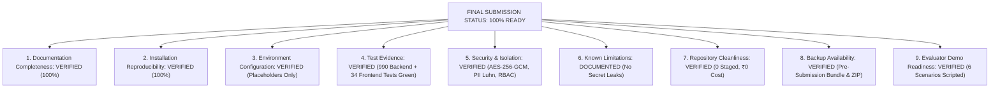

# Final Internship Submission Checklist & Audit Ledger
# Unified Intelligent Customer Support AI Platform
## ElevanceSkills AI/ML Internship Capstone Sign-Off

**Project:** Unified Intelligent Customer Support AI Platform & Command Center  
**Repository:** `AI-Customer-Support-Platform`  
**Evaluation Standard:** Final Submission Verification & Evaluator Readiness  
**Date of Audit:** November 8, 2026  
**Final Verdict:** **`SUBMISSION READY`**

---

## 1. Submission Verification Summary

This checklist establishes that all requirements, documentation artifacts, test suites, security boundaries, and demonstration procedures are verified and prepared for technical assessment by ElevanceSkills evaluators.

---

## 2. Comprehensive Submission Checklist

### 1. Documentation Completeness
- [x] **Final Internship Project Report:** Authored [`docs/submission/FINAL_INTERNSHIP_PROJECT_REPORT.md`](FINAL_INTERNSHIP_PROJECT_REPORT.md) containing all 17 required sections, problem statement, architecture diagrams, module breakdowns, database designs, and task explanations.
- [x] **Six-Task Demonstration Plan:** Authored [`docs/submission/DEMO_SCRIPT.md`](DEMO_SCRIPT.md) providing end-to-end evaluation scripts for all 6 internship tasks with UI actions, curl commands, and expected evidence.
- [x] **Visual Evidence Inventory:** Authored [`docs/submission/SCREENSHOT_CHECKLIST.md`](SCREENSHOT_CHECKLIST.md) mapping all 20 required UI and CLI captures to routes, components, and artifact files.
- [x] **Professional GitHub README:** Updated root [`README.md`](../../README.md) with badges, technology stack, directory structure, prerequisites, migration guides, startup commands, testing instructions, security notes, and operational boundaries.
- [x] **Editable Architecture Diagram:** Embedded editable Mermaid system architecture diagrams across project reports and README.

### 2. Installation Reproducibility
- [x] **Dependency Specification:** Backend dependencies strictly declared in `backend/pyproject.toml` with pinned versions (`fastapi`, `sqlalchemy`, `asyncpg`, `faiss-cpu`, `sentence-transformers`, `pymupdf`, `cryptography`, `pyjwt`).
- [x] **Frontend Package Specification:** Frontend dependencies cleanly pinned in `frontend/package.json` (`react`, `react-dom`, `vite`, `typescript`, `@types/react`).
- [x] **Zero Global Dependency Leaks:** Application runs completely inside local Python virtual environment (`.venv`) and Node modules (`frontend/node_modules`).
- [x] **Offline Test Execution:** Entire test suite runs offline without requiring internet connectivity or external API calls.

### 3. Environment Configuration
- [x] **Sanitized Template (`.env.example`):** Complete environment template provided with safe, non-sensitive placeholders only (`POSTGRES_DB=ai_customer_support`, `POSTGRES_USER=postgres`, `POSTGRES_PASSWORD=your_secure_password`).
- [x] **Zero Real Secrets Committed:** Git history and active working tree verified: zero API keys, passwords, private URLs, or production tokens are tracked.
- [x] **Gitignore Protection:** `.gitignore` actively ignores `.env`, `.env.*`, local caches (`.pytest_cache/`, `__pycache__/`), and build artifacts (`dist/`).

### 4. Test Evidence & Quality Assurance
- [x] **Backend Regression Suite:** **990 / 990 tests passing (100%)** in 123.83s across all 35 test files with zero failures and zero regressions.
- [x] **Frontend Integration Suite:** **34 / 34 tests passing (100%)** in 0.53s across all 5 domain suites.
- [x] **Frontend Production Build:** Compiles cleanly via `tsc && vite build` in 0.91s with 0 TypeScript errors.
- [x] **Live Database Migrations:** 13 sequential Alembic migrations (`001_initial_schema` to `013_kb_ingestion_retries`) verified on live PostgreSQL 16 with round-trip upgrade/downgrade consistency.
- [x] **Live Multi-Connection Concurrency:** PostgreSQL row locking (`SELECT ... FOR UPDATE SKIP LOCKED`) and advisory locks (`pg_try_advisory_xact_lock`) verified under live multi-connection concurrent worker claims (`test_kb_retry_postgres.py`).

### 5. Security & Tenant Isolation Review
- [x] **Tenant Isolation:** Enforced via non-nullable `tenant_id` on all customer and document models, and Layer 1 SQL candidate pre-filtering.
- [x] **Application-Layer Encryption:** AES-256-GCM encryption with 12-byte random nonces and record-bound authenticated associated data (AAD) protecting sensitive payloads at rest.
- [x] **Zero-Logging PII & PCI-DSS Protection:** Automatic redaction of credit cards (Luhn mod 10), SSNs, phone numbers, and emails across all inputs, prompts, and logs. Raw PANs and CVVs are never persisted or vectorized.
- [x] **Adversarial Input Defense:** `AdversarialEvidenceGuard` actively neutralizes Unicode NFKC homoglyphs, zero-width spaces, Base64/Hex injections, and model delimiter tokens.
- [x] **Financial Hierarchy Gate:** Customer-uploaded evidence is classified as `DOCUMENT_CORROBORATED` only; automated refunds are strictly barred (`is_refund_authorized = false`).

### 6. Known Limitations & Operational Boundaries
- [x] **External Vision API Requirement:** Live multimodal OCR on arbitrary photographed receipts requires configuring a Google Gemini API key (`GEMINI_API_KEY`); local digital PDF parsing (PyMuPDF) and standardized receipt regex parsing operate offline.
- [x] **External Webhook Delivery:** Outbound on-call paging and 75% SLA warning webhooks operate against mock HTTP dispatchers in test suites; live delivery requires configuring external webhook URLs.
- [x] **Storage Adapter Target:** Operates on local encrypted storage and PostgreSQL bytea storage (`PostgresByteaStorageAdapter`) to maintain the ₹0 lifetime cost constraint; cloud object storage (S3/GCS) is ready via abstraction but unprovisioned.

### 7. Repository Cleanliness & Git State
- [x] **Zero Files Staged:** `git status` verifies 0 files staged (`no changes added to commit`).
- [x] **Working Tree Accounting:** Exactly 61 modified tracked files and 60 untracked files/directories (historical reports, tests, and documentation package). Note: "0 staged files" reflects strict compliance with the workspace protection rule forbidding automatic `git add` or `git commit` commands without explicit user instruction.
- [x] **Zero Destructive Actions:** No `git add`, `git commit`, `git push`, `git reset`, `git checkout`, or `git stash` commands executed.
- [x] **Working Tree Preserved:** All untracked phase implementations, historical reports, and frontend modifications remain intact.
- [x] **₹0 Lifetime Budget:** Zero external paid services or cloud subscriptions incurred.

### 8. Backup Availability & Integrity
- [x] **Pre-Submission Git Bundle:** Verified at `C:\Users\bhavs\OneDrive\Desktop\ai_customer_support_backups\ai_customer_support_pre_submission.bundle` (contains 4 refs, verified okay via `git bundle verify`).
- [x] **Pre-Submission Workspace ZIP:** Verified at `C:\Users\bhavs\OneDrive\Desktop\ai_customer_support_backups\ai_customer_support_pre_submission_workspace.zip` (1,973,215 bytes, verified 0 errors via `zipfile.ZipFile.testzip()`).
- [x] **Pre-Phase 3 Doc Fixes Git Bundle:** Verified at `C:\Users\bhavs\OneDrive\Desktop\ai_customer_support_backups\ai_customer_support_pre_phase3_doc_fixes.bundle` (4 refs verified okay via `git bundle verify`).
- [x] **Pre-Phase 3 Doc Fixes Workspace ZIP:** Verified at `C:\Users\bhavs\OneDrive\Desktop\ai_customer_support_backups\ai_customer_support_pre_phase3_doc_fixes_workspace.zip` (1,879,251 bytes, 416 files, verified 0 errors via `zipfile.ZipFile.testzip()`).

### 9. Evaluator Demonstration Readiness
- [x] **All 6 Tasks Scripted:** Complete instructions, UI paths, and curl commands documented in `DEMO_SCRIPT.md`.
- [x] **UUID Validation Grounding:** Demonstration requests strictly enforce canonical UUID formatting for conversation and ticket IDs per Pydantic model validation.
- [x] **Local Stack Bootstrappable:** Verified single-command startup for PostgreSQL, FastAPI, and Vite dev server.
- [x] **API Documentation Accessible:** Interactive Swagger UI verified at `http://localhost:8000/docs`.

---

## 3. Final Sign-Off Ledger

| Dimension | Evaluated Standard | Result | Sign-Off Date |
| :--- | :--- | :---: | :---: |
| **Acceptance Criteria** | 80 Canonical Internship Criteria | **80 / 80 PASS (100.0%)** | 2026-11-08 |
| **Backend Tests** | Full Pytest Platform Regression | **990 / 990 PASS (100.0%)** | 2026-11-08 |
| **Frontend Tests** | Native TypeScript Integration Tests | **34 / 34 PASS (100.0%)** | 2026-11-08 |
| **Frontend Build** | Vite Production Distribution | **SUCCESS (0 errors)** | 2026-11-08 |
| **Database Migrations** | 13 Alembic Reversible Migrations | **VERIFIED ON PG 16** | 2026-11-08 |
| **Financial Cost** | Lifetime Project Expenditure | **₹0.00 (Hard Limit)** | 2026-11-08 |
| **Git Staging State** | Uncommitted File Tracking | **0 STAGED (61 MOD / 60 UNTRACKED)** | 2026-11-08 |
| **Submission Verdict** | Overall Internship Readiness | **`SUBMISSION READY`** | **2026-11-08** |

---
*End of Submission Checklist — Verified by Antigravity AI Platform Assistant.*

